# AI-Powered Pharmaceutical Supply Chain Control Tower Agent
## 12-Week Production Prototype — Multi-Echelon Decision Support & Risk Simulation

[](https://www.python.org/downloads/)
[](https://docs.pydantic.dev/)
[](file:///d:/AI%20Pharmaceutical%20Supply%20Chain/tests)
[](file:///d:/AI%20Pharmaceutical%20Supply%20Chain/docs/data_dictionary.md)
[]()

---

## 1. Executive Summary & Vision

The **AI-Powered Pharmaceutical Supply Chain Control Tower** is an autonomous, evidence-grounded decision-support system engineered for senior pharmaceutical supply chain executives and planners. 

Operating across an **Indian multi-echelon supply network** (Baddi / Ankleshwar formulation plants, Nagpur / Bhiwandi / Chennai distribution centers, and metropolitan demand markets), the Control Tower monitors end-to-end operations for critical antibiotics—modeled on **Augmentin 625mg** (T10 blister strips and T30 HDPE bottle packs).

```mermaid
flowchart LR
    subgraph Data["1. Relational Data Layer"]
        D33["33 Relational Schemas<br/>(Master, Bridges, Facts)"]
    end

    subgraph Deterministic["2. Deterministic Core Engines"]
        INV["FEFO & Stock Projection<br/>(Zero Math by LLM)"]
        MRP["BOM Explosion & Netting"]
        RISK["Rule-Based Risk Detector"]
        SIM["What-If Feasibility Sandbox"]
    end

    subgraph AI["3. Agentic AI Layer"]
        AGENT["Evidence-Grounded Copilot<br/>(Cites Record IDs)"]
        HITL["Human Approval Guard<br/>(human_approval_required=True)"]
    end

    subgraph UI["4. Executive Control Tower"]
        DASH["10-Page Interactive UI<br/>(Plotly + Alerts + Briefings)"]
    end

    Data --> Deterministic
    Deterministic --> AI
    AI --> UI
```



---

## 2. Core Architectural Principles

1. **Zero Mathematical Hallucinations:**
   - Large Language Models (LLMs) are **strictly prohibited from calculating numbers, lead times, or inventory balances**.
   - All projections ($I_t = I_{t-1} + R_t + P_t - D_t$), BOM explosions, OTIF percentages, and composite risk scores are computed deterministically in pure Python.
2. **Relational Evidence Grounding (`bridge_risk_evidence`):**
   - The AI agent cannot fabricate claims. Every risk alert and narrative briefing is tied directly to underlying relational database records (`purchase_order_id`, `batch_id`, `lot_id`, `capacity_record_id`).
3. **Mandatory Human-in-the-Loop Governance:**
   - Autonomous execution of supply chain interventions is blocked at the schema level. 
   - All mitigation recommendations require planner validation (`human_approval_required = True`). Setting this field to `False` strictly raises a validation error.
4. **Pharmaceutical Compliance & Lifecycle Rigor:**
   - Models Good Manufacturing Practice (cGMP 21 CFR Part 211) and Good Distribution Practice (GDP).
   - Enforces lot-level **FEFO (First-Expired, First-Out)** dispatch and **MARSL (Minimum Acceptable Remaining Shelf Life)** validation.

---

## 3. 33-Entity Relational Data Architecture

The platform models the complete 8-stage pharmaceutical lifecycle across **6 structural tiers**:

```
Layer 1: Master Dimensions (8 Tables)
  ├── dim_product                 (Pharmaceutical brand families)
  ├── dim_finished_sku            (Sellable presentation formats: T10 strip & T30 bottle)
  ├── dim_material                (APIs, excipients, primary & secondary packaging)
  ├── dim_supplier                (Synthetic qualified vendor profiles)
  ├── dim_location                (Plants, Central DCs, Regional DCs, and Hubs)
  ├── dim_customer                (Hospital networks, wholesalers, retail pharmacies)
  ├── dim_market                  (Metropolitan demand planning zones across India)
  └── dim_production_line         (Plant cleanrooms, packaging and tableting assets)

Layer 2: Network Topology & Bridges (4 Tables)
  ├── bridge_bill_of_material     (Multi-level recipe with scrap factors 1.0% - 3.5%)
  ├── bridge_supplier_material    (Approved vendor qualification and lead times)
  ├── bridge_sku_market           (Market authorization & MARSL shelf-life thresholds)
  └── bridge_location_route       (Transportation lanes, transit SLAs & reefer requirements)

Layer 3: Transactional & Planning Facts (9 Tables)
  ├── fact_demand_history         (104-week weekly historical demand baseline)
  ├── fact_customer_order         (Commercial sales orders and backorder balances)
  ├── fact_demand_forecast        (26-week horizon forecasts with P10/P90 prediction intervals)
  ├── fact_supply_plan            (Master replenishment schedule to DCs)
  ├── fact_material_requirement   (BOM netting and component shortage calculation)
  ├── fact_inventory_projection   (Recursive multi-echelon forward stock trajectory)
  ├── fact_purchase_order         (Supplier procurement orders & OTIF tracking)
  ├── fact_inventory_lot          (Physical lot positions, QC status, and expiry dates)
  └── fact_material_consumption   (Actual plant-floor chemical dispensing vs. BOM)

Layer 4: Manufacturing & Quality Facts (3 Tables)
  ├── fact_production_order       (Plant work orders and capacity bookings)
  ├── fact_batch                  (Chemical synthesis genealogy and CoA release milestones)
  └── fact_quality_event          (GMP deviations, sterility retests, and quarantine holds)

Layer 5: Capacity & Logistics Facts (2 Tables)
  ├── fact_capacity               (Weekly line net hours, maintenance, and overload flags)
  └── fact_shipment               (Inter-DC reefer consignments and transit tracking)

Layer 6: Control Tower, Risk & Governance (7 Tables)
  ├── dim_scenario                (Disruption catalog: Scenarios A through E)
  ├── fact_risk_event             (0-100 composite risk scoring engine)
  ├── bridge_risk_evidence        (Anti-hallucination record-level evidence linker)
  ├── fact_root_cause             (Deterministic backward causal dependency graph)
  ├── fact_mitigation_simulation  (Isolated what-if action evaluations & cost modeling)
  ├── fact_recommendation         (Ranked action proposals with mandatory human sign-off)
  └── dataset_manifest            (Reproducibility audit log with fixed seed 20261014)
```

> **The 33 vs 30 Table Reconciliation:**
> - **33 Relational Schemas:** Formally specified in [`docs/data_dictionary.md`](file:///d:/AI%20Pharmaceutical%20Supply%20Chain/docs/data_dictionary.md) and enforced via Pydantic v2 in `src/models/`.
> - **30 Baseline Tables (691 Verified Records):** Pre-populated in Phase 1 across SQLite (`data/processed/control_tower.db`), Parquet, and CSV.
> - **3 Dynamic Runtime Tables:** (`fact_root_cause`, `fact_mitigation_simulation`, `fact_recommendation`) are dynamically populated by Phase 2 analytics and simulation engines.

---

## 4. Benchmark Disruption Stress Tests

The synthetic generator and simulation sandbox model 5 core disruption scenarios:

| Scenario ID | Disruption Type | Mechanism | Impacted Entity | Physical Evidence Citation |
| :--- | :--- | :--- | :--- | :--- |
| **SCN-A** | API Supplier Delivery Delay | PO arrival shifted $+14$ days | `fact_purchase_order` | `PO-API-001` (Supplier `SUP-001`) |
| **SCN-B** | Batch QA Release Hold | Sterility retest delays CoA $+10$ days | `fact_batch`, `fact_quality_event` | `BATCH-AUG-2026-01`, `QEV-2026-001` |
| **SCN-C** | Shared Packaging Shortage | Carton supplier stockout affects T10 & T30 | `fact_material_requirement` | `MAT-PKG-CART` |
| **SCN-D** | FEFO Expiry Exposure | Pallet lot shelf life drops below MARSL | `fact_inventory_lot` | `LOT-AUG-EXP-01` (RSL $< 90\text{d}$) |
| **SCN-E** | Feasibility Conflict | Expedite PO but packing line on maintenance | `fact_capacity`, `fact_mitigation_simulation`| `LINE-PLANT1-01` (Committed $>$ Net) |

---

## 5. 12-Week Master Implementation Roadmap

| Phase | Calendar Horizon | Focus & Key Deliverables | Governance Milestone | Status |
| :--- | :--- | :--- | :--- | :--- |
| **Phase 1** | Weeks 1 – 3<br/>(27-Oct to 13-Nov-2026) | Domain foundation, 33-entity schema specification, Pydantic contracts, 691-record synthetic dataset, data integrity test suite. | **Gate 1 Review** (Data Architecture & Provenance) | **In Progress** (Weeks 1-2 Done, Week 3 Active) |
| **Phase 2** | Weeks 4 – 7<br/>(16-Nov to 11-Dec-2026) | Deterministic analytical engines: FEFO allocator, inventory projection, MRP explosion, ML demand forecasting (P10/P90), risk detector, what-if simulator. | **Gate 2 Review** (Deterministic Analytics Engine) | **Planned** |
| **Phase 3** | Weeks 8 – 9<br/>(14-Dec to 25-Dec-2026) | Agentic AI orchestration (evidence-grounded briefing agent, router) and full 10-page Streamlit Control Tower dashboard. | **Gate 3 Review** (Control Tower Application) | **Planned** |
| **Phase 4** | Weeks 10 – 12<br/>(28-Dec-2026 to 18-Jan-2027)| Contingent scale-up (30 products, 20 disruptions), Responsible AI system card, prompt injection audit, final executive showcase. | **Gate 4 Review** (Executive Demo & Handover) | **Planned** |

---

## 6. Project Structure

```
AI-Pharmaceutical-Supply-Chain/
├── data/
│   ├── processed/
│   │   ├── control_tower.db                # SQLite database (30 baseline tables, 691 records)
│   │   ├── control_tower_full_database.xlsx# Multi-tab operational workbook
│   │   ├── dataset_manifest.json           # Seed: 20261014 reproducibility audit log
│   │   ├── csv/                            # 30 individual CSV table exports
│   │   └── parquet/                        # 30 compressed Parquet exports
├── docs/
│   ├── architecture_blueprint.md           # 5-tier enterprise system architecture
│   ├── data_dictionary.md                  # Master technical dictionary for all 33 entities
│   ├── domain_glossary.md                  # FEFO formulas, lead-time taxonomy, BOM structures
│   ├── erd_diagram.md                      # Comprehensive Mermaid ERD with cardinalities
│   ├── gate_1_review_preparation.md        # Phase 1 Gate 1 review dossier
│   ├── master_data_specification.md        # Technical spec for 8 master entities
│   ├── network_bridge_specification.md     # Technical spec for 4 bridge entities
│   ├── transactional_fact_specification.md # Technical spec for 9 transactional facts
│   ├── manufacturing_risk_specification.md # Technical spec for 12 mfg, quality & risk entities
│   └── database_viewer.html                # Standalone HTML/JS explorer for SQLite database
├── src/
│   ├── agent/
│   │   └── contracts.py                    # Rigid Pydantic tool response contracts
│   ├── engine/
│   │   └── fefo_rules.py                   # Pure Python FEFO eligibility & depletion logic
│   ├── generator/
│   │   ├── config.py                       # Network topology & simulation configuration
│   │   ├── master_data.py                  # Seeded master entity synthesizer
│   │   ├── demand_data.py                  # 104-week demand history generator
│   │   ├── supply_data.py                  # Transactions & lot inventory generator
│   │   ├── disruption_injector.py          # Benchmark scenarios A through E injector
│   │   └── runner.py                       # Master generator orchestrator
│   └── models/
│       ├── bridges.py                      # Pydantic models for bridge tables
│       ├── capacity_logistics.py           # Pydantic models for capacity & shipments
│       ├── control_tower.py                # Pydantic models for risks, evidence & manifest
│       ├── demand.py                       # Pydantic models for history, orders, forecasts
│       ├── manufacturing_quality.py        # Pydantic models for work orders, batches, deviations
│       ├── master.py                       # Pydantic models for 8 master dimensions
│       ├── planning.py                     # Pydantic models for supply plans, MRP, projections
│       └── procurement_inventory.py        # Pydantic models for POs, lots, consumption
├── tests/
│   ├── test_agent_contracts.py             # Verifies zero-hallucination agent schemas
│   ├── test_bridge_models.py               # Verifies BOM explosion and route validation
│   ├── test_data_integrity.py              # Verifies relational integrity & non-negative balances
│   ├── test_fefo_rules.py                  # Verifies FEFO sorting, depletion & expiry warnings
│   ├── test_manufacturing_risk_models.py   # Verifies QA hold dates & human approval mandate
│   ├── test_master_models.py               # Verifies master entity constraints & boundaries
│   └── test_transactional_models.py        # Verifies temporal anti-leakage guards
├── AI_Supply_Chain_Control_Tower_12_Week_Executive_Schedule.xlsx # 3-tab master executive roadmap
├── build_refined_3tab_schedule.py          # Generator script for executive Excel roadmap
└── README.md
```

---

## 7. Verification & Automated Testing

The workspace maintains a 100% automated test pass rate across all data structures, mathematical formulas, and governance constraints:

```bash
# Run the complete test suite
python -m pytest tests/ -v
```

```
============================= test session starts =============================
collected 52 items

tests/test_agent_contracts.py .......... PASSED [ 10%]
tests/test_bridge_models.py ............ PASSED [ 20%]
tests/test_data_integrity.py ........... PASSED [ 33%]
tests/test_fefo_rules.py ............... PASSED [ 46%]
tests/test_manufacturing_risk_models.py  PASSED [ 67%]
tests/test_master_models.py ............ PASSED [ 83%]
tests/test_transactional_models.py ..... PASSED [100%]

============================= 52 passed in 0.92s ==============================
```

---
*Maintained under Phase 1 Governance: AI Pharmaceutical Supply Chain Control Tower Agent Prototype.*
