# AI-Powered Pharmaceutical Supply Chain Control Tower Agent
## 12-Week Production Prototype — Multi-Echelon Decision Support & Risk Simulation

[](https://www.python.org/downloads/)
[](https://docs.pydantic.dev/)
[](file:///d:/AI%20Pharmaceutical%20Supply%20Chain/tests)
[](file:///d:/AI%20Pharmaceutical%20Supply%20Chain/docs/data_dictionary.md)
[](file:///d:/AI%20Pharmaceutical%20Supply%20Chain/data/processed/control_tower.db)
[-darkgreen.svg)](file:///d:/AI%20Pharmaceutical%20Supply%20Chain/docs/forecast_model_card.md)
[-success.svg)](file:///d:/AI%20Pharmaceutical%20Supply%20Chain/docs/week_04_reconciliation_report.md)
[](file:///d:/AI%20Pharmaceutical%20Supply%20Chain/docs/gate_1_executive_sign_off.md)

---

## 1. Executive Summary & Vision

The **AI-Powered Pharmaceutical Supply Chain Control Tower** is an autonomous, evidence-grounded decision-support and simulation system engineered for senior pharmaceutical supply chain executives and operations leaders. 

Operating across an **Indian multi-echelon supply network** (Baddi & Ankleshwar formulation plants, Nagpur & Bhiwandi central distribution centers, Chennai secondary hub, and major metropolitan demand zones), the Control Tower monitors end-to-end operations for life-saving oral antibiotics—modeled on **Amoxicillin / Clavulanate Potassium 500/125mg** in blister strips (`SKU-AUG-500-T10`) and HDPE bottle presentations (`SKU-AUG-500-T30`).

```mermaid
flowchart LR
    subgraph Data["1. Relational Data Layer (Weeks 01-03)"]
        D33["33 Relational Schemas<br/>(Master, Bridges, Facts)"]
        DB["Tri-Export Storage<br/>(SQLite, 30 Parquet, 30 CSV)"]
        DISR["Scenarios A-E Generator<br/>(Synthetic Seed 20261014)"]
        D33 --> DB
        DISR --> DB
    end

    subgraph Deterministic["2. Deterministic Core Engines (Weeks 04-05)"]
        INV["FEFO & Stock Projections<br/>(26-Wk Echelon Balance)"]
        MRP["BOM Explosion & Netting<br/>(APIs, Excipients, Foils)"]
        ANL["OTIF & Capacity Analytics<br/>(Line Maintenance Buffers)"]
        REC["Stock Reconciliation<br/>(0.000000% Drift Proven)"]
        FST["ML Demand Forecasting<br/>(Ridge 7.76% WAPE, P10/P90)"]
        ANOM["Demand Anomaly Detector<br/>(Z-Score, IQR, Impact)"]
    end

    subgraph AI["3. Risk & AI Orchestration (Weeks 06-08)"]
        RISK["Rule-Based Risk Detector<br/>(6 Risk Categories, 0-100 Score)"]
        ROOT["Backward Causal Graph<br/>(bridge_risk_evidence)"]
        SIM["What-If Sandbox Simulator<br/>(Expedite, Transfer, Reschedule)"]
        AGENT["Evidence-Grounded Agent<br/>(human_approval_required=True)"]
    end

    subgraph UI["4. Executive Control Tower (Weeks 09-12)"]
        DASH["Streamlit Control Tower<br/>(10-Page Interactive UI + S&OP)"]
    end

    Data --> Deterministic
    Deterministic --> AI
    AI --> UI
```



---

## 2. Core Architectural & Life Sciences Principles

1. **Zero Mathematical Hallucinations:**
   - Large Language Models (LLMs) are **strictly prohibited from calculating numbers, lead times, safety stocks, or inventory balances**.
   - All forward projections ($I_t = I_{t-1} + R_t + P_t - D_t$), BOM explosions, supplier OTIF rates, demand forecasts, and composite risk scores are executed deterministically in pure Python and NumPy.
2. **Relational Evidence Grounding (`bridge_risk_evidence`):**
   - The AI agent cannot fabricate claims. Every risk alert, anomaly detection, and narrative briefing is tied directly to underlying relational database records (`po_id`, `batch_id`, `lot_id`, `capacity_id`).
3. **Mandatory Human-in-the-Loop Governance:**
   - Autonomous execution of binding operational interventions is blocked at the schema level.
   - All mitigation recommendations require planner validation (`human_approval_required = True`). Setting this field to `False` strictly raises a validation error.
4. **Pharmaceutical Compliance & GxP Rigor:**
   - Adheres to FDA 21 CFR Part 11, cGMP 21 CFR Part 211, and GAMP 5 Category 5 standards.
   - Enforces lot-level **FEFO (First-Expired, First-Out)** allocation, **MARSL (Minimum Acceptable Remaining Shelf Life)** validation, quarantine release gates, and temperature-controlled reefer logistics.

---

## 3. 33-Entity Relational Data Architecture

The platform models the complete 8-stage pharmaceutical lifecycle across **6 structural tiers**:

```
Layer 1: Master Dimensions (8 Tables)
  ├── dim_product                 (Pharmaceutical brand families & critical medicine flags)
  ├── dim_finished_sku            (Sellable presentation formats: T10 blister strip & T30 bottle)
  ├── dim_material                (Active APIs, excipients, primary foils & secondary packaging)
  ├── dim_supplier                (Synthetic qualified vendor profiles & contracted lead times)
  ├── dim_location                (Baddi/Ankleshwar Plants, Nagpur/Bhiwandi DCs, Chennai Hub)
  ├── dim_customer                (Hospital networks, institutional wholesalers, retail pharmacies)
  ├── dim_market                  (Metropolitan demand planning zones across India)
  └── dim_production_line         (Cleanrooms, tableting assets, blister & bottle packaging lines)

Layer 2: Network Topology & Bridges (4 Tables)
  ├── bridge_bill_of_material     (Multi-level recipe with scrap factors 1.0% - 3.5%)
  ├── bridge_supplier_material    (Approved vendor qualification, pricing, and transit lead times)
  ├── bridge_sku_market           (Market marketing authorization & MARSL shelf-life thresholds)
  └── bridge_location_route       (Transportation lanes, transit SLAs, and reefer cold-chain flags)

Layer 3: Transactional & Planning Facts (9 Tables)
  ├── fact_demand_history         (104-week weekly historical commercial demand baseline)
  ├── fact_customer_order         (Commercial sales orders, delivery milestones, backorders)
  ├── fact_demand_forecast        (26-week horizon forecasts with P10/P50/P90 prediction intervals)
  ├── fact_supply_plan            (Master replenishment schedule to regional distribution centers)
  ├── fact_material_requirement   (BOM netting, scrap allowance, and component shortage calculation)
  ├── fact_inventory_projection   (Recursive multi-echelon forward stock trajectory)
  ├── fact_purchase_order         (Supplier procurement orders & OTIF compliance tracking)
  ├── fact_inventory_lot          (Physical lot positions, QC release status, and expiry dates)
  └── fact_material_consumption   (Actual plant-floor chemical dispensing vs. theoretical BOM)

Layer 4: Manufacturing & Quality Facts (3 Tables)
  ├── fact_production_order       (Plant work orders, start/end dates, capacity bookings)
  ├── fact_batch                  (Chemical synthesis genealogy, QA test dates, CoA release milestones)
  └── fact_quality_event          (GMP deviations, sterility retests, and quarantine holds)

Layer 5: Capacity & Logistics Facts (2 Tables)
  ├── fact_capacity               (Weekly line net hours, maintenance downtime, overload flags)
  └── fact_shipment               (Inter-DC reefer consignments and milestone transit tracking)

Layer 6: Control Tower, Risk & Governance (7 Tables)
  ├── dim_scenario                (Disruption catalog: Scenarios A through E)
  ├── fact_risk_event             (0-100 composite risk scoring engine across 6 categories)
  ├── bridge_risk_evidence        (Anti-hallucination record-level relational evidence linker)
  ├── fact_root_cause             (Deterministic backward causal dependency graph)
  ├── fact_mitigation_simulation  (Isolated what-if action evaluations, cost modeling, feasibility)
  ├── fact_recommendation         (Ranked action proposals with mandatory human sign-off mandate)
  └── dataset_manifest            (Reproducibility audit log with fixed seed 20261014)
```

> **The 33 vs 30 Table Parity:**
> - **33 Relational Schemas:** Formally specified in [`docs/data_dictionary.md`](file:///d:/AI%20Pharmaceutical%20Supply%20Chain/docs/data_dictionary.md) and enforced via Pydantic v2 in `src/models/`.
> - **30 Baseline Tables (691 Verified Records):** Pre-populated in Phase 1 across SQLite ([`control_tower.db`](file:///d:/AI%20Pharmaceutical%20Supply%20Chain/data/processed/control_tower.db)), Parquet, and CSV.
> - **3 Dynamic Runtime Tables:** (`fact_root_cause`, `fact_mitigation_simulation`, `fact_recommendation`) are dynamically populated by Phase 2 analytics and simulation engines.

---

## 4. Benchmark Disruption Stress Tests

The synthetic generator and simulation sandbox model 5 core disruption scenarios:

| Scenario ID | Disruption Type | Mechanism | Impacted Entity | Physical Evidence Citation |
| :--- | :--- | :--- | :--- | :--- |
| **SCN-A** | API Supplier Delivery Delay | PO arrival shifted $+14$ days | `fact_purchase_order` | `PO-API-001` (Supplier `SUP-001`) |
| **SCN-B** | Batch QA Release Hold | Sterility retest delays CoA $+10$ days | `fact_batch`, `fact_quality_event` | `BATCH-AUG-2026-01`, `QEV-2026-001` |
| **SCN-C** | Shared Packaging Shortage | Carton supplier stockout affects T10 & T30 | `fact_material_requirement` | `MAT-PKG-CART` |
| **SCN-D** | FEFO Expiry Exposure | Pallet lot shelf life drops below MARSL | `fact_inventory_lot` | `LOT-AUG-EXP-01` (RSL $< 90\text{d}$) |
| **SCN-E** | Feasibility Conflict | Expedite PO but packing line on maintenance | `fact_capacity`, `fact_mitigation_simulation`| `LINE-PLANT1-01` (Committed $>$ Net) |

---

## 5. 12-Week Master Implementation Roadmap & Current Status

| Phase | Calendar Horizon | Focus & Key Deliverables | Governance Milestone | Status |
| :--- | :--- | :--- | :--- | :---: |
| **Phase 1** | Weeks 1 – 3<br/>(27-Oct to 13-Nov-2026) | Domain foundation, 33-entity schema specification, Pydantic contracts, 691-record synthetic dataset, tri-export, and data integrity test suite. | **Gate 1 Review** (Data Architecture & Provenance) | **COMPLETED & SIGNED OFF**<br/>[`gate_1_executive_sign_off.md`](file:///d:/AI%20Pharmaceutical%20Supply%20Chain/docs/gate_1_executive_sign_off.md) |
| **Phase 2: W04** | Week 4<br/>(16-Nov to 20-Nov-2026) | Deterministic KPI & Inventory Projections: FEFO allocation, 26-wk stock projection ($I_t = I_{t-1} + R_t + P_t - D_t$), MRP BOM explosion, OTIF/capacity analytics, and multi-echelon reconciliation buffer. | **Week 04 Review** (Deterministic Conservation) | **COMPLETED & SIGNED OFF**<br/>[`week_04_reconciliation_report.md`](file:///d:/AI%20Pharmaceutical%20Supply%20Chain/docs/week_04_reconciliation_report.md) |
| **Phase 2: W05** | Week 5<br/>(23-Nov to 27-Nov-2026) | Demand Forecasting & Model Evaluation: Leakage-free time-series split, statistical baselines, Ridge ML champion (7.76% WAPE), P10/P90 prediction intervals, tracking signal drift monitor, anomaly detector, and Model Card. | **Week 05 Review** (Forecasting & Anomaly Layer) | **COMPLETED & SIGNED OFF**<br/>[`forecast_model_card.md`](file:///d:/AI%20Pharmaceutical%20Supply%20Chain/docs/forecast_model_card.md) |
| **Phase 2: W06** | Week 6<br/>(30-Nov to 04-Dec-2026) | Risk Detection & Root-Cause Tracing Engine: Deterministic 6-category risk detector, transparent composite 0–100 risk score, `bridge_risk_evidence` linker, and backward causal dependency graph. | **Week 06 Review** (Risk & Evidence Layer) | **ACTIVE** |
| **Phase 2: W07** | Week 7<br/>(07-Dec to 11-Dec-2026) | Mitigation Simulator & Feasibility Engine: Non-destructive simulation sandbox (`src/engine/simulator.py`), 3 actions (Supplier Expedite, Stock Transfer, Production Reschedule), multi-criteria recommendation engine, and Gate 2 sign-off. | **Gate 2 Review** (Deterministic Analytics Engine) | **PLANNED** |
| **Phase 3** | Weeks 8 – 9<br/>(14-Dec to 25-Dec-2026) | Agentic AI orchestration (evidence-grounded briefing agent, router) and full 10-page Streamlit Control Tower dashboard. | **Gate 3 Review** (Control Tower Application) | **PLANNED** |
| **Phase 4** | Weeks 10 – 12<br/>(28-Dec-2026 to 18-Jan-2027)| Contingent scale-up (30 products, 20 disruptions), Responsible AI system card, prompt injection audit, final executive showcase. | **Gate 4 Review** (Executive Demo & Handover) | **PLANNED** |

---

## 6. Phase 2 Analytical Engines & Forecasting Core (Weeks 04 & 05 Complete)

### 6.1 Deterministic Supply Chain Engines (`src/engine/`)
* **FEFO Inventory Allocation Engine ([`src/engine/inventory.py`](file:///d:/AI%20Pharmaceutical%20Supply%20Chain/src/engine/inventory.py)):**
  * Evaluates physical lots, enforces QA release gates (`quality_status == 'Released'`), screens regulatory recall status (`'None'`), filters by destination MARSL thresholds, and allocates demand using strict chronological FEFO depletion.
* **Forward Inventory Projection Engine ([`src/engine/projections.py`](file:///d:/AI%20Pharmaceutical%20Supply%20Chain/src/engine/projections.py)):**
  * Computes 26-week weekly rolling balance: $I_t = I_{t-1} + R_t + P_t - D_t$, with multi-echelon lead-time offsets, scheduled PO receipts, and lot-level expiry decrementing.
* **MRP Bill-of-Materials Explosion Engine ([`src/engine/mrp.py`](file:///d:/AI%20Pharmaceutical%20Supply%20Chain/src/engine/mrp.py)):**
  * Recursively explodes multi-level BOMs with chemical scrap factors (1.0% to 3.5%), nets gross requirements against qualified stock, and calculates component shortages and planned PO release dates.
* **Supplier & Capacity Analytics Engine ([`src/engine/analytics.py`](file:///d:/AI%20Pharmaceutical%20Supply%20Chain/src/engine/analytics.py)):**
  * Tracks Purchase Order On-Time In-Full (OTIF) metrics against SLAs and computes plant line capacity utilization, idle hours, and overload bottleneck risks.
* **Multi-Echelon Mathematical Reconciliation Engine ([`src/engine/reconciliation.py`](file:///d:/AI%20Pharmaceutical%20Supply%20Chain/src/engine/reconciliation.py)):**
  * Proves exact conservation of physical inventory across 122 network entities with **0.000000% unexplained drift** ([`docs/week_04_reconciliation_report.md`](file:///d:/AI%20Pharmaceutical%20Supply%20Chain/docs/week_04_reconciliation_report.md)).

### 6.2 Demand Forecasting & Time-Series Analytics (`src/forecasting/`)
* **Leakage-Free Preprocessing Pipeline ([`src/forecasting/prep.py`](file:///d:/AI%20Pharmaceutical%20Supply%20Chain/src/forecasting/prep.py)):**
  * Chronologically partitions 104 weeks into 78w train / 13w validation / 13w holdout test (0 days overlap).
  * Synthesizes 31 strictly causal features: 12 autoregressive lags ($L_1 \dots L_{12}$), 12 rolling statistics on $y(t-1)$, cyclical Fourier seasonality ($\sin/\cos$), and monsoon/Diwali pulses.
  * Automated data leakage audit engine (`audit_time_series_leakage`) guarantees zero future target contamination.
* **Statistical Baseline Suite ([`src/forecasting/baseline.py`](file:///d:/AI%20Pharmaceutical%20Supply%20Chain/src/forecasting/baseline.py)):**
  * Evaluates Seasonal Naive ($m=52$), Simple & Weighted Moving Averages, and Holt-Winters Additive Seasonality.
  * Establishes the official executive hurdle rate: **Seasonal Naive 52 at 16.23% WAPE**.
* **Machine Learning Forecaster & Prediction Intervals ([`src/forecasting/ml_models.py`](file:///d:/AI%20Pharmaceutical%20Supply%20Chain/src/forecasting/ml_models.py)):**
  * **Champion Model:** L2-Regularized Ridge Regression ($\alpha = 10.0$) achieving **7.76% WAPE** on out-of-time holdout test (**+52.2% error reduction** over baseline hurdle), -0.45% bias, and +0.18 tracking signal.
  * Generates probabilistic P10 / P50 / P90 confidence intervals using expanding horizon uncertainty: $\sigma_h = \sigma_0 \sqrt{1 + 0.05(h-1)}$.
* **Multi-Dimensional Slice Evaluation & Version Registry ([`src/forecasting/evaluation.py`](file:///d:/AI%20Pharmaceutical%20Supply%20Chain/src/forecasting/evaluation.py)):**
  * Evaluates slices across SKUs, Markets, and Horizons (W01–W04: 9.87%, W05–W12: 6.25%, W13–W26: 21.59%) with 100% volume conservation.
  * Automated tracking signal drift monitoring with statistical alarms ($|TS| > 4.0$) and multi-version SQLite persistence (`ForecastRegistry`).
* **Statistical Demand Anomaly Detector ([`src/forecasting/anomaly.py`](file:///d:/AI%20Pharmaceutical%20Supply%20Chain/src/forecasting/anomaly.py)):**
  * Dual-method outlier detection (Rolling Volatility-Adjusted Z-Score $\ge 3.0$ and Tukey's Non-Parametric IQR Fences).
  * Identifies structural step-changes and regional channel distortions.
  * Deterministically propagates anomalies downstream into days-of-supply depletion, safety stock burn %, and financial exposure ($).
* **Official Forecast Model Card ([`docs/forecast_model_card.md`](file:///d:/AI%20Pharmaceutical%20Supply%20Chain/docs/forecast_model_card.md)):**
  * Institutional GxP model governance dossier adhering to FDA 21 CFR Part 11 and Google Responsible AI standards.

---

## 7. Project Structure

```
AI-Pharmaceutical-Supply-Chain/
├── data/
│   ├── processed/
│   │   ├── control_tower.db                # SQLite database (30 baseline tables, 691 records)
│   │   ├── control_tower_full_database.xlsx# Multi-tab operational workbook
│   │   ├── dataset_manifest.json           # Seed: 20261014 reproducibility audit log
│   │   ├── csv/                            # 30 individual CSV table exports
│   │   └── parquet/                        # 30 compressed Parquet exports
├── docs/
│   ├── architecture_blueprint.md           # 5-tier enterprise system architecture
│   ├── baseline_forecasting_specification.md # Statistical baselines & hurdle benchmarks
│   ├── database_viewer.html                # Standalone HTML/JS explorer for SQLite database
│   ├── data_dictionary.md                  # Master technical dictionary for all 33 entities
│   ├── demand_data_generator_specification.md # 104-week historical demand generator spec
│   ├── demand_forecasting_preprocessing_specification.md # Causal features & leakage audit spec
│   ├── disruption_injector_specification.md # Scenarios A through E injection mechanics
│   ├── domain_glossary.md                  # FEFO formulas, lead-time taxonomy, BOM structures
│   ├── erd_diagram.md                      # Comprehensive Mermaid ERD with cardinalities
│   ├── forecast_evaluation_and_versioning_specification.md # Slice evaluation & registry spec
│   ├── forecast_model_card.md              # Official GxP Forecast Model Card (Week 05 sign-off)
│   ├── gate_1_executive_sign_off.md        # Formal Phase 1 Gate 1 Executive Sign-Off Dossier
│   ├── gate_1_review_preparation.md        # Gate 1 audit preparation & check-sheet
│   ├── generator_architecture_master_synthesizer.md # Master data generator spec
│   ├── inventory_engine_specification.md   # FEFO allocation & lot-level rules spec
│   ├── inventory_projection_engine_specification.md # 26-week multi-echelon projection spec
│   ├── manufacturing_risk_specification.md # Technical spec for 12 mfg, quality & risk entities
│   ├── master_data_specification.md        # Technical spec for 8 master entities
│   ├── ml_forecasting_specification.md     # Ridge/GBM ML models & P10/P90 intervals spec
│   ├── mrp_engine_specification.md         # Multi-level BOM explosion & netting spec
│   ├── network_bridge_specification.md     # Technical spec for 4 bridge entities
│   ├── supplier_and_capacity_analytics_specification.md # OTIF & line capacity spec
│   ├── supply_transactions_generator_specification.md # Orders, lots, batches generator spec
│   ├── transactional_fact_specification.md # Technical spec for 9 transactional facts
│   └── week_04_reconciliation_report.md    # Multi-echelon inventory conservation audit report
├── src/
│   ├── agent/
│   │   └── contracts.py                    # Rigid Pydantic tool response contracts
│   ├── engine/
│   │   ├── analytics.py                    # Supplier OTIF & plant line capacity metrics
│   │   ├── fefo_rules.py                   # Pure Python FEFO eligibility & depletion logic
│   │   ├── inventory.py                    # Lot-level FEFO allocation & posture assessment
│   │   ├── mrp.py                          # Multi-level BOM explosion & component netting
│   │   ├── projections.py                  # 26-week forward inventory projection calculator
│   │   └── reconciliation.py               # Complete mathematical stock conservation auditor
│   ├── forecasting/
│   │   ├── anomaly.py                      # Demand anomaly detection & downstream impact propagation
│   │   ├── baseline.py                     # Statistical baseline forecasting models & hurdle
│   │   ├── evaluation.py                   # Slice evaluation, tracking signal drift & registry
│   │   ├── ml_models.py                    # Ridge champion forecaster & P10/P90 prediction intervals
│   │   └── prep.py                         # Leakage-free time-series splitting & causal features
│   ├── generator/
│   │   ├── config.py                       # Network topology & simulation configuration
│   │   ├── master_data.py                  # Seeded master entity synthesizer
│   │   ├── demand_data.py                  # 104-week demand history generator
│   │   ├── supply_data.py                  # Transactions & lot inventory generator
│   │   ├── disruption_injector.py          # Benchmark scenarios A through E injector
│   │   └── runner.py                       # Master generator orchestrator
│   └── models/
│       ├── bridges.py                      # Pydantic models for bridge tables
│       ├── capacity_logistics.py           # Pydantic models for capacity & shipments
│       ├── control_tower.py                # Pydantic models for risks, evidence & manifest
│       ├── demand.py                       # Pydantic models for history, orders, forecasts
│       ├── manufacturing_quality.py        # Pydantic models for work orders, batches, deviations
│       ├── master.py                       # Pydantic models for 8 master dimensions
│       ├── planning.py                     # Pydantic models for supply plans, MRP, projections
│       └── procurement_inventory.py        # Pydantic models for POs, lots, consumption
├── tests/
│   ├── test_agent_contracts.py             # Verifies zero-hallucination agent schemas
│   ├── test_bridge_models.py               # Verifies BOM explosion and route validation
│   ├── test_data_integrity.py              # Verifies relational integrity & non-negative balances
│   ├── test_disruption_injector.py         # Verifies Scenarios A-E benchmark disruption manifests
│   ├── test_engine_analytics.py            # Verifies supplier OTIF and line capacity utilization
│   ├── test_engine_inventory.py            # Verifies lot-level FEFO eligibility and allocation
│   ├── test_engine_mrp.py                  # Verifies multi-level BOM explosion and MRP netting
│   ├── test_engine_projections.py          # Verifies 26-week multi-echelon inventory projection
│   ├── test_engine_reconciliation.py       # Verifies 0.000000% inventory drift conservation
│   ├── test_fefo_rules.py                  # Verifies FEFO sorting, depletion & expiry warnings
│   ├── test_forecasting_anomaly.py         # Verifies Z-score, IQR, structural shift & impact
│   ├── test_forecasting_baseline.py        # Verifies Seasonal Naive, Exp Smoothing & hurdle rate
│   ├── test_forecasting_evaluation.py      # Verifies slice metrics, tracking signal & registry
│   ├── test_forecasting_ml.py              # Verifies Ridge forecaster & P10/P90 prediction intervals
│   ├── test_forecasting_prep.py            # Verifies chronological split & causal feature pipeline
│   ├── test_generator_demand.py            # Verifies 104-week historical demand synthesizer
│   ├── test_generator_master.py            # Verifies master entity synthesizer & seed consistency
│   ├── test_generator_supply.py            # Verifies transactional orders & lots generator
│   ├── test_manufacturing_risk_models.py   # Verifies QA hold dates & human approval mandate
│   ├── test_master_models.py               # Verifies master entity constraints & boundaries
│   └── test_transactional_models.py        # Verifies temporal anti-leakage guards
├── AI_Supply_Chain_Control_Tower_12_Week_Executive_Schedule.xlsx # 3-tab master executive roadmap
├── build_refined_3tab_schedule.py          # Generator script for executive Excel roadmap
└── README.md
```

---

## 8. Verification & Automated Testing

The workspace maintains a **100% automated test pass rate** across all 22 test suites spanning foundational data structures, analytical engines, mathematical conservation, machine learning forecasters, and anomaly detectors:

```bash
# Run the complete test suite
python -m pytest tests/ -q
```

```
........................................................................ [ 38%]
........................................................................ [ 76%]
.............................................                            [100%]
189 passed in 4.03s
```

### Test Suite Breakdown (189 Passing Tests)

| Category / Layer | Test File | Test Count | Key Verification Objectives |
| :--- | :--- | :---: | :--- |
| **Agent & Governance** | `test_agent_contracts.py` | 5 | Pydantic response schemas, record ID citations, mandatory `human_approval_required = True`. |
| **Relational Schemas** | `test_master_models.py`<br/>`test_bridge_models.py`<br/>`test_transactional_models.py`<br/>`test_manufacturing_risk_models.py` | 28 | Referential integrity, primary key uniqueness, non-negative quantities, chronological milestone sequences. |
| **Data Integrity & Synthetic Gen** | `test_data_integrity.py`<br/>`test_disruption_injector.py`<br/>`test_generator_master.py`<br/>`test_generator_demand.py`<br/>`test_generator_supply.py` | 38 | Multi-format export parity (SQLite/Parquet/CSV), Scenarios A-E manifest fidelity, fixed seed reproducibility. |
| **Deterministic Engines (Week 04)** | `test_fefo_rules.py`<br/>`test_engine_inventory.py`<br/>`test_engine_projections.py`<br/>`test_engine_mrp.py`<br/>`test_engine_analytics.py`<br/>`test_engine_reconciliation.py` | 59 | Lot FEFO allocation, MARSL filtering, 26-wk stock projections, BOM explosion, OTIF/capacity, 0.000000% inventory drift conservation. |
| **Forecasting & Anomaly (Week 05)** | `test_forecasting_prep.py`<br/>`test_forecasting_baseline.py`<br/>`test_forecasting_ml.py`<br/>`test_forecasting_evaluation.py`<br/>`test_forecasting_anomaly.py` | 59 | Chronological time-series splitting, 31 causal features, leakage audit, baseline hurdle clearance, Ridge Champion (7.76% WAPE), P10/P90 prediction intervals, slice conservation, tracking signal drift ($|TS|>4$), Z-score/IQR anomaly detection. |
| **Total Test Suite** | **22 Test Files** | **189** | **100% Pass Rate in 4.03s (Zero Math by LLM)** |

---

*Maintained under Phase 2 Governance: AI Pharmaceutical Supply Chain Control Tower Agent Prototype.*
