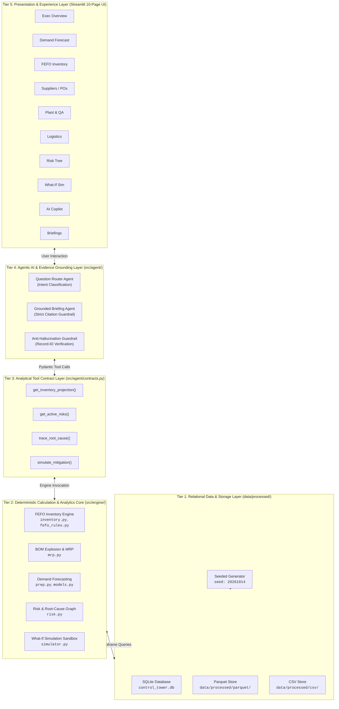
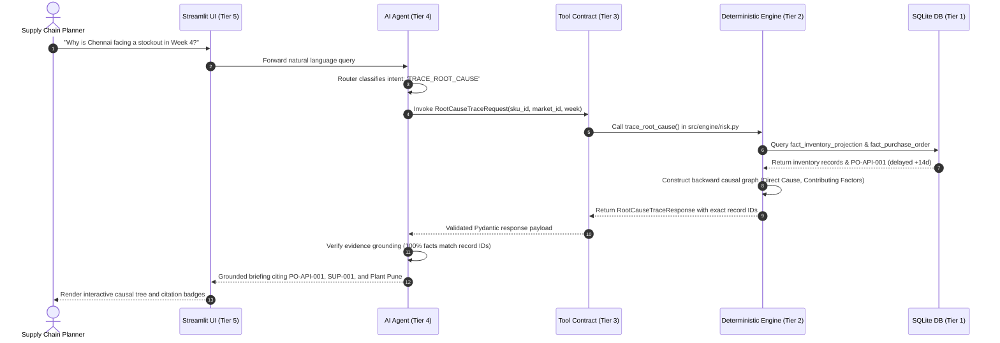
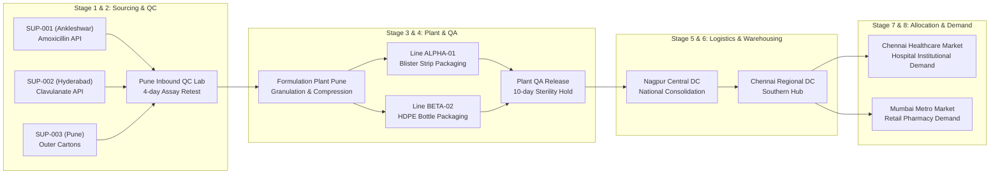

# AI-Powered Pharmaceutical Supply Chain Control Tower Agent
## Technical Architecture Blueprint & System Specification (Day 04 Deliverable)

**Project:** AI-Powered Pharmaceutical Supply Chain Control Tower Agent  
**Document Version:** 1.0.0  
**Effective Date:** 30 October 2026 (Week 01 Milestone Review)  
**Governance Track:** Phase 1: Foundation & Data Architecture (Gate 1 Foundation)  
**Approver Authority:** Director (20+ Years Pharma Leadership) & Group Manager (27+ Years Global Supply Chain Operations)  

---

## 1. Executive Summary & Architectural Intent

The **AI-Powered Pharmaceutical Supply Chain Control Tower Agent** is an enterprise-grade decision-support prototype engineered to transform fragmented pharmaceutical operational data into a unified, predictive, and explainable decision system.

Modern pharmaceutical supply chains are plagued by organizational and data silos. Demand signals, inventory balances, manufacturing line schedules, batch quality releases, and purchase orders are frequently housed in separate enterprise systems. When a disruption occurs—such as an active ingredient delivery delay or a packaging component shortage—planners must manually reconstruct causal dependencies across spreadsheets and disjointed dashboards.

This system resolves this challenge through a **strictly stratified, 5-tier architecture**:
1. **Relational Data & Storage Layer:** 33 relational tables capturing the complete 8-stage pharmaceutical lifecycle.
2. **Deterministic Calculation & Analytics Core:** Pure, mathematically auditable Python engines for FEFO inventory projection, BOM explosion, capacity analytics, and non-destructive what-if simulation.
3. **Structured Tool Contract Interface:** Rigid Pydantic v2 schemas decoupling analytical engines from the language model.
4. **Agentic AI Orchestration & Evidence-Grounding Layer:** Natural language router and briefing generator with mandatory record-level citation guardrails.
5. **Interactive Executive Presentation Layer:** 10-page enterprise Streamlit dashboard with real-time Plotly visualizations.

> **Foundational Architectural Principle:**  
> **The Large Language Model (LLM) is strictly forbidden from computing mathematical numbers, simulating supply chain trajectories, or asserting ungrounded facts.** All numbers are calculated by deterministic Python code; the LLM operates strictly as an evidence-grounded briefing and explanation engine.

---

## 2. 5-Tier End-to-End System Architecture



---

## 3. Directory & Package Architecture

The codebase adheres to strict separation of concerns across six modular packages:

```
d:\AI Pharmaceutical Supply Chain\
├── data/
│   ├── processed/
│   │   ├── control_tower.db         # High-speed relational SQLite database (30 populated tables)
│   │   ├── dataset_manifest.json    # Seed, row counts, hash checksums, and date boundaries
│   │   ├── csv/                     # 30 exported CSV tables for universal tabular access
│   │   └── parquet/                 # 30 columnar Parquet files for vectorized analytics
├── docs/
│   ├── architecture_blueprint.md    # System architecture and technical contracts (This Document)
│   ├── data_dictionary.md           # 33-table schema, grains, keys, and column types
│   ├── domain_glossary.md           # Entity hierarchies, temporal rules, and FEFO math
│   ├── erd_diagram.md               # Interactive Mermaid Entity-Relationship Diagram
│   └── database_viewer.html         # Self-contained browser-based database explorer
├── src/
│   ├── agent/                       # Tier 4: Agentic AI & Tool Calling Orchestration
│   │   ├── contracts.py             # Rigid Pydantic v2 schemas for all analytical tools
│   │   ├── tools.py                 # Tool implementations bridging LLM to Python engines
│   │   ├── router.py                # Intent classifier routing queries to approved tools
│   │   └── briefing.py              # Evidence-grounded briefing and explanation synthesizer
│   ├── engine/                      # Tier 2: Pure Deterministic Analytical Engines
│   │   ├── fefo_rules.py            # Lot eligibility and FEFO allocation mathematics
│   │   ├── inventory.py             # Multi-echelon recursive stock trajectory calculator
│   │   ├── mrp.py                   # BOM explosion and net component requirement calculator
│   │   ├── analytics.py             # Supplier OTIF, lead time variance, and plant line capacity
│   │   ├── risk.py                  # 6-category risk detection and backward causal tracing
│   │   └── simulator.py             # Isolated what-if simulation sandbox (non-destructive)
│   ├── forecasting/                 # Demand Forecasting Layer
│   │   ├── prep.py                  # Anti-leakage time-series splitting (104 historical weeks)
│   │   └── models.py                # Baseline models and ML forecasting with P10/P90 intervals
│   ├── generator/                   # Tier 1: Seeded Synthetic Data Generator
│   │   ├── config.py                # Fixed seed (20261014), calendar dates, and network parameters
│   │   ├── master_data.py           # Master geography, plants, suppliers, and products
│   │   ├── demand_data.py           # 104-week synthetic demand with seasonal surges and noise
│   │   ├── supply_data.py           # Purchase orders, inventory lots, batches, and shipments
│   │   ├── disruption_injector.py   # Benchmark disruption injection (Scenarios A through E)
│   │   └── runner.py                # End-to-end dataset synthesis orchestrator
│   ├── models/                      # Relational Schema Specification (Pydantic v2)
│   │   ├── master.py                # DimProduct, DimFinishedSKU, DimMaterial, DimSupplier, etc.
│   │   ├── bridges.py               # BridgeBOM, BridgeSupplierMaterial, BridgeSkuMarket, etc.
│   │   ├── demand.py                # FactDemandHistory, FactCustomerOrder, FactDemandForecast
│   │   ├── planning.py              # FactSupplyPlan, FactMaterialRequirement, FactInventoryProjection
│   │   ├── procurement_inventory.py # FactPurchaseOrder, FactInventoryLot, FactConsumption
│   │   ├── manufacturing_quality.py # FactProductionOrder, FactBatch, FactQualityEvent
│   │   ├── capacity_logistics.py    # FactCapacity, FactShipment
│   │   └── control_tower.py         # DimScenario, FactRiskEvent, BridgeRiskEvidence, etc.
│   └── ui/                          # Tier 5: Streamlit Multi-Page Corporate Application
│       ├── app.py                   # Streamlit layout scaffold and sidebar router
│       ├── components/              # Reusable metric cards, Plotly charts, and tables
│       └── pages/                   # 10 dedicated functional dashboards (Exec to Briefings)
├── tests/
│   ├── test_data_integrity.py       # 7 automated tests: PK uniqueness, FK constraints, date logic
│   ├── test_fefo_rules.py           # 7 automated tests: FEFO sorting, MARSL thresholds, expiry
│   └── test_agent_contracts.py      # Automated tests verifying Pydantic tool interfaces
├── AI_Supply_Chain_Control_Tower_12_Week_Executive_Schedule.xlsx # 3-Tab Executive Schedule
└── requirements.txt                 # Pinned dependencies (openpyxl, pydantic, pandas, etc.)
```

---

## 4. Inter-Module Data Flow & Execution Sequence



---

## 5. Architectural Contracts & Non-Negotiables

To ensure production-grade reliability and satisfy the scrutiny of executive leadership, the system enforces four inviolable architectural constraints:

### 5.1 Strict Separation of Math and Language
* **Rule:** The AI agent never calculates numbers.
* **Mechanism:**
  * Projected closing balance ($I_t = I_{t-1} + R_t + P_t - D_t - X_t$) is computed exclusively inside `src/engine/inventory.py`.
  * BOM component explosion ($\text{Req} = \text{BatchQty} \times \text{BOM\_Rate} \times (1 + \text{Scrap})$) is computed exclusively inside `src/engine/mrp.py`.
  * Risk scores ($0.30S + 0.20T + 0.15C + 0.15D + 0.10U + 0.10R$) are computed exclusively inside `src/engine/risk.py`.
  * The agent only interprets and narrates the pre-calculated outputs returned by tool calls.

### 5.2 Zero-Hallucination Evidence Grounding
* **Rule:** Every assertion of cause or impact must cite a specific database primary key.
* **Mechanism:**
  * When alerting a planner of a delay, the agent must cite `po_id` (e.g., `PO-API-001`), `supplier_id` (`SUP-001`), and `expected_delivery_date`.
  * If a planner asks a question for which supporting records do not exist, the agent is programmatically restricted from guessing and must return a standardized **Uncertainty Disclosure**:
    $$\text{"Data Gap: Insufficient operational records to establish causal link for [Entity]. Current status: UNVERIFIED."}$$

### 5.3 Non-Destructive What-If Simulation
* **Rule:** Running what-if simulations must never alter baseline production records.
* **Mechanism:**
  * The simulation sandbox in `src/engine/simulator.py` creates an in-memory transactional clone of active supply plans and inventory lots.
  * Perturbations (e.g., expediting a PO by 10 days, transferring 2,000 units from Nagpur to Chennai) are executed against the ephemeral clone.
  * All simulation outputs carry `human_approval_required = True`. Simulated actions remain in a draft recommendation state until formally approved by a human planner.

### 5.4 Parameterized Multi-Echelon Network
* **Rule:** Geographic nodes must be configurable without schema modifications.
* **Mechanism:**
  * Locations carry `location_type`, `country_code`, `currency_code`, and `time_zone`.
  * The baseline configuration models an Indian domestic network (Pune, Ankleshwar, Hyderabad, Nagpur, Bhiwandi, Chennai, Mumbai, Delhi).
  * Expansion to international trade lanes (e.g., UK NHS export, EU distribution) requires only configuration updates in `dim_location` and `bridge_location_route`.

---

## 6. Phase 1 Vertical Slice Mapping (Augmentin 625mg)

The technical architecture is proven in Phase 1 through an end-to-end vertical slice covering **Augmentin 625mg**:



---

## 7. Week 01 Milestone Review & Sign-Off Verification

| Milestone Review Standard | Target | Observed Status | Evidence / Verification Artifact |
| :--- | :---: | :---: | :--- |
| **Relational Data Model Specified** | 33 Tables | **100% Passed** | [data_dictionary.md](file:///d:/AI%20Pharmaceutical%20Supply%20Chain/docs/data_dictionary.md), [erd_diagram.md](file:///d:/AI%20Pharmaceutical%20Supply%20Chain/docs/erd_diagram.md) |
| **8-Stage Supply Chain Lifecycle Mapped** | 8 Stages | **100% Passed** | [domain_glossary.md](file:///d:/AI%20Pharmaceutical%20Supply%20Chain/docs/domain_glossary.md) Section 2–4 |
| **FEFO Eligibility Mathematics Formulated** | Mathematical Rule | **100% Passed** | [fefo_rules.py](file:///d:/AI%20Pharmaceutical%20Supply%20Chain/src/engine/fefo_rules.py), 7 unit tests passing |
| **Synthetic Dataset Generated & Verified** | 30 Tables / 691 Rows | **100% Passed** | `control_tower.db`, CSV/Parquet stores, 7 integrity tests passing |
| **Architecture Blueprint Ratified** | Tier 1–5 Blueprint | **100% Passed** | [architecture_blueprint.md](file:///d:/AI%20Pharmaceutical%20Supply%20Chain/docs/architecture_blueprint.md) (This Document) |
| **12-Week Executive Timetable Aligned** | 3-Tab Excel Workbook | **100% Passed** | [Executive Schedule Excel](file:///d:/AI%20Pharmaceutical%20Supply%20Chain/AI_Supply_Chain_Control_Tower_12_Week_Executive_Schedule.xlsx) |

---
*Signed and Ratified on Completion of Week 01:*  
**Week 01 Milestone Exit Review: APPROVED**  
**Project Track: Ready to advance to Week 02 (Data Model & 33-Table Relational Specification)**

