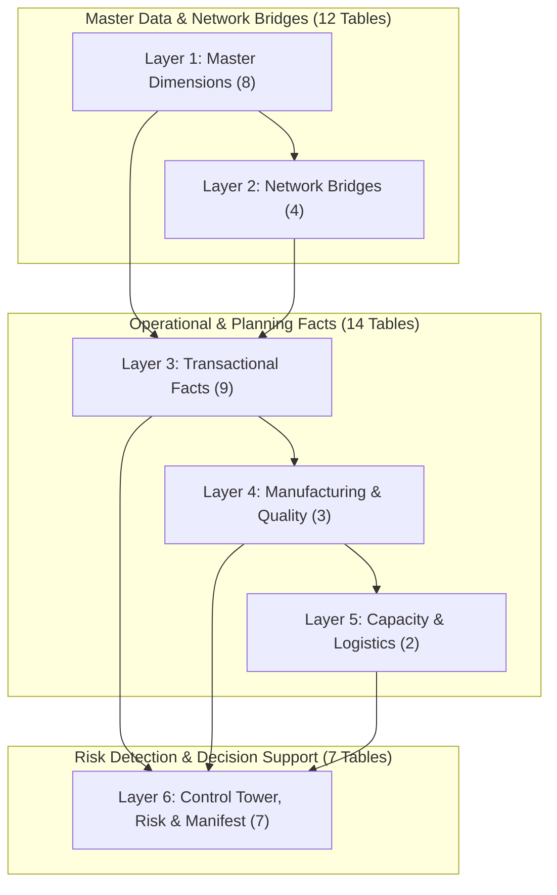

# Master Data Dictionary & Schema Specification (33 Entities)
## AI-Powered Pharmaceutical Supply Chain Control Tower
### Phase 1: Foundation & Data Architecture — Comprehensive Specification

**Project:** AI-Powered Pharmaceutical Supply Chain Control Tower Agent  
**Document Version:** 2.0.0 (Consolidated Master Publication)  
**Effective Date:** 06 November 2026 (Week 02, Day 09 Milestone)  
**Governance Track:** Phase 1: Foundation & Data Architecture (Gate 1 Readiness)  
**Approving Authorities:** Group Manager (27+ Years Global Supply Chain Operations) & Director (20+ Years Pharma Leadership)  

---

## 1. Executive Summary & Architectural Scope

In pharmaceutical manufacturing and distribution, rigorous data architecture is mandatory to ensure patient safety, regulatory compliance (cGMP 21 CFR Part 211, EU Annex 11), and mathematical integrity. 

This Data Dictionary defines the **authoritative relational schema for all 33 entities** comprising the AI-Powered Control Tower. The schema models an **Indian multi-echelon supply network** (Baddi / Ankleshwar manufacturing plants, Bhiwandi / Chennai / Nagpur distribution centers, and metropolitan demand markets) utilizing **Augmentin 625mg** (T10 blister pack and T30 HDPE bottle pack) as the primary Phase 1 vertical slice.

### The 33 vs 30 Table Reconciliation
* **33 Relational Entities Defined in Schema:** Complete structural data model enforced by Pydantic v2 validation contracts in `src/models/`.
* **30 Pre-Populated Baseline Tables (691 Records):** In Phase 1 (Week 3), exactly 30 physical tables are generated into SQLite (`control_tower.db`), Parquet, and CSV using reproducible seed `20261014`.
* **3 Dynamic Runtime Tables:** The remaining 3 tables (`fact_root_cause`, `fact_mitigation_simulation`, and `fact_recommendation`) are dynamically populated during runtime execution by the Phase 2 deterministic analytics and what-if simulation engines.

---

## 2. Layer 1: Master Data Entities (8 Tables)

Master data entities define the persistent physical, commercial, and legal structures of the pharmaceutical supply network.

---

### Table 1: `dim_product` (Product Families)
* **Purpose:** Stores broad pharmaceutical product family identities and therapeutic classifications.
* **Grain:** One row per pharmaceutical product family.
* **Primary Key:** `product_id` (String format: `PRD-xxx`)

| Field Name | Data Type | Physical / Business Meaning | Validation & Governance Constraints |
| :--- | :--- | :--- | :--- |
| `product_id` | String | Unique product family identifier (e.g., `PRD-AUG`). | Primary Key. Alphanumeric. |
| `product_name` | String | Commercial family brand name (e.g., `Augmentin`). | Not Null, minimum length 2. |
| `product_family` | String | Therapeutic class grouping (e.g., `Antibiotic-Penicillin`). | Not Null. |
| `therapy_area` | String | Clinical domain (e.g., `Anti-Infectives`). | Not Null. |
| `critical_medicine_flag` | Boolean | Designates life-saving or essential drug status. | Default `True`. Raises alert prioritization. |
| `synthetic_data_flag` | Boolean | Synthetic provenance indicator. | Constant `True`. Strictly enforced. |

---

### Table 2: `dim_finished_sku` (Sellable Finished SKUs)
* **Purpose:** Stores specific sellable finished pack configurations and packaging presentations.
* **Grain:** One row per finished sellable SKU presentation.
* **Primary Key:** `finished_sku_id` (String format: `SKU-xxx`, e.g., `SKU-AUG-625-T10`)
* **Foreign Key:** `product_id` $\rightarrow$ `dim_product.product_id`

| Field Name | Data Type | Physical / Business Meaning | Validation & Governance Constraints |
| :--- | :--- | :--- | :--- |
| `finished_sku_id` | String | Pack-level commercial identifier. | Primary Key. Alphanumeric. |
| `product_id` | String | Parent pharmaceutical product family. | Foreign Key $\rightarrow$ `dim_product`. |
| `sku_description` | String | Detailed clinical presentation description. | Not Null. |
| `dosage_form` | String | Formulation type (Tablet, Capsule, Suspension). | Controlled enum. |
| `strength` | String | Active ingredient strength label (e.g., `625mg`). | Not Null. |
| `pack_configuration` | String | Packaging presentation (e.g., `10-Tablet Strip`, `30-Bottle`).| Not Null. |
| `shelf_life_days` | Integer | Regulatory approved finished shelf life in days. | Integer $> 0$, default 730 (24 months). |
| `storage_condition` | String | Temperature regime (`Ambient 15-25C`, `Cold 2-8C`). | Controlled storage enum. |
| `launch_date` | Date | Commercial market introduction date. | ISO 8601 Date. |
| `status` | String | Commercial status (`Active`, `Discontinued`). | Default `Active`. |
| `synthetic_data_flag` | Boolean | Synthetic provenance indicator. | Constant `True`. Strictly enforced. |

---

### Table 3: `dim_material` (Raw Materials, APIs & Packaging)
* **Purpose:** Catalogs active pharmaceutical ingredients (APIs), excipients, and primary/secondary packaging materials.
* **Grain:** One row per raw or packaging material component.
* **Primary Key:** `material_sku_id` (String format: `MAT-xxx`, e.g., `MAT-API-001`)

| Field Name | Data Type | Physical / Business Meaning | Validation & Governance Constraints |
| :--- | :--- | :--- | :--- |
| `material_sku_id` | String | Unique component material code. | Primary Key. Alphanumeric. |
| `material_name` | String | Chemical or trade description (e.g., `Amoxicillin Trihydrate API`).| Not Null. |
| `material_type` | String | Category: `API`, `Excipient`, `Primary_Packaging`, `Secondary_Packaging`. | Controlled category enum. |
| `unit_of_measure` | String | Stock inventory unit (`kg`, `units`, `rolls`). | Controlled UOM enum. |
| `shelf_life_days` | Integer | Approved component shelf life in days. | Integer $> 0$. |
| `retest_interval_days` | Integer | Mandatory chemical re-assay period for APIs. | Integer $\ge 0$ (e.g., 365 days). |
| `release_time_days` | Integer | Standard QC analytical testing duration ($L_{\text{qc}}$). | Integer $\ge 0$ (typically 5 to 14 days). |
| `critical_material_flag`| Boolean | Single-point-of-failure component indicator. | Default `True` for APIs. |
| `storage_condition` | String | Handling requirement (`Controlled Room Temp`, `Dessicated`). | Controlled storage enum. |
| `synthetic_data_flag` | Boolean | Synthetic provenance indicator. | Constant `True`. Strictly enforced. |

---

### Table 4: `dim_supplier` (Vendors & Material Suppliers)
* **Purpose:** Stores synthetic vendor profiles supplying active ingredients, excipients, and packaging.
* **Grain:** One row per approved supplier vendor.
* **Primary Key:** `supplier_id` (String format: `SUP-xxx`, e.g., `SUP-001`)

| Field Name | Data Type | Physical / Business Meaning | Validation & Governance Constraints |
| :--- | :--- | :--- | :--- |
| `supplier_id` | String | Unique synthetic supplier code. | Primary Key. Alphanumeric. |
| `supplier_name` | String | Fictional enterprise business name. | Not Null. |
| `supplier_type` | String | Vendor classification: `API_Manufacturer`, `Packaging_Vendor`. | Controlled vendor type. |
| `default_lead_time_days`| Integer | Baseline procurement delivery lead time ($L_{\text{supplier}}$). | Integer $> 0$ (e.g., 30 to 60 days). |
| `minimum_order_quantity`| Float | Contractual minimum procurement volume (MOQ). | Float $\ge 0.0$. |
| `order_multiple` | Float | Packaging or pallet multiple increment. | Float $> 0.0$. |
| `otif_target` | Float | Contractual On-Time In-Full SLA percentage. | Float between 0.0% and 100.0%, default 95.0%. |
| `risk_tier` | String | Vendor operational risk rating (`Low`, `Medium`, `High`).| Controlled risk tier enum. |
| `single_source_dependency_flag`| Boolean| Flags material lines with zero qualified backup vendors. | Boolean. |
| `synthetic_data_flag` | Boolean | Synthetic provenance indicator. | Constant `True`. Strictly enforced. |

---

### Table 5: `dim_location` (Manufacturing Plants, DCs & Warehouses)
* **Purpose:** Stores physical network facilities across the manufacturing and distribution topology.
* **Grain:** One row per physical facility site.
* **Primary Key:** `location_id` (String format: `LOC-xxx`, e.g., `LOC-PLANT-01`)

| Field Name | Data Type | Physical / Business Meaning | Validation & Governance Constraints |
| :--- | :--- | :--- | :--- |
| `location_id` | String | Unique facility network node code. | Primary Key. Alphanumeric. |
| `location_name` | String | Facility name (e.g., `Baddi Formulation Plant 1`). | Not Null. |
| `location_type` | String | Node classification: `PLANT`, `CENTRAL_DC`, `REGIONAL_DC`, `SUPPLIER`. | Controlled node enum. |
| `city` | String | Real Indian metropolitan anchor (Baddi, Ankleshwar, Nagpur, Bhiwandi). | Validated against Indian master geography. |
| `state` | String | Indian State or Union Territory (Himachal Pradesh, Gujarat, Maharashtra).| Validated state. |
| `country` | String | Country jurisdiction. | Default `India`. |
| `capacity` | Float | Maximum weekly throughput capacity (packs/wk or MT/wk).| Float $\ge 0.0$. |
| `cold_chain_capable` | Boolean | Designates active refrigeration infrastructure ($2^\circ\text{C}-8^\circ\text{C}$). | Default `False`. |
| `synthetic_entity_flag`| Boolean | Synthetic provenance indicator. | Constant `True`. Strictly enforced. |

---

### Table 6: `dim_customer` (Hospitals & Institutional Wholesalers)
* **Purpose:** Stores customer and healthcare distribution entities ordering finished goods.
* **Grain:** One row per customer commercial account.
* **Primary Key:** `customer_id` (String format: `CUST-xxx`, e.g., `CUST-001`)
* **Foreign Key:** `market_id` $\rightarrow$ `dim_market.market_id`

| Field Name | Data Type | Physical / Business Meaning | Validation & Governance Constraints |
| :--- | :--- | :--- | :--- |
| `customer_id` | String | Unique customer commercial account ID. | Primary Key. Alphanumeric. |
| `customer_name` | String | Fictional enterprise name (e.g., `Apex Healthcare Wholesalers`).| Not Null. |
| `market_id` | String | Associated regional delivery market territory. | Foreign Key $\rightarrow$ `dim_market`. |
| `customer_type` | String | Account type: `Hospital_Network`, `National_Wholesaler`, `Retail_Chain`. | Controlled customer type enum. |
| `service_priority` | String | Service tier SLA (`Tier-1_Critical`, `Tier-2_Standard`). | Controlled priority enum. |
| `synthetic_data_flag` | Boolean | Synthetic provenance indicator. | Constant `True`. Strictly enforced. |

---

### Table 7: `dim_market` (Regional Demand Territories)
* **Purpose:** Defines regional demand planning aggregation territories across India.
* **Grain:** One row per regional planning market.
* **Primary Key:** `market_id` (String format: `MKT-xxx`, e.g., `MKT-IN-HYD`)

| Field Name | Data Type | Physical / Business Meaning | Validation & Governance Constraints |
| :--- | :--- | :--- | :--- |
| `market_id` | String | Unique planning market identifier. | Primary Key. Alphanumeric. |
| `market_name` | String | Commercial region label (e.g., `Hyderabad Metro Zone`). | Not Null. |
| `city` | String | Anchor metropolitan commercial center. | Real Indian city. |
| `state` | String | Primary state territory. | Real Indian state. |
| `region` | String | Macro geographic zone (`North`, `South`, `West`, `East`). | Controlled macro zone enum. |
| `synthetic_data_flag` | Boolean | Synthetic provenance indicator. | Constant `True`. Strictly enforced. |

---

### Table 8: `dim_production_line` (Plant Cleanrooms & Packaging Assets)
* **Purpose:** Represents individual plant manufacturing, granulation, tableting, and packaging lines.
* **Grain:** One row per physical production line asset.
* **Primary Key:** `production_line_id` (String format: `LINE-xxx`, e.g., `LINE-PLANT1-01`)
* **Foreign Key:** `location_id` $\rightarrow$ `dim_location.location_id` (Must be `PLANT`)

| Field Name | Data Type | Physical / Business Meaning | Validation & Governance Constraints |
| :--- | :--- | :--- | :--- |
| `production_line_id` | String | Unique production line asset identifier. | Primary Key. Alphanumeric. |
| `location_id` | String | Manufacturing plant hosting the line asset. | Foreign Key $\rightarrow$ `dim_location` (`PLANT`). |
| `line_name` | String | Asset description (e.g., `High-Speed Blister Packaging Line 1`).| Not Null. |
| `capacity_unit` | String | Capacity scheduling unit (`hours_per_week`). | Constant `hours_per_week`. |
| `standard_rate` | Float | Nominal operating throughput speed (packs per machine hour).| Float $> 0.0$ (e.g., 2,500 packs/hr). |
| `supported_product_group`| String | Compatible dosage form group (`Oral_Solid_Dose`). | Controlled product group. |
| `maintenance_constraints`| String | Scheduled preventive maintenance frequency rules. | Text documentation. |

---

## 3. Layer 2: Network Topology & Bridge Tables (4 Tables)

Bridge tables resolve many-to-many relationships across formulation recipes, multi-sourcing contracts, commercial market authorizations, and inter-city transport corridors.

---

### Table 9: `bridge_bill_of_material` (Formulation & Packaging BOM)
* **Purpose:** Multi-level recipe linking finished SKUs to raw materials, APIs, and packaging with scrap factors.
* **Grain:** One row per finished SKU and component material per active BOM version.
* **Primary Key:** `bom_id` (String format: `BOM-xxx`)
* **Foreign Keys:**
  * `finished_sku_id` $\rightarrow$ `dim_finished_sku.finished_sku_id`
  * `material_sku_id` $\rightarrow$ `dim_material.material_sku_id`

#### Mathematical BOM Explosion Formulation:
$$\text{Gross Component Requirement} = \text{Planned Finished Units} \times \text{quantity\_per\_finished\_unit} \times \left(1 + \frac{\text{scrap\_factor\_pct}}{100}\right)$$

| Field Name | Data Type | Physical / Business Meaning | Validation & Governance Constraints |
| :--- | :--- | :--- | :--- |
| `bom_id` | String | Unique BOM formulation line identifier. | Primary Key. Alphanumeric. |
| `finished_sku_id` | String | Finished commercial SKU presentation. | Foreign Key $\rightarrow$ `dim_finished_sku`. |
| `material_sku_id` | String | Required component material SKU. | Foreign Key $\rightarrow$ `dim_material`. |
| `quantity_per_finished_unit`| Float | Net component quantity per 1 finished sellable pack. | Float $> 0.0$. |
| `scrap_factor_pct` | Float | Process loss and waste factor percentage. | Float: $0.0 \le \text{scrap} \le 10.0\%$ (typically $1.0\%-3.5\%$). |
| `effective_start_date` | Date | Regulatory activation date of BOM revision. | ISO 8601 Date. |
| `effective_end_date` | Date (Nullable)| Obsolescence date of BOM revision. | Must be $\ge \text{effective\_start\_date}$ if populated. |
| `bom_version` | String | Revision control tag (`V1.0`, `V2.0`). | Not Null. |
| `synthetic_data_flag` | Boolean | Synthetic provenance indicator. | Constant `True`. Strictly enforced. |

---

### Table 10: `bridge_supplier_material` (Approved Vendor Qualification)
* **Purpose:** Documents qualified suppliers, vendor-specific lead times, and sourcing allocation priorities.
* **Grain:** One row per qualified supplier and material component pairing.
* **Composite Foreign Keys:**
  * `supplier_id` $\rightarrow$ `dim_supplier.supplier_id`
  * `material_sku_id` $\rightarrow$ `dim_material.material_sku_id`

| Field Name | Data Type | Physical / Business Meaning | Validation & Governance Constraints |
| :--- | :--- | :--- | :--- |
| `supplier_id` | String | Qualified vendor organization. | Foreign Key $\rightarrow$ `dim_supplier`. |
| `material_sku_id` | String | Approved component material SKU. | Foreign Key $\rightarrow$ `dim_material`. |
| `supplier_lead_time_days`| Integer | Agreed contractual procurement delivery lead time. | Integer $> 0$. |
| `minimum_order_quantity`| Float | Vendor-specific minimum order volume (MOQ). | Float $\ge 0.0$. |
| `approved_supplier_flag`| Boolean | GMP regulatory qualification status. | Default `True`. If `False`, vendor cannot be PO source. |
| `supplier_priority` | Integer | Sourcing ranking (`1 = Primary`, `2 = Secondary/Backup`). | Integer $\ge 1$. |

---

### Table 11: `bridge_sku_market` (Commercial Market Authorization & MARSL)
* **Purpose:** Maps SKU commercial eligibility across geographic territories and enforces Minimum Acceptable Remaining Shelf Life (MARSL).
* **Grain:** One row per finished SKU and demand market pairing.
* **Composite Foreign Keys:**
  * `finished_sku_id` $\rightarrow$ `dim_finished_sku.finished_sku_id`
  * `market_id` $\rightarrow$ `dim_market.market_id`

| Field Name | Data Type | Physical / Business Meaning | Validation & Governance Constraints |
| :--- | :--- | :--- | :--- |
| `finished_sku_id` | String | Commercial finished product SKU. | Foreign Key $\rightarrow$ `dim_finished_sku`. |
| `market_id` | String | Target regional commercial territory. | Foreign Key $\rightarrow$ `dim_market`. |
| `market_priority` | Integer | Commercial delivery ranking for scarce stock rationing. | Integer $\ge 1$ (`1 = Highest Priority`). |
| `service_level_target`| Float | Contractual OTIF target percentage. | Float: $50.0\% \le \text{SLA} \le 100.0\%$, default 98.0%. |
| `min_remaining_shelf_life_days`| Integer| Regulatory MARSL threshold required upon customer receipt. | Integer $> 0$ (typically 180 to 270 days). |

---

### Table 12: `bridge_location_route` (Transportation Lanes & Transit SLAs)
* **Purpose:** Represents permitted physical transit corridors between plants, DCs, and regional hubs.
* **Grain:** One row per origin and destination facility pairing.
* **Primary Key:** `route_id` (String format: `RT-xxx`)
* **Foreign Keys:**
  * `origin_location_id` $\rightarrow$ `dim_location.location_id`
  * `destination_location_id` $\rightarrow$ `dim_location.location_id` (Must not equal origin)

| Field Name | Data Type | Physical / Business Meaning | Validation & Governance Constraints |
| :--- | :--- | :--- | :--- |
| `route_id` | String | Unique transportation lane identifier. | Primary Key. Alphanumeric. |
| `origin_location_id` | String | Shipping facility dispatch dock. | Foreign Key $\rightarrow$ `dim_location`. |
| `destination_location_id`| String | Receiving facility inbound dock. | Foreign Key $\rightarrow$ `dim_location`. **Must $\ne$ origin.** |
| `transport_mode` | String | Logistics mode: `Road`, `Air`, `Rail`. | Controlled transit mode enum. |
| `standard_transit_days`| Integer | Baseline dock-to-dock transit duration ($L_{\text{transit}}$). | Integer $\ge 1$ (e.g., 2 to 5 days). |
| `transport_cost_per_unit`| Float | Freight and handling cost per unit in INR. | Float $\ge 0.0$. |
| `cold_chain_required_flag`| Boolean | Mandates active refrigerated reefer container. | Default `False`. |
| `route_status` | String | Lane operational status (`Active`, `Monsoon_Disrupted`). | Default `Active`. |

---

## 4. Layer 3: Transactional & Planning Fact Tables (9 Tables)

Transactional and planning fact tables record physical execution events and forward-looking replenishment calculations.

---

### Table 13: `fact_demand_history` (104-Week Demand Baseline)
* **Purpose:** Captures historical weekly customer demand volume and fulfilled shipments across 104 weeks (2 years). Serves as baseline training data for forecasting models.
* **Grain:** One record per Monday week start date, finished SKU, regional market, and scenario.
* **Composite Primary Key:** `(week_start_date, finished_sku_id, market_id, scenario_id)`
* **Foreign Keys:**
  * `finished_sku_id` $\rightarrow$ `dim_finished_sku.finished_sku_id`
  * `market_id` $\rightarrow$ `dim_market.market_id`
  * `scenario_id` $\rightarrow$ `dim_scenario.scenario_id`

| Field Name | Data Type | Physical / Business Meaning | Validation & Governance Constraints |
| :--- | :--- | :--- | :--- |
| `week_start_date` | Date | Monday start date of weekly historical bucket. | ISO 8601 Date. |
| `finished_sku_id` | String | Commercial finished product SKU. | Foreign Key $\rightarrow$ `dim_finished_sku`. |
| `market_id` | String | Servicing regional consumer market. | Foreign Key $\rightarrow$ `dim_market`. |
| `demand_quantity` | Float | True customer demand volume in sellable packs. | Float $\ge 0.0$. |
| `fulfilled_quantity`| Float | Actual commercial shipments fulfilled against demand. | Float $\ge 0.0$. |
| `lost_sales_quantity`| Float | Unfulfilled demand resulting in lost revenue. | Auto-calculated: $\max(0, \text{Demand} - \text{Fulfilled})$. |
| `event_type` | String | Demand anomaly driver (`Normal`, `Holiday_Spike`, `Epidemic_Surge`). | Controlled categorical enum. |
| `scenario_id` | String | Scenario identifier (`SCN-BASE`). | Default `SCN-BASE`. |
| `synthetic_data_flag`| Boolean| Synthetic provenance indicator. | Constant `True`. Strictly enforced. |

---

### Table 14: `fact_customer_order` (Customer Sales Order Lines)
* **Purpose:** Captures distinct purchasing transactions from hospital networks, wholesalers, and retail chains.
* **Grain:** One record per customer order line item.
* **Primary Key:** `customer_order_id` (String format: `ORD-xxx`, e.g., `ORD-2026-001`)
* **Foreign Keys:**
  * `customer_id` $\rightarrow$ `dim_customer.customer_id`
  * `market_id` $\rightarrow$ `dim_market.market_id`
  * `finished_sku_id` $\rightarrow$ `dim_finished_sku.finished_sku_id`

| Field Name | Data Type | Physical / Business Meaning | Validation & Governance Constraints |
| :--- | :--- | :--- | :--- |
| `customer_order_id` | String | Unique commercial sales order number. | Primary Key. Alphanumeric. |
| `customer_id` | String | Purchasing institutional or wholesale account. | Foreign Key $\rightarrow$ `dim_customer`. |
| `market_id` | String | Regional delivery territory. | Foreign Key $\rightarrow$ `dim_market`. |
| `finished_sku_id` | String | Ordered finished SKU presentation. | Foreign Key $\rightarrow$ `dim_finished_sku`. |
| `order_date` | Date | Timestamp of order registration. | ISO 8601 Date. |
| `requested_delivery_date`| Date | Customer requested dock arrival milestone. | Must be $\ge \text{order\_date}$. |
| `promised_delivery_date` | Date | ERP confirmed delivery date milestone. | Must be $\ge \text{order\_date}$. |
| `ordered_quantity` | Float | Quantity ordered in sellable packs. | Float $> 0.0$. |
| `fulfilled_quantity` | Float | Quantity successfully delivered. | Float $\ge 0.0$, default 0.0. |
| `outstanding_quantity` | Float | Backorder balance remaining. | Auto-calculated: $\max(0, \text{Ordered} - \text{Fulfilled})$. |
| `order_status` | String | State: `Open`, `In_Transit`, `Delivered`, `Short_Shipped`, `Cancelled`. | Controlled order status enum. |

---

### Table 15: `fact_demand_forecast` (26-Week Forecast & Probabilistic Intervals)
* **Purpose:** Stores versioned demand forecasts generated by statistical and ML models over a 26-week future planning horizon. Enforces anti-leakage date guards.
* **Grain:** One record per forecast ID (version date, target week, finished SKU, market, scenario).
* **Primary Key:** `forecast_id` (String format: `FCST-xxx`)
* **Foreign Keys:**
  * `finished_sku_id` $\rightarrow$ `dim_finished_sku.finished_sku_id`
  * `market_id` $\rightarrow$ `dim_market.market_id`
  * `scenario_id` $\rightarrow$ `dim_scenario.scenario_id`

| Field Name | Data Type | Physical / Business Meaning | Validation & Governance Constraints |
| :--- | :--- | :--- | :--- |
| `forecast_id` | String | Unique forecast record identifier. | Primary Key. Alphanumeric. |
| `forecast_version_date`| Date | **As-of creation date to prevent future data leakage.** | ISO 8601 Date. |
| `target_week` | Date | Monday start date of predicted horizon week. | **Must be $\ge \text{forecast\_version\_date}$.** |
| `finished_sku_id` | String | Predicted finished SKU pack format. | Foreign Key $\rightarrow$ `dim_finished_sku`. |
| `market_id` | String | Destination market zone. | Foreign Key $\rightarrow$ `dim_market`. |
| `forecast_quantity` | Float | Deterministic point forecast volume in packs. | Float $\ge 0.0$. |
| `lower_bound` | Float | Probabilistic P10 lower prediction interval bound. | Float $\ge 0.0$, must be $\le \text{upper\_bound}$. |
| `upper_bound` | Float | Probabilistic P90 upper prediction interval bound. | Float $\ge 0.0$, must be $\ge \text{lower\_bound}$. |
| `override_quantity` | Float (Nullable)| Documented human planner override. | Optional float $\ge 0.0$. |
| `model_version` | String | Algorithm release code (e.g., `Ensemble-HoltWinters-Ridge-v1.0`).| Documentation tracking. |
| `scenario_id` | String | Baseline or disruption scenario identifier. | Foreign Key $\rightarrow$ `dim_scenario`. |

---

### Table 16: `fact_supply_plan` (Master Replenishment Schedule)
* **Purpose:** Specifies planned weekly replenishment targets to distribution centers and formulation plants.
* **Grain:** One record per supply replenishment line.
* **Primary Key:** `supply_plan_id` (String format: `SP-xxx`)
* **Foreign Keys:**
  * `finished_sku_id` $\rightarrow$ `dim_finished_sku.finished_sku_id`
  * `location_id` $\rightarrow$ `dim_location.location_id`
  * `scenario_id` $\rightarrow$ `dim_scenario.scenario_id`

| Field Name | Data Type | Physical / Business Meaning | Validation & Governance Constraints |
| :--- | :--- | :--- | :--- |
| `supply_plan_id` | String | Unique replenishment schedule line. | Primary Key. Alphanumeric. |
| `finished_sku_id` | String | Replenished finished SKU. | Foreign Key $\rightarrow$ `dim_finished_sku`. |
| `location_id` | String | Receiving facility node (e.g., Central DC Nagpur). | Foreign Key $\rightarrow$ `dim_location`. |
| `planned_week` | Date | Target replenishment planning bucket. | Monday planning date. |
| `planned_quantity` | Float | Target replenishment volume in packs. | Float $\ge 0.0$. |
| `source_type` | String | Mode: `MANUFACTURING`, `INTER_DC_TRANSFER`, `CMO_PURCHASE`. | Controlled source enum. |
| `source_order_id` | String (Nullable)| Traceable link to production order or shipment. | Foreign Key link. |
| `expected_availability_date`| Date | Milestone when stock passes QA and is eligible for dispatch. | Must be $\ge \text{planned\_week}$. |
| `scenario_id` | String | Scenario identifier. | Default `SCN-BASE`. |
| `plan_status` | String | Lifecycle state (`Draft`, `Committed`, `Executed`). | Default `Committed`. |

---

### Table 17: `fact_material_requirement` (Gross/Net MRP Explosion)
* **Purpose:** Netting engine records for component materials. Converts planned production orders into gross component need via BOM explosion, nets against on-hand eligible stock and incoming POs, and calculates net shortages.
* **Grain:** One record per component requirement line.
* **Primary Key:** `requirement_id` (String format: `REQ-xxx`)
* **Foreign Keys:**
  * `production_order_id` $\rightarrow$ `fact_production_order.production_order_id`
  * `material_sku_id` $\rightarrow$ `dim_material.material_sku_id`
  * `scenario_id` $\rightarrow$ `dim_scenario.scenario_id`

#### Mathematical Net Shortage Formulation:
$$\text{shortage\_quantity} = \max\Big(0, \ \text{required\_quantity} - \text{eligible\_available\_quantity} - \text{expected\_receipt\_quantity}\Big)$$

| Field Name | Data Type | Physical / Business Meaning | Validation & Governance Constraints |
| :--- | :--- | :--- | :--- |
| `requirement_id` | String | Unique component requirement code. | Primary Key. Alphanumeric. |
| `production_order_id` | String | Linked manufacturing work order. | Foreign Key $\rightarrow$ `fact_production_order`. |
| `material_sku_id` | String | Required component material SKU. | Foreign Key $\rightarrow$ `dim_material`. |
| `required_quantity` | Float | Gross material requirement calculated via BOM explosion. | Float $\ge 0.0$. |
| `required_date` | Date | Need-by date at manufacturing plant dock. | ISO 8601 Date. |
| `eligible_available_quantity`| Float | Released unreserved stock on-hand by need-by date. | Float $\ge 0.0$. |
| `expected_receipt_quantity` | Float | Confirmed incoming POs arriving before need-by date. | Float $\ge 0.0$. |
| `shortage_quantity` | Float | Net unfulfilled component deficit. | Auto-calculated deterministic netting. |
| `scenario_id` | String | Scenario identifier. | Default `SCN-BASE`. |

---

### Table 18: `fact_inventory_projection` (Multi-Echelon Forward Trajectory)
* **Purpose:** Core projection engine table. Stores the weekly stock balance trajectory across all echelons and identifies projected safety stock breaches and stockout occurrences across a 26-week horizon.
* **Grain:** One record per item, facility node, weekly bucket, and scenario.
* **Primary Key:** `projection_id` (String format: `PRJ-xxx`)
* **Foreign Keys:**
  * `location_id` $\rightarrow$ `dim_location.location_id`
  * `scenario_id` $\rightarrow$ `dim_scenario.scenario_id`

#### Mathematical Stock Trajectory Formulation:
$$I_t = I_{t-1} + R_t + P_t - D_t$$
$$\text{projected\_shortage} = \max\Big(0, \ -I_t\Big) \quad \text{when } I_t < 0$$

| Field Name | Data Type | Physical / Business Meaning | Validation & Governance Constraints |
| :--- | :--- | :--- | :--- |
| `projection_id` | String | Unique projection row ID. | Primary Key. Alphanumeric. |
| `item_type` | String | `FINISHED_SKU` or `RAW_MATERIAL`. | Controlled item category. |
| `item_id` | String | `finished_sku_id` or `material_sku_id`. | Foreign key identifier. |
| `location_id` | String | Facility node (Plant, Central DC, Regional DC). | Foreign Key $\rightarrow$ `dim_location`. |
| `week_start_date` | Date | Monday horizon date. | ISO 8601 Date. |
| `opening_inventory` | Float | Opening eligible stock balance ($I_{t-1}$). | Unreserved released stock. |
| `planned_receipts` | Float | Confirmed PO or inbound transfer receipts ($R_t$). | Float $\ge 0.0$. |
| `planned_production` | Float | Finished goods batch receipts ($P_t$). | Float $\ge 0.0$. |
| `forecast_demand` | Float | Customer demand forecast or material gross usage ($D_t$). | Float $\ge 0.0$. |
| `projected_ending_inventory`| Float | Projected closing stock balance ($I_t$). | Reconciles mathematically. |
| `safety_stock` | Float | Configured target safety buffer units. | Float $\ge 0.0$. |
| `projected_shortage` | Float | Deficit volume below zero stock. | $\max(0, -\text{Ending Inventory})$. |
| `scenario_id` | String | Scenario identifier. | Default `SCN-BASE`. |

---

### Table 19: `fact_purchase_order` (Vendor Procurement & OTIF Tracking)
* **Purpose:** Material purchasing orders. Tracks PO issuance, supplier commitments, physical receipt dates, and On-Time In-Full (OTIF) delivery variance.
* **Grain:** One record per purchase order line item.
* **Primary Key:** `purchase_order_id` (String format: `PO-xxx`, e.g., `PO-2026-001`)
* **Foreign Keys:**
  * `supplier_id` $\rightarrow$ `dim_supplier.supplier_id`
  * `material_sku_id` $\rightarrow$ `dim_material.material_sku_id`

| Field Name | Data Type | Physical / Business Meaning | Validation & Governance Constraints |
| :--- | :--- | :--- | :--- |
| `purchase_order_id` | String | Unique purchase order code. | Primary Key. Alphanumeric. |
| `supplier_id` | String | Selected vendor entity. | Foreign Key $\rightarrow$ `dim_supplier`. |
| `material_sku_id` | String | Procured material SKU. | Foreign Key $\rightarrow$ `dim_material`. |
| `order_date` | Date | Date PO was transmitted to vendor. | ISO 8601 Date. |
| `requested_delivery_date`| Date | Buyer required delivery date. | Must be $\ge \text{order\_date}$. |
| `confirmed_delivery_date`| Date | Vendor promised dock delivery date. | Must be $\ge \text{order\_date}$. |
| `actual_receipt_date` | Date (Nullable)| Physical gate-in receipt date at plant dock. | Must be $\ge \text{order\_date}$ if populated. |
| `ordered_quantity` | Float | Contracted purchase volume in material UOM. | Float $> 0.0$. |
| `received_quantity` | Float | Verified received quantity. | Float $\ge 0.0$, default 0.0. |
| `purchase_order_status` | String | Status: `Open`, `In_Transit`, `Received`, `Delayed`, `Short_Shipped`. | Controlled PO state. |
| `delay_reason` | String (Nullable)| Root-cause classification for delayed delivery. | Informs Scenario A causal tracing. |
| `quality_status` | String | Inspection state: `Pending_Inspection`, `Released`, `Quarantined`. | Default `Pending_Inspection`. |

---

### Table 20: `fact_inventory_lot` (Physical Lot Balances & FEFO State)
* **Purpose:** Physical batch inventory positions. Underpins FEFO allocation by recording manufacturing dates, expiry dates, QA release milestones, and quarantine/blocked flags.
* **Grain:** One record per physical inventory lot and location.
* **Primary Key:** `lot_id` (String format: `LOT-xxx`, e.g., `LOT-API-2026-01`)
* **Foreign Keys:**
  * `location_id` $\rightarrow$ `dim_location.location_id`
  * `batch_id` $\rightarrow$ `fact_batch.batch_id` (Nullable)

#### FEFO Lot Eligibility Rule:
$$E(l, m, t) = \mathbb{I}(\text{quality\_status} = \text{'Released'}) \cdot \mathbb{I}(\text{recall\_status} = \text{'None'}) \cdot \mathbb{I}(\text{RSL}(l, t) \ge \text{MARSL}(m)) \cdot \mathbb{I}(Q_{\text{avail}} > 0)$$

| Field Name | Data Type | Physical / Business Meaning | Validation & Governance Constraints |
| :--- | :--- | :--- | :--- |
| `lot_id` | String | Unique physical batch/lot tracking identity. | Primary Key. Alphanumeric. |
| `item_type` | String | `FINISHED_SKU` or `RAW_MATERIAL`. | Controlled item category. |
| `item_id` | String | `finished_sku_id` or `material_sku_id`. | Foreign key identifier. |
| `location_id` | String | Physical warehouse or plant facility holding stock. | Foreign Key $\rightarrow$ `dim_location`. |
| `batch_id` | String (Nullable)| Associated finished manufacturing batch. | Foreign Key $\rightarrow$ `fact_batch`. |
| `manufacture_date` | Date | Physical synthesis or packaging date. | ISO 8601 Date. |
| `expiry_date` | Date | Regulatory stamped expiration milestone. | **Must strictly exceed `manufacture_date`.** |
| `retest_date` | Date (Nullable)| Mandated chemical re-assay date for APIs. | ISO 8601 Date. |
| `quantity_on_hand` | Float | Total physical stock currently held on-site. | Float $\ge 0.0$. |
| `reserved_quantity` | Float | Stock allocated to active packing or customer orders. | Float $\ge 0.0$, must be $\le \text{quantity\_on\_hand}$. |
| `blocked_quantity` | Float | Stock under regulatory, quality, or recall embargo. | Float $\ge 0.0$. |
| `quality_status` | String | Quality state: `Released`, `Quarantined`, `Blocked`, `Expired`. | Controlled quality status enum. |
| `receipt_date` | Date | Date inventory arrived at facility. | ISO 8601 Date. |
| `release_date` | Date (Nullable)| Date QA formally released the lot. | Must be $\ge \text{receipt\_date}$ if populated. |
| `recall_status` | String | Regulatory recall state (`None`, `Class-I`, `Under_Investigation`).| Default `None`. |
| `synthetic_data_flag` | Boolean | Synthetic provenance indicator. | Constant `True`. Strictly enforced. |

---

### Table 21: `fact_material_consumption` (Actual Batch Material Dispensing)
* **Purpose:** Manufacturing floor dispensing records. Audits actual chemical ingredient consumption against theoretical BOM requirements.
* **Grain:** One record per production order, material SKU, and consumed lot.
* **Primary Key:** `consumption_id` (String format: `CONS-xxx`)
* **Foreign Keys:**
  * `production_order_id` $\rightarrow$ `fact_production_order.production_order_id`
  * `material_sku_id` $\rightarrow$ `dim_material.material_sku_id`
  * `lot_id` $\rightarrow$ `fact_inventory_lot.lot_id`

| Field Name | Data Type | Physical / Business Meaning | Validation & Governance Constraints |
| :--- | :--- | :--- | :--- |
| `consumption_id` | String | Unique dispensing transaction ID. | Primary Key. Alphanumeric. |
| `production_order_id` | String | Manufacturing work order consuming material. | Foreign Key $\rightarrow$ `fact_production_order`. |
| `material_sku_id` | String | Consumed chemical ingredient or packaging SKU. | Foreign Key $\rightarrow$ `dim_material`. |
| `lot_id` | String | Specific raw material lot dispensed from warehouse. | Foreign Key $\rightarrow$ `fact_inventory_lot`. |
| `planned_quantity` | Float | Theoretical BOM requirement. | Float $> 0.0$. |
| `actual_quantity` | Float | Physical quantity charged into batch reactor/line. | Float $\ge 0.0$. |
| `consumption_date` | Date | Timestamp of dispensing to plant cleanroom. | ISO 8601 Date. |
| `variance_quantity` | Float | Dispensing variance. | Auto-calculated: $\text{Actual} - \text{Planned}$. |

---

## 5. Layer 4: Manufacturing & Quality Fact Tables (3 Tables)

Manufacturing and quality entities capture cleanroom operations, batch genealogy, Certificate of Analysis (CoA) release lifecycles, and Good Manufacturing Practice (GMP) deviations.

---

### Table 22: `fact_production_order` (Plant Work Orders)
* **Purpose:** Plant floor packaging and compression work orders executing planned replenishment.
* **Grain:** One record per production order line.
* **Primary Key:** `production_order_id` (String format: `PROD-xxx`, e.g., `PROD-2026-001`)
* **Foreign Keys:**
  * `finished_sku_id` $\rightarrow$ `dim_finished_sku.finished_sku_id`
  * `location_id` $\rightarrow$ `dim_location.location_id` (`MANUFACTURING_PLANT`)
  * `production_line_id` $\rightarrow$ `dim_production_line.production_line_id`

| Field Name | Data Type | Physical / Business Meaning | Validation & Governance Constraints |
| :--- | :--- | :--- | :--- |
| `production_order_id` | String | Unique manufacturing work order number. | Primary Key. Alphanumeric. |
| `finished_sku_id` | String | Finished product SKU being packaged. | Foreign Key $\rightarrow$ `dim_finished_sku`. |
| `location_id` | String | Manufacturing plant facility node. | Foreign Key $\rightarrow$ `dim_location`. |
| `production_line_id` | String | Assigned packaging/compression line asset. | Foreign Key $\rightarrow$ `dim_production_line`. |
| `planned_start_date` | Date | Scheduled production start milestone. | ISO 8601 Date. |
| `planned_completion_date`| Date | Scheduled production completion milestone. | Must be $\ge \text{planned\_start\_date}$. |
| `actual_start_date` | Date (Nullable)| Actual timestamp when line commenced setup. | ISO 8601 Date. |
| `actual_completion_date`| Date (Nullable)| Actual timestamp when line finished run. | Must be $\ge \text{actual\_start\_date}$ if populated. |
| `planned_quantity` | Float | Target batch pack output. | Float $> 0.0$. |
| `actual_quantity` | Float | Gross sellable packs produced. | Float $\ge 0.0$, default 0.0. |
| `expected_yield` | Float | Standard operational yield percentage. | Percentage: $0.0 \le \text{Yield} \le 100.0\%$, default 98.0%. |
| `actual_yield` | Float (Nullable)| Achieved operational yield percentage. | Float between 0.0% and 100.0%. |
| `planned_hours` | Float | Machine hours booked on production line. | Float $> 0.0$. |
| `actual_hours` | Float (Nullable)| Physical machine hours logged. | Float $\ge 0.0$. |
| `production_status` | String | State: `Planned`, `Released`, `In_Progress`, `Completed`, `On_Hold`. | Controlled status enum. |
| `delay_reason` | String (Nullable)| Downtime cause (`API Shortage`, `Line Breakdown`).| Informs root-cause tracing. |

---

### Table 23: `fact_batch` (Manufacturing Batch Genealogy & CoA Release)
* **Purpose:** Physical synthesized chemical batch genealogy. Tracks physical processing completion, laboratory sampling, and final Qualified Person (QP) regulatory release.
* **Grain:** One record per physical manufacturing batch.
* **Primary Key:** `batch_id` (String format: `BATCH-xxx`, e.g., `BATCH-AUG-2026-01`)
* **Foreign Keys:**
  * `production_order_id` $\rightarrow$ `fact_production_order.production_order_id`
  * `finished_sku_id` $\rightarrow$ `dim_finished_sku.finished_sku_id`
  * `location_id` $\rightarrow$ `dim_location.location_id`

| Field Name | Data Type | Physical / Business Meaning | Validation & Governance Constraints |
| :--- | :--- | :--- | :--- |
| `batch_id` | String | Traceable master batch identifier. | Primary Key. Alphanumeric. |
| `production_order_id` | String | Parent manufacturing order. | Foreign Key $\rightarrow$ `fact_production_order`. |
| `finished_sku_id` | String | Finished SKU presentation. | Foreign Key $\rightarrow$ `dim_finished_sku`. |
| `location_id` | String | Manufacturing plant site. | Foreign Key $\rightarrow$ `dim_location`. |
| `manufacture_date` | Date | Date packaging run finished on the plant floor. | ISO 8601 Date. |
| `quality_submission_date`| Date | Date samples were transferred to QC laboratory. | **Must be $\ge \text{manufacture\_date}$.** |
| `expected_release_date`| Date | Target CoA release date based on standard test SLA. | **Must be $\ge \text{quality\_submission\_date}$.** |
| `actual_release_date` | Date (Nullable)| Formal date Certificate of Analysis was signed. | Must be $\ge \text{quality\_submission\_date}$ if populated. |
| `batch_quantity` | Float | Net usable packs produced in batch. | Float $> 0.0$. |
| `batch_status` | String | Quality state: `In_Testing`, `Released`, `Quarantined`, `Rejected`. | Controlled batch status enum. |
| `rejection_reason` | String (Nullable)| Failure classification (`Sterility Failure`, `OOS Dissolution`). | Informs quality failure root-causes. |

---

### Table 24: `fact_quality_event` (GMP Deviations & Quarantine Holds)
* **Purpose:** Quality deviations, sterility failures, and laboratory holds. Directly anchors **Scenario B (Batch QA Release Hold)**.
* **Grain:** One record per quality deviation event.
* **Primary Key:** `quality_event_id` (String format: `QEV-xxx`, e.g., `QEV-2026-001`)

| Field Name | Data Type | Physical / Business Meaning | Validation & Governance Constraints |
| :--- | :--- | :--- | :--- |
| `quality_event_id` | String | Unique quality deviation identifier. | Primary Key. Alphanumeric. |
| `entity_type` | String | Impacted entity: `BATCH`, `INVENTORY_LOT`, `PURCHASE_ORDER`.| Controlled entity enum. |
| `entity_id` | String | Underlying batch_id, lot_id, or po_id. | Traceable primary key reference. |
| `event_type` | String | Category: `Sterility_Retest`, `OOS_Investigation`, `Temperature_Excursion`. | Controlled deviation type. |
| `event_date` | Date | Date deviation occurred or was flagged. | ISO 8601 Date. |
| `expected_resolution_date`| Date | Planned investigation completion milestone. | Must be $\ge \text{event\_date}$. |
| `actual_resolution_date`| Date (Nullable)| Date deviation was formally signed off and closed. | Must be $\ge \text{event\_date}$ if populated. |
| `quality_status` | String | State: `Pending`, `Cleared`, `Rejected`, `Quarantined`.| Default `Pending`. |
| `delay_days` | Integer | Downstream release delay introduced by deviation ($L_{\text{qa\_release}}$).| Integer $\ge 0$. |
| `reason_code` | String | Standardized deviation classification code (e.g., `DEV-STER-001`).| Minimum length 3. |

---

## 6. Layer 5: Capacity & Logistics Fact Tables (2 Tables)

Capacity and logistics entities track plant line availability, equipment utilization, and inter-city freight movements.

---

### Table 25: `fact_capacity` (Plant Line Operating Hours & Utilization)
* **Purpose:** Weekly line machine capacity. Directly anchors **Scenario E (Mitigation Feasibility Conflict)** by evaluating committed hours against maintenance windows.
* **Grain:** One record per plant line, weekly period start date, and scenario.
* **Primary Key:** `capacity_record_id` (String format: `CAP-xxx`, e.g., `CAP-PLANT1-LINE1-W44`)
* **Foreign Keys:**
  * `location_id` $\rightarrow$ `dim_location.location_id`
  * `production_line_id` $\rightarrow$ `dim_production_line.production_line_id`
  * `scenario_id` $\rightarrow$ `dim_scenario.scenario_id`

#### Mathematical Capacity Formulations:
$$\text{Capacity Utilization \%} = \left(\frac{\text{committed\_hours}}{\text{net\_available\_hours}}\right) \times 100$$
$$\text{Is Overloaded} = \mathbb{I}(\text{committed\_hours} > \text{net\_available\_hours})$$

| Field Name | Data Type | Physical / Business Meaning | Validation & Governance Constraints |
| :--- | :--- | :--- | :--- |
| `capacity_record_id` | String | Unique weekly capacity line identifier. | Primary Key. Alphanumeric. |
| `location_id` | String | Manufacturing plant site code. | Foreign Key $\rightarrow$ `dim_location`. |
| `production_line_id` | String | Production line asset code. | Foreign Key $\rightarrow$ `dim_production_line`. |
| `period_start_date` | Date | Monday start date of weekly planning horizon. | ISO 8601 Date. |
| `net_available_hours` | Float | Gross weekly operating hours minus holidays. | Float $\ge 0.0$, default 120.0 hrs. |
| `maintenance_hours` | Float | Scheduled preventive maintenance hours. | Float $\ge 0.0$, default 8.0 hrs. |
| `downtime_hours` | Float | Unplanned breakdown or tooling changeover downtime. | Float $\ge 0.0$, default 0.0 hrs. |
| `committed_hours` | Float | Machine hours booked by scheduled work orders. | Float $\ge 0.0$, default 0.0 hrs. |
| `scenario_id` | String | Baseline or disruption scenario identifier. | Default `SCN-BASE`. |

---

### Table 26: `fact_shipment` (Inter-Facility Transport & Reefer Monitoring)
* **Purpose:** Finished product transit consignments between Plants, Central DCs, and Regional Hubs.
* **Grain:** One record per freight consignment dispatch.
* **Primary Key:** `shipment_id` (String format: `SHIP-xxx`, e.g., `SHIP-2026-001`)
* **Foreign Keys:**
  * `origin_location_id` $\rightarrow$ `dim_location.location_id`
  * `destination_location_id` $\rightarrow$ `dim_location.location_id` (Must not equal origin)
  * `finished_sku_id` $\rightarrow$ `dim_finished_sku.finished_sku_id`
  * `lot_id` $\rightarrow$ `fact_inventory_lot.lot_id`

| Field Name | Data Type | Physical / Business Meaning | Validation & Governance Constraints |
| :--- | :--- | :--- | :--- |
| `shipment_id` | String | Unique consignment consignment code. | Primary Key. Alphanumeric. |
| `origin_location_id` | String | Shipping facility dock (Plant or Central DC). | Foreign Key $\rightarrow$ `dim_location`. |
| `destination_location_id`| String | Receiving facility dock (Central DC or Regional DC). | Foreign Key $\rightarrow$ `dim_location`. **Must $\ne$ origin.** |
| `finished_sku_id` | String | Dispatched commercial SKU. | Foreign Key $\rightarrow$ `dim_finished_sku`. |
| `lot_id` | String | Dispatched physical inventory lot. | Foreign Key $\rightarrow$ `fact_inventory_lot`. |
| `dispatch_date` | Date | Date consignment departed shipping dock. | ISO 8601 Date. |
| `expected_arrival_date` | Date | Scheduled delivery milestone ($L_{\text{transit}}$). | **Must be $\ge \text{dispatch\_date}$.** |
| `actual_arrival_date` | Date (Nullable)| Gate-in physical arrival date at destination dock. | Must be $\ge \text{dispatch\_date}$ if populated. |
| `shipped_quantity` | Float | Dispatched pack volume. | Float $> 0.0$. |
| `received_quantity` | Float | Verified received pack volume. | Float $\ge 0.0$, default 0.0. |
| `transport_mode` | String | Logistics mode (`Road`, `Air`, `Rail`). | Controlled mode enum. |
| `shipment_status` | String | State: `Manifested`, `In_Transit`, `Delivered`, `Delayed`.| Controlled status enum. |
| `delay_reason` | String (Nullable)| Logistics bottleneck reason (`Monsoon Flooding`). | Causal explanation. |
| `temperature_excursion_flag`| Boolean | Flags cold-chain temperature excursion ($>8^\circ\text{C}$). | If `True`, triggers lot quarantine on arrival. |

---

## 7. Layer 6: Control Tower, Risk & Governance Entities (7 Tables)

Layer 6 anchors the AI Control Tower decision-support framework. It records stress test scenario parameters, detected operational risks, verifiable evidence citations, backward causal tracing graphs, non-destructive mitigation simulations, human-approved recommendations, and the reproducibility manifest.

---

### Table 27: `dim_scenario` (Disruption Scenario Registry)
* **Purpose:** Formal registry of benchmark disruption stress tests (Scenarios A through E) and baseline parameters.
* **Grain:** One record per scenario definition.
* **Primary Key:** `scenario_id` (String format: `SCN-xxx`, e.g., `SCN-BASE`, `SCN-A-API-DELAY`)

| Field Name | Data Type | Physical / Business Meaning | Validation & Governance Constraints |
| :--- | :--- | :--- | :--- |
| `scenario_id` | String | Unique scenario code (`SCN-BASE`, `SCN-A`, `SCN-B`, `SCN-C`, `SCN-D`, `SCN-E`).| Primary Key. Alphanumeric. |
| `scenario_name` | String | Formal descriptive title of scenario. | Not Null. |
| `scenario_type` | String | Category: `BASELINE`, `DISRUPTION_INJECTED`, `STRESS_TEST`.| Controlled category enum. |
| `description` | String | Detailed clinical and operational impact narrative. | Not Null. |
| `injection_table` | String | Target relational table receiving disruption parameter. | e.g., `fact_purchase_order`, `fact_batch`. |
| `injection_parameter` | String | Altered variable (e.g., `actual_receipt_date`, `quality_status`).| Not Null. |
| `active_flag` | Boolean | Designates currently active scenario for simulation comparison.| Default `False`. |

---

### Table 28: `fact_risk_event` (Detected Supply Chain Exceptions)
* **Purpose:** Exception engine output. Evaluates 6 risk categories across the 26-week horizon and calculates transparent composite risk scores.
* **Grain:** One record per detected risk exception.
* **Primary Key:** `risk_id` (String format: `RISK-xxx`, e.g., `RISK-2026-001`)

#### Composite Risk Score Formulation:
$$\text{Composite Risk Score} = 0.30S + 0.20T + 0.15C + 0.15D + 0.10U + 0.10R$$
*Where $S$ = Shortage Severity, $T$ = Lead Time to Impact, $C$ = Criticality, $D$ = Downstream Scope, $U$ = Data Uncertainty, and $R$ = Recurrence.*

$$\text{Days to Impact} = \text{impact\_date} - \text{detection\_date}$$

| Field Name | Data Type | Physical / Business Meaning | Validation & Governance Constraints |
| :--- | :--- | :--- | :--- |
| `risk_id` | String | Unique risk alert identifier. | Primary Key. Alphanumeric. |
| `risk_category` | String | Type: `Stockout`, `Safety_Stock_Breach`, `Expiry_Exposure`, `Supplier_Delay`, `Line_Capacity_Overload`, `Batch_QA_Delay`. | Controlled 6-risk category enum. |
| `severity` | String | Qualitative severity: `Low`, `Medium`, `High`, `Critical`. | Controlled severity enum. |
| `composite_score` | Float | Decomposed transparent weighted rating. | Float between 0.0 and 100.0. |
| `detection_date` | Date | Date when exception engine detected condition. | ISO 8601 Date. |
| `impact_date` | Date | Projected date when physical stockout or bottleneck hits. | **Must be $\ge \text{detection\_date}$.** |
| `impacted_sku_or_material_id`| String | Target finished SKU or material SKU. | Foreign Key reference. |
| `impacted_location_id` | String | Target facility node. | Foreign Key $\rightarrow$ `dim_location`. |
| `projected_shortage_units`| Float | Calculated physical deficit volume. | Float $\ge 0.0$. |
| `scenario_id` | String | Scenario identifier. | Default `SCN-BASE`. |
| `status` | String | Workflow status: `Active`, `Under_Investigation`, `Mitigated`, `Closed`. | Default `Active`. |

---

### Table 29: `bridge_risk_evidence` (Anti-Hallucination Evidence Linker)
* **Purpose:** **The Anti-Hallucination Anchor.** Maps each detected risk directly to supporting operational records (`PO-API-001`, `BATCH-AUG-2026-01`, `LINE-PLANT1-01`).
* **Grain:** One record per Risk ID and supporting evidence record pairing.
* **Composite Foreign Keys:**
  * `risk_id` $\rightarrow$ `fact_risk_event.risk_id`
  * `evidence_record_id` $\rightarrow$ Underlying operational primary key

| Field Name | Data Type | Physical / Business Meaning | Validation & Governance Constraints |
| :--- | :--- | :--- | :--- |
| `risk_id` | String | Parent risk exception event. | Foreign Key $\rightarrow$ `fact_risk_event`. |
| `evidence_record_id` | String | Underlying physical operational primary key. | Valid PK in operational table. |
| `evidence_table` | String | Source table: `fact_purchase_order`, `fact_batch`, `fact_capacity`, `fact_inventory_lot`, `fact_quality_event`. | Controlled table enum. |
| `evidence_field` | String | Exact field indicating anomaly (e.g., `actual_receipt_date`, `quality_status`). | Not Null. |
| `evidence_value` | String | Value observed in database verifying the alert. | Not Null. |
| `contribution_weight`| Float | Relative causal weight of this evidence line ($0.0 \le w \le 1.0$).| Float: $\sum w_i = 1.0$ per risk. |

---

### Table 30: `fact_root_cause` (Backward Causal Dependency Graph)
* **Purpose:** Deterministic backward causal tracing. Distinguishes Direct Causes, Contributing Factors, and Downstream Impacts, while logging explicit Uncertainty Notes when data gaps exist.
* **Grain:** One record per root cause determination.
* **Primary Key:** `root_cause_id` (String format: `RC-xxx`)
* **Foreign Key:** `risk_id` $\rightarrow$ `fact_risk_event.risk_id`

| Field Name | Data Type | Physical / Business Meaning | Validation & Governance Constraints |
| :--- | :--- | :--- | :--- |
| `root_cause_id` | String | Unique root-cause trace identifier. | Primary Key. Alphanumeric. |
| `risk_id` | String | Parent risk exception event. | Foreign Key $\rightarrow$ `fact_risk_event`. |
| `direct_cause` | String | Immediate physical catalyst (e.g., `Delayed API Receipt PO-API-001`).| Not Null. |
| `contributing_factors` | JSON / String | Secondary enabling conditions (e.g., `Single Supplier Dependency`).| Structured JSON or text. |
| `downstream_impacts` | JSON / String | Cascade effects on packaging orders, DC stocks, and hospitals.| Structured JSON or text. |
| `evidence_complete_flag`| Boolean | True if all intermediate nodes trace to verified records.| Boolean. |
| `confidence_or_uncertainty_note`| String | Explicit documentation of data sufficiency or gaps.| Not Null. |

---

### Table 31: `fact_mitigation_simulation` (What-If Simulation Sandbox Runs)
* **Purpose:** Evaluates candidate corrective actions (Supplier Expedite, Stock Reallocation, Line Reschedule) in an isolated sandbox, calculating shortage reduction %, synthetic cost, and operational feasibility.
* **Grain:** One record per simulation run.
* **Primary Key:** `simulation_id` (String format: `SIM-xxx`)
* **Foreign Key:** `risk_id` $\rightarrow$ `fact_risk_event.risk_id`

| Field Name | Data Type | Physical / Business Meaning | Validation & Governance Constraints |
| :--- | :--- | :--- | :--- |
| `simulation_id` | String | Unique simulation experiment run ID. | Primary Key. Alphanumeric. |
| `risk_id` | String | Target risk exception being resolved. | Foreign Key $\rightarrow$ `fact_risk_event`. |
| `scenario_id` | String | Disruption scenario context. | Foreign Key $\rightarrow$ `dim_scenario`. |
| `action_type` | String | Corrective action: `EXPEDITE_PO`, `TRANSFER_STOCK`, `RESCHEDULE_PRODUCTION`. | Controlled action type enum. |
| `action_parameters` | JSON / String | Execution inputs (e.g., `days_expedited: 7, premium_freight: true`).| Structured JSON. |
| `baseline_outcome` | String | Unmitigated baseline impact (e.g., `Shortage: 12,000 packs`).| Baseline metrics summary. |
| `simulated_outcome` | String | Post-action outcome (e.g., `Shortage: 0 packs`). | Post-mitigation metrics summary. |
| `risk_reduction` | Float | Percentage reduction in projected shortage. | Float: $0.0\% \le \Delta \le 100.0\%$. |
| `estimated_cost` | Float | Total financial cost of intervention in INR. | Float $\ge 0.0$. |
| `feasibility_status` | String | Status: `FEASIBLE`, `INFEASIBLE_CAPACITY`, `INFEASIBLE_TRANSIT`, `INFEASIBLE_SHELF_LIFE`. | Controlled feasibility enum. |
| `remaining_constraints`| String | Unresolved operational bottlenecks. | Documentation text. |

---

### Table 32: `fact_recommendation` (Human-in-the-Loop Action Proposals)
* **Purpose:** Ranked decision-support proposals for planner review. **Strictly enforces human approval requirements (`human_approval_required = True`).**
* **Grain:** One record per candidate recommendation.
* **Primary Key:** `recommendation_id` (String format: `REC-xxx`)
* **Foreign Keys:**
  * `risk_id` $\rightarrow$ `fact_risk_event.risk_id`
  * `simulation_id` $\rightarrow$ `fact_mitigation_simulation.simulation_id`

| Field Name | Data Type | Physical / Business Meaning | Validation & Governance Constraints |
| :--- | :--- | :--- | :--- |
| `recommendation_id` | String | Unique recommendation identifier. | Primary Key. Alphanumeric. |
| `risk_id` | String | Parent risk exception event. | Foreign Key $\rightarrow$ `fact_risk_event`. |
| `simulation_id` | String | Supporting simulation run proving feasibility. | Foreign Key $\rightarrow$ `fact_mitigation_simulation`. |
| `recommended_action` | String | Action type (`EXPEDITE_PO`, `TRANSFER_STOCK`, `RESCHEDULE_PRODUCTION`).| Controlled action type. |
| `recommended_quantity`| Float | Quantity of units or hours recommended. | Float $\ge 0.0$. |
| `expected_benefit` | String | Summary of benefit (e.g., `Averts 100% of hospital shortage`).| Narrative text. |
| `estimated_cost` | Float | Financial cost in INR. | Float $\ge 0.0$. |
| `feasibility_status` | String | Confirmed feasibility status (`FEASIBLE`). | Must be `FEASIBLE`. |
| `evidence_reference` | String | Primary record ID cited as grounds for action. | Traceable operational record ID. |
| `human_approval_required`| Boolean| **Mandatory Human-in-the-Loop Guard.** | **Strictly enforced Constant `True`. Raises error if False.** |
| `approval_status` | String | Workflow state: `Pending_Review`, `Approved`, `Rejected`. | Default `Pending_Review`. |
| `created_date` | Date | Timestamp of recommendation generation. | ISO 8601 Date. |

---

### Table 33: `dataset_manifest` (Synthetic Data Provenance Audit)
* **Purpose:** Reproducibility audit log. Records the fixed seed (`20261014`), row counts per table, date boundaries, and validation status.
* **Grain:** One record per release build.
* **Primary Key:** `dataset_version` (String format: `vX.Y.Z`, e.g., `v1.0.0`)

| Field Name | Data Type | Physical / Business Meaning | Validation & Governance Constraints |
| :--- | :--- | :--- | :--- |
| `dataset_version` | String | Release version string (e.g., `v1.0.0-phase1`). | Primary Key. Semantic versioning. |
| `generation_timestamp` | DateTime | Exact ISO 8601 UTC timestamp of synthesizer execution. | ISO 8601 DateTime. |
| `random_seed` | Integer | Fixed pseudo-random generator seed. | Constant `20261014` for reproducibility. |
| `record_counts` | JSON / Dict | Exact row count per table across all 30 baseline tables. | Key-value dictionary. |
| `date_range` | JSON / Dict | Global horizon: `start_date: 2024-11-04`, `end_date: 2027-05-03`.| Bounded dates dictionary. |
| `scenario_coverage` | JSON / Dict | Coverage map for Scenarios A through E. | Structured JSON. |
| `validation_status` | String | Verification state: `PASSED`, `FAILED`. | Default `PASSED`. |
| `synthetic_data_flag` | Boolean | Synthetic provenance indicator. | Constant `True`. Strictly enforced. |

---

## 8. Summary of Validation Constraints & Cross-Cutting Governance

To guarantee that the Control Tower functions as a defensible, audit-ready enterprise platform, the following cross-cutting governance constraints are enforced across all 33 schemas:

1. **Synthetic Data Provenance (`synthetic_data_flag = True`):**
   * Every master, fact, and manifest entity carries an immutable flag certifying synthetic origin. No proprietary or confidential enterprise records are stored.
2. **Anti-Leakage Temporal Guards (`target_week >= forecast_version_date`):**
   * Forecasting and planning facts enforce temporal causality. Backtesting algorithms cannot access future data points.
3. **Physical Mass Conservation ($I_t = I_{t-1} + R_t + P_t - D_t$):**
   * Forward inventory balances reconcile opening inventory, planned receipts, production outputs, and demand dispatches without unexplained drift.
4. **FEFO Eligibility Enforcement ($E(l, m, t)$):**
   * Lots are eligible for allocation if and only if they are in `Released` quality status, carry `recall_status = 'None'`, and have remaining shelf life exceeding the market MARSL threshold.
5. **Anti-Hallucination Evidence Linkage (`bridge_risk_evidence`):**
   * The AI briefing layer cannot generate arbitrary claims. Every alert and recommendation is linked directly to primary record IDs in the relational database.
6. **Strict Human-in-the-Loop Mandate (`human_approval_required = True`):**
   * Automated corrective execution is strictly prohibited. Pydantic validation rejects any recommendation where `human_approval_required` is `False`.

---
*Signed and Approved for Implementation:*  
**Week 02, Day 09 Milestone Sign-Off — Phase 1: Foundation & Data Architecture**  
*Comprehensive 33-Entity Relational Data Dictionary Successfully Published.*
