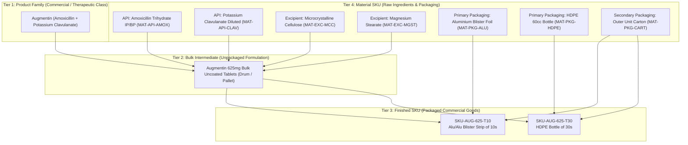
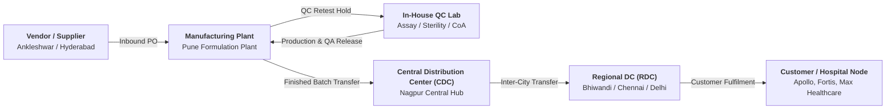
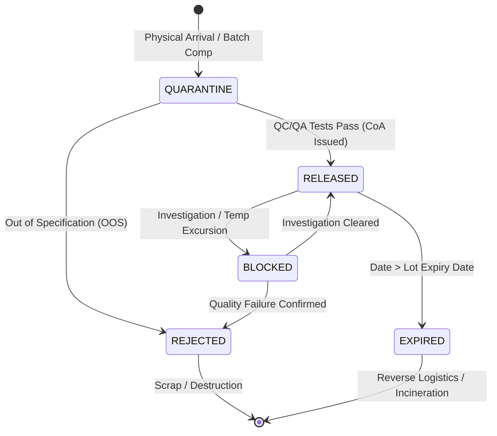
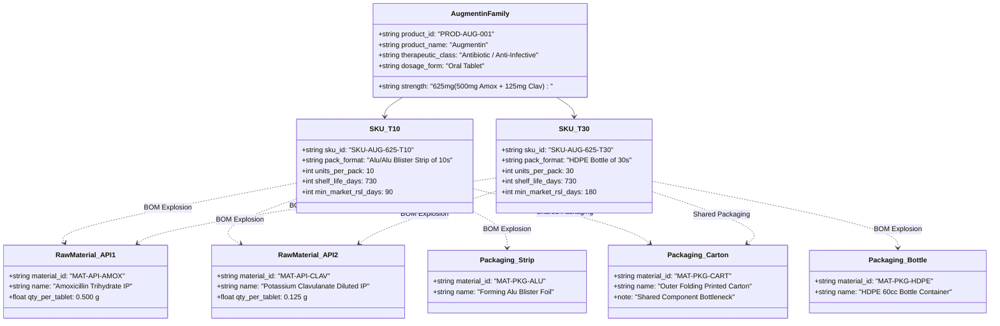

# Pharmaceutical Supply Chain Domain Glossary & Operating Principles
## Technical Standard & Mathematical Definitions (Day 03 Deliverable)

**Project:** AI-Powered Pharmaceutical Supply Chain Control Tower Agent  
**Document Version:** 1.0.0  
**Effective Date:** 29 October 2026  
**Audience:** Supply Chain Planners, AI Engineers, Enterprise Leadership (Director & Group Manager)  
**Governance Track:** Phase 1: Foundation & Data Architecture (Gate 1 Foundation)  

---

## 1. Executive Summary & Purpose

In pharmaceutical supply chains, imprecise terminology leads directly to catastrophic operational failures. For example, confusing **Physical Inventory** with **Eligible Inventory** can cause an Enterprise Resource Planning (ERP) system to promise unreleased or near-expiry batches to hospital tenders, resulting in regulatory recalls, contractual penalties, and critical drug shortages. Similarly, confusing **Supplier Lead Time** with **Cumulative Replacement Lead Time** leads to production line starvation when planners fail to account for mandatory quality testing holds.

This document establishes the **immutable operating definitions, entity hierarchies, temporal taxonomy, and mathematical rules** governing the Control Tower Agent. Every calculation in `src/engine/`, every Pydantic schema in `src/models/`, and every prompt in `src/agent/` must adhere strictly to these principles.

---

## 2. Strict Entity Separation Hierarchy

To eliminate ambiguity across procurement, manufacturing, and distribution, the data model strictly separates physical and commercial items into four discrete tiers:

### 2.1 Entity Taxonomy Definitions

| Tier | Entity Name | Database Table | Definition & Operational Scope | Example |
| :--- | :--- | :--- | :--- | :--- |
| **Tier 1** | **Product Family** | `dim_product` | High-level commercial brand or therapeutic grouping representing a single molecular combination and clinical indication. Has no physical stock. | `PROD-AUG-001` (Augmentin 625mg) |
| **Tier 2** | **Bulk Intermediate** | *Internal Routing* | The unpackaged, formulated chemical product produced after granulating, blending, and compressing raw materials. Measured in mass (kg) or thousands of units. | Augmentin 625mg compressed core tablets |
| **Tier 3** | **Finished SKU** | `dim_finished_sku` | The final packaged product ready for commercial sale or clinical distribution. Possesses a specific unit-of-measure, primary/secondary packaging format, barcode (GTIN), and regulatory license. | `SKU-AUG-625-T10` (Strip 10s) `SKU-AUG-625-T30` (Bottle 30s) |
| **Tier 4** | **Material SKU** | `dim_material` | Raw chemical ingredients, excipients, and primary/secondary packaging materials procured from external suppliers. | `MAT-API-AMOX` (Amoxicillin Trihydrate) `MAT-PKG-CART` (Outer Folding Carton) |

### 2.2 Material Classification

1. **Active Pharmaceutical Ingredient (API):** The biologically active chemical compound responsible for pharmacological effect. Characterized by high cost, strict vendor pre-qualification, and mandatory inbound QC assay retesting.
2. **Excipients:** Inactive chemical carriers, binders, disintegrants, and lubricants (e.g., Microcrystalline Cellulose, Magnesium Stearate) required for tablet formulation and drug stability.
3. **Primary Packaging:** Packaging materials in direct physical contact with the chemical formulation (e.g., Alu/Alu blister foils, pharmaceutical-grade HDPE bottles, child-resistant caps). Must comply with pharmacopeial barrier and moisture standards.
4. **Secondary Packaging:** Outer packaging protecting primary packs during transport and display (e.g., cardboard outer cartons, patient package inserts, corrugated shipping shippers). **Key Operational Bottleneck:** As demonstrated in Scenario C, a shortage of outer folding cartons halts production just as severely as an API shortage.

---

## 3. Multi-Echelon Network Node Taxonomy

The physical network consists of five distinct facility types modeled in `dim_location`:

1. **Supplier Facility (`SUP`):** External vendor manufacturing facilities located in chemical manufacturing belts (e.g., Ankleshwar, Gujarat or Hyderabad, Telangana).
2. **Formulation Manufacturing Plant (`PLANT`):** Manufacturing site housing primary formulation suites (granulation, compression) and secondary packaging lines.
3. **Quality Control Laboratory (`QC_LAB`):** Dedicated analytical testing facilities conducting chemical assays, microbiological sterility tests, and Certificate of Analysis (CoA) verifications.
4. **Central Distribution Center (`CDC`):** Central logistics hub (e.g., Nagpur, Maharashtra) receiving finished goods from plants and consolidating inventory for national redistribution.
5. **Regional Distribution Center (`RDC`):** Regional warehousing facilities situated near major metropolitan demand centers (e.g., Bhiwandi for Western India, Chennai for Southern India, Delhi-NCR for Northern India).
6. **Customer / Destination Account (`CUST`):** Institutional hospital networks, government tender authorities, and regional pharmacy distributors placing weekly replenishment orders.

---

## 4. Temporal Taxonomy & Lead Time Formulations

In supply chain mathematics, treating lead time as a single static number creates chronic replenishment errors. The Control Tower decomposes end-to-end duration into five measurable, auditable temporal segments:

$$\begin{array}{rcccl}
\text{PO Issue} & \xrightarrow{\quad L_{\text{supplier}} \quad} & \text{Dock Arrival} & \xrightarrow{\quad L_{\text{qc\_inbound}} \quad} & \text{Material Release} \\
& & & \xrightarrow{\quad T_{\text{mfg}} \quad} & \text{Batch Packaged} \\
& & & \xrightarrow{\quad L_{\text{qa\_release}} \quad} & \text{Finished Goods Release} \\
& & & \xrightarrow{\quad L_{\text{transit}} \quad} & \text{DC Receipt}
\end{array}$$

### 4.1 Lead Time Taxonomy

1. **Supplier Procurement Lead Time ($L_{\text{supplier}}$):**
   * *Definition:* Elapsed calendar days from Purchase Order transmission (`po_issue_date`) to physical arrival at plant receiving dock (`promised_delivery_date` / `actual_delivery_date`).
   * *Mathematical Representation:*
     $$L_{\text{supplier}} = t_{\text{dock\_arrival}} - t_{\text{po\_issue}}$$
2. **Inbound QC Retest & Quarantine Hold Time ($L_{\text{qc\_inbound}}$):**
   * *Definition:* Elapsed days for physical sampling, chemical assay testing, moisture analysis, and Certificate of Analysis approval before raw material can be issued to production.
   * *Mandatory Constraint:* Material inventory remains in `QUARANTINE` status during this entire period. Production cannot consume material until:
     $$t_{\text{material\_available}} = t_{\text{dock\_arrival}} + L_{\text{qc\_inbound}}$$
3. **Manufacturing Run Cycle Time ($T_{\text{mfg}}$):**
   * *Definition:* Total duration required to formulate, compress, and package a production batch.
   * *Formula:*
     $$T_{\text{mfg}} = T_{\text{setup}} + \frac{Q_{\text{batch}}}{\text{Line\_Speed}} + T_{\text{clean\_down}}$$
     where $Q_{\text{batch}}$ is batch quantity and Line Speed is expressed in units per hour.
4. **Finished Goods QA Release Lead Time ($L_{\text{qa\_release}}$):**
   * *Definition:* Mandatory quarantine testing period post-packaging for bulk dissolution, content uniformity, sterility, and Qualified Person (QP) release signature.
   * *Mandatory Constraint:* Finished product cannot be dispatched to distribution centers while under QA hold.
     $$t_{\text{fg\_release}} = t_{\text{mfg\_complete}} + L_{\text{qa\_release}}$$
5. **Logistics In-Transit Lead Time ($L_{\text{transit}}$):**
   * *Definition:* Calendar transit days between dispatch from manufacturing plant dock and verified physical receipt at destination warehouse dock.
   * *Formula:*
     $$t_{\text{dc\_receipt}} = t_{\text{plant\_dispatch}} + L_{\text{transit}}$$
6. **Cumulative End-to-End Replacement Lead Time ($L_{\text{cumulative}}$):**
   * *Definition:* Total elapsed time required to replenish a stockout at a distribution center starting from an initial raw material purchase order:
     $$L_{\text{cumulative}} = L_{\text{supplier}} + L_{\text{qc\_inbound}} + T_{\text{mfg}} + L_{\text{qa\_release}} + L_{\text{transit}}$$

---

## 5. Inventory Taxonomy & State Machine

Inventory is tracked at the **Lot / Batch level** in `fact_inventory_lot`. Each lot transitions through a strict quality state machine:

### 5.1 Quality Status Taxonomy

* `QUARANTINE`: Physical stock present on-site undergoing laboratory sampling or batch record review. **Ineligible for production consumption or customer dispatch.**
* `RELEASED`: Formally verified and signed off by Quality Assurance. Eligible for allocation subject to shelf-life rules.
* `BLOCKED`: Temporarily frozen pending investigation (e.g., cold-chain temperature excursion alarm, packaging defect inquiry).
* `REJECTED`: Fails pharmacopeial specifications. Quarantined for destruction; zero economic or operational availability.
* `EXPIRED`: Calendar date has surpassed lot expiration date. Immediate regulatory lock; must be scrapped.

---

## 6. Mathematical Formulation for FEFO Eligibility

In pharmaceutical distribution, **FIFO (First-In, First-Out) is legally and commercially prohibited**. Supply chains must operate strictly under **FEFO (First-Expired, First-Out)** with **Minimum Acceptable Remaining Shelf Life (MARSL)** filters.

### 6.1 Mathematical Formulation of Lot Eligibility

Let:
* $l$ denote an individual inventory lot $\in \mathcal{L}$.
* $m$ denote a destination customer market $\in \mathcal{M}$.
* $t$ denote the current calendar planning date.
* $Q_{\text{phys}}(l, t)$ denote the physical on-hand quantity of lot $l$ at time $t$.
* $\text{Status}(l, t)$ denote the current quality status of lot $l$ at time $t$.
* $\text{ExpiryDate}(l)$ denote the formal regulatory expiry date stamped on lot $l$.
* $\text{MARSL}(m)$ denote the Minimum Acceptable Remaining Shelf Life (in days) required by market $m$.

#### Definition: Remaining Shelf Life (RSL)
$$\text{RSL}(l, t) = \text{ExpiryDate}(l) - t \quad (\text{in days})$$

#### Definition: Binary Eligibility Indicator Function
The binary indicator function $E(l, m, t) \in \{0, 1\}$ evaluates whether lot $l$ is legally and commercially eligible to satisfy demand in market $m$ at time $t$:

$$E(l, m, t) = \mathbb{I}\Big(\text{Status}(l, t) = \text{'RELEASED'}\Big) \cdot \mathbb{I}\Big(\text{RSL}(l, t) \ge \text{MARSL}(m)\Big) \cdot \mathbb{I}\Big(Q_{\text{phys}}(l, t) > 0\Big)$$

Where:
$$\mathbb{I}(\text{Condition}) = \begin{cases} 1 & \text{if Condition is True} \\ 0 & \text{if Condition is False} \end{cases}$$

#### Definition: Eligible Available Stock ($Q_{\text{elig}}$)
For a finished SKU $s$ across all lots in warehouse location $k$ serving market $m$:

$$Q_{\text{elig}}(s, k, m, t) = \sum_{l \in \mathcal{L}(s, k)} Q_{\text{phys}}(l, t) \cdot E(l, m, t)$$

> **Operational Insight:** Physical stock on-hand $Q_{\text{phys}}$ will frequently be greater than eligible stock $Q_{\text{elig}}$. If a warehouse has 10,000 units on-hand, but 4,000 units are under QA hold and 2,000 units have only 60 days remaining shelf life against a 90-day hospital rule, $Q_{\text{elig}} = 4,000$ units. **The Control Tower projects inventory solely on $Q_{\text{elig}}$.**

### 6.2 FEFO Priority Allocation Algorithm

When allocating stock to customer orders or market demand:
1. Filter candidate lots to those where $E(l, m, t) = 1$.
2. Sort eligible lots in **ascending order of Expiration Date**:
   $$\text{Lot Priority Order} = \text{Sort}\Big(\{l \mid E(l, m, t) = 1\}, \text{key} = \text{ExpiryDate}(l) \text{ ASC}, \text{tie\_breaker} = \text{lot\_id} \text{ ASC}\Big)$$
3. Deplete stock sequentially from the earliest expiring lot until order quantity is fulfilled.

### 6.3 Expiry Exposure Risk Metric ($R_{\text{expiry}}$)
If a lot $l$ is released but its remaining shelf life is diminishing faster than demand can consume it before falling below $\text{MARSL}(m)$, the lot enters **Expiry Exposure Risk**:

$$\text{Days To Ineligibility}(l, m, t) = \text{RSL}(l, t) - \text{MARSL}(m)$$

If $\text{Days To Ineligibility}(l, m, t) \le 30$ and projected local consumption $< Q_{\text{phys}}(l, t)$, the Control Tower automatically raises an **Expiry Exposure Alert** (Scenario D).

---

## 7. Multi-Echelon Stock Balance & Conservation Equations

To ensure mathematical integrity across the network, inventory balance must obey strict physical conservation. No inventory can appear or disappear without an audited transaction.

### 7.1 Forward Inventory Balance Equation

For any SKU $s$, at facility $k$, across discrete weekly time buckets $t \in \{1, 2, \dots, T\}$:

$$I_{s, k, t} = I_{s, k, t-1} + R_{s, k, t} + P_{s, k, t} + T^{\text{in}}_{s, k, t} - D_{s, k, t} - T^{\text{out}}_{s, k, t} - X_{s, k, t}$$

Where:
* $I_{s, k, t}$: Projected closing eligible inventory balance at end of week $t$.
* $I_{s, k, t-1}$: Opening inventory balance of week $t$ (closing balance of week $t-1$).
* $R_{s, k, t}$: Confirmed incoming supplier receipts reaching `RELEASED` status in week $t$.
* $P_{s, k, t}$: Completed manufacturing production batches receiving QA release in week $t$.
* $T^{\text{in}}_{s, k, t}$: Inter-facility transfers arriving and received at location $k$ in week $t$.
* $D_{s, k, t}$: Customer / market demand dispatched from location $k$ in week $t$.
* $T^{\text{out}}_{s, k, t}$: Inter-facility transfer dispatches departing location $k$ in week $t$.
* $X_{s, k, t}$: Expired, damaged, or quality-rejected stock scrapped in week $t$.

### 7.2 Safety Stock Breach & Stockout Metrics

Let $\text{SS}_{s, k}$ denote the planned safety stock policy threshold:
* **Safety Stock Breach:**
  $$\text{Breach}(s, k, t) = \max\Big(0, \ \text{SS}_{s, k} - I_{s, k, t}\Big) \quad \text{when } I_{s, k, t} > 0$$
* **Projected Stockout (Unmet Demand):**
  $$\text{Stockout}(s, k, t) = \max\Big(0, \ -I_{s, k, t}\Big) \quad \text{when } I_{s, k, t} < 0$$
* **Weeks of Supply (WoS):**
  $$\text{WoS}_{s, k, t} = \frac{I_{s, k, t}}{\overline{D}_{s, k, \text{forward\_4w}}}$$

---

## 8. Phase 1 Representative Demo Slice (Augmentin 625mg Family)

To validate all mathematical equations and business logic, Phase 1 implements a complete, self-contained single-product vertical slice:

### 8.1 Bill of Materials (BOM) per 1,000 Finished Units

| Finished SKU | Required Component Material | Material Type | Quantity Required | Scrap Factor |
| :--- | :--- | :--- | :--- | :--- |
| **`SKU-AUG-625-T10`** | `MAT-API-AMOX` (Amoxicillin API) | Active Ingredient | 5.00 kg | +2.0% (0.10 kg) |
| **`SKU-AUG-625-T10`** | `MAT-API-CLAV` (Clavulanate API) | Active Ingredient | 1.25 kg | +3.5% (0.04 kg) |
| **`SKU-AUG-625-T10`** | `MAT-EXC-MCC` (Microcrystalline Cellulose) | Excipient Binder | 1.80 kg | +1.0% (0.02 kg) |
| **`SKU-AUG-625-T10`** | `MAT-PKG-ALU` (Alu Blister Foil) | Primary Packaging | 100 strips | +1.5% (1.5 strips)|
| **`SKU-AUG-625-T10`** | `MAT-PKG-CART` (Outer Carton) | Secondary Packaging | 100 cartons | +2.0% (2 cartons) |
| **`SKU-AUG-625-T30`** | `MAT-API-AMOX` (Amoxicillin API) | Active Ingredient | 15.00 kg | +2.0% (0.30 kg) |
| **`SKU-AUG-625-T30`** | `MAT-API-CLAV` (Clavulanate API) | Active Ingredient | 3.75 kg | +3.5% (0.13 kg) |
| **`SKU-AUG-625-T30`** | `MAT-EXC-MCC` (Microcrystalline Cellulose) | Excipient Binder | 5.40 kg | +1.0% (0.05 kg) |
| **`SKU-AUG-625-T30`** | `MAT-PKG-HDPE` (HDPE Bottle 60cc) | Primary Packaging | 33.3 bottles | +1.0% (0.3 bottle)|
| **`SKU-AUG-625-T30`** | `MAT-PKG-CART` (Outer Carton) | Secondary Packaging | 33.3 cartons | +2.0% (0.7 carton)|

---

## 9. Compliance & Quality Verification Checklist

* [x] **Entity Integrity:** Product Family, Finished SKU, and Material SKU are strictly separated with foreign key constraints.
* [x] **Quality Gate Rules:** Only lots with `status = 'RELEASED'` qualify for eligible inventory.
* [x] **FEFO Prioritization:** Allocation algorithms strictly order eligible lots ascending by `expiry_date`.
* [x] **Shelf-Life Safeguard:** Any lot with $\text{RSL} < \text{MARSL}(m)$ is disqualified from fulfilling demand in market $m$.
* [x] **Conservation Law:** Stock balances balance exactly ($I_t = I_{t-1} + R_t + P_t - D_t - X_t$) with zero unexplained drift.
* [x] **Disruption Grounding:** Scenarios A, B, C, D, and E directly map to specific breakdowns in this glossary's rules.

---
*Signed and Approved for Implementation:*  
**Day 03 Milestone Sign-Off — Phase 1: Foundation & Data Architecture**

