```mermaid
erDiagram
    %% =========================================================
    %% LAYER 1: MASTER DATA ENTITIES (8 Tables)
    %% =========================================================
    DIM_PRODUCT ||--o{ DIM_FINISHED_SKU : "has_presentations"
    DIM_PRODUCT {
        string product_id PK
        string product_name
        string product_family
        string therapy_area
        boolean critical_medicine_flag
        boolean synthetic_data_flag
    }

    DIM_FINISHED_SKU ||--o{ BRIDGE_BILL_OF_MATERIAL : "consumes_components"
    DIM_FINISHED_SKU ||--o{ BRIDGE_SKU_MARKET : "authorized_in"
    DIM_FINISHED_SKU ||--o{ FACT_DEMAND_HISTORY : "historical_demand"
    DIM_FINISHED_SKU ||--o{ FACT_DEMAND_FORECAST : "forecasted_demand"
    DIM_FINISHED_SKU ||--o{ FACT_CUSTOMER_ORDER : "ordered_in"
    DIM_FINISHED_SKU ||--o{ FACT_SUPPLY_PLAN : "planned_replenishment"
    DIM_FINISHED_SKU ||--o{ FACT_PRODUCTION_ORDER : "manufactured_via"
    DIM_FINISHED_SKU ||--o{ FACT_BATCH : "packaged_into"
    DIM_FINISHED_SKU ||--o{ FACT_SHIPMENT : "transported_as"
    DIM_FINISHED_SKU {
        string finished_sku_id PK
        string product_id FK
        string sku_description
        string dosage_form
        string strength
        string pack_configuration
        int shelf_life_days
        string storage_condition
        date launch_date
        string status
        boolean synthetic_data_flag
    }

    DIM_MATERIAL ||--o{ BRIDGE_BILL_OF_MATERIAL : "component_in_bom"
    DIM_MATERIAL ||--o{ BRIDGE_SUPPLIER_MATERIAL : "supplied_via"
    DIM_MATERIAL ||--o{ FACT_PURCHASE_ORDER : "ordered_via_po"
    DIM_MATERIAL ||--o{ FACT_MATERIAL_REQUIREMENT : "netted_requirement"
    DIM_MATERIAL ||--o{ FACT_MATERIAL_CONSUMPTION : "charged_in_batch"
    DIM_MATERIAL {
        string material_sku_id PK
        string material_name
        string material_type
        string unit_of_measure
        int shelf_life_days
        int retest_interval_days
        int release_time_days
        boolean critical_material_flag
        string storage_condition
        boolean synthetic_data_flag
    }

    DIM_SUPPLIER ||--o{ BRIDGE_SUPPLIER_MATERIAL : "qualified_for"
    DIM_SUPPLIER ||--o{ FACT_PURCHASE_ORDER : "fulfils_po"
    DIM_SUPPLIER {
        string supplier_id PK
        string supplier_name
        string supplier_type
        int default_lead_time_days
        float minimum_order_quantity
        float order_multiple
        float otif_target
        string risk_tier
        boolean single_source_dependency_flag
        boolean synthetic_data_flag
    }

    DIM_LOCATION ||--o{ DIM_PRODUCTION_LINE : "houses_lines"
    DIM_LOCATION ||--o{ FACT_INVENTORY_LOT : "stores_physical_stock"
    DIM_LOCATION ||--o{ FACT_CAPACITY : "reports_line_hours"
    DIM_LOCATION ||--o{ FACT_SUPPLY_PLAN : "destination_node"
    DIM_LOCATION ||--o{ FACT_INVENTORY_PROJECTION : "projected_balance_node"
    DIM_LOCATION ||--o{ BRIDGE_LOCATION_ROUTE : "origin_or_destination"
    DIM_LOCATION {
        string location_id PK
        string location_name
        string location_type
        string city
        string state
        string country
        float capacity
        boolean cold_chain_capable
        boolean synthetic_entity_flag
    }

    DIM_PRODUCTION_LINE ||--o{ FACT_PRODUCTION_ORDER : "executes_work_order"
    DIM_PRODUCTION_LINE ||--o{ FACT_CAPACITY : "period_line_hours"
    DIM_PRODUCTION_LINE {
        string production_line_id PK
        string location_id FK
        string line_name
        string capacity_unit
        float standard_rate
        string supported_product_group
        string maintenance_constraints
    }

    DIM_MARKET ||--o{ BRIDGE_SKU_MARKET : "commercial_zone"
    DIM_MARKET ||--o{ DIM_CUSTOMER : "serves_customers"
    DIM_MARKET ||--o{ FACT_DEMAND_HISTORY : "records_market_demand"
    DIM_MARKET ||--o{ FACT_DEMAND_FORECAST : "forecast_zone"
    DIM_MARKET ||--o{ FACT_CUSTOMER_ORDER : "destination_market"
    DIM_MARKET {
        string market_id PK
        string market_name
        string city
        string state
        string region
        boolean synthetic_data_flag
    }

    DIM_CUSTOMER ||--o{ FACT_CUSTOMER_ORDER : "places_order"
    DIM_CUSTOMER {
        string customer_id PK
        string customer_name
        string market_id FK
        string customer_type
        string service_priority
        boolean synthetic_data_flag
    }

    %% =========================================================
    %% LAYER 2: RELATIONAL NETWORK BRIDGES (4 Tables)
    %% =========================================================
    BRIDGE_BILL_OF_MATERIAL {
        string bom_id PK
        string finished_sku_id FK
        string material_sku_id FK
        float quantity_per_finished_unit
        float scrap_factor_pct
        date effective_start_date
        date effective_end_date
        string bom_version
        boolean synthetic_data_flag
    }

    BRIDGE_SUPPLIER_MATERIAL {
        string supplier_id FK
        string material_sku_id FK
        int supplier_lead_time_days
        float minimum_order_quantity
        float order_multiple
        boolean approved_supplier_flag
        int supplier_priority
        date effective_start_date
        date effective_end_date
    }

    BRIDGE_SKU_MARKET {
        string finished_sku_id FK
        string market_id FK
        int market_priority
        float service_level_target
        int min_acceptable_rsl_days
        date effective_start_date
        date effective_end_date
    }

    BRIDGE_LOCATION_ROUTE {
        string route_id PK
        string origin_location_id FK
        string destination_location_id FK
        string transport_mode
        int standard_transit_days
        float transport_cost_per_unit
        boolean cold_chain_required_flag
        string route_status
    }

    %% =========================================================
    %% LAYER 3: TRANSACTIONAL & PLANNING FACTS (9 Tables)
    %% =========================================================
    FACT_DEMAND_HISTORY {
        date week_start_date PK
        string finished_sku_id PK, FK
        string market_id PK, FK
        string scenario_id PK, FK
        float demand_quantity
        float fulfilled_quantity
        float lost_sales_quantity
        string event_type
        boolean synthetic_data_flag
    }

    FACT_CUSTOMER_ORDER {
        string customer_order_id PK
        string customer_id FK
        string market_id FK
        string finished_sku_id FK
        date order_date
        date requested_delivery_date
        date promised_delivery_date
        float ordered_quantity
        float fulfilled_quantity
        float outstanding_quantity
        string order_status
    }

    FACT_DEMAND_FORECAST {
        string forecast_id PK
        date forecast_version_date
        date target_week
        string finished_sku_id FK
        string market_id FK
        float forecast_quantity
        float lower_bound
        float upper_bound
        float override_quantity
        string model_version
        string scenario_id FK
    }

    FACT_SUPPLY_PLAN {
        string supply_plan_id PK
        string finished_sku_id FK
        string location_id FK
        date planned_week
        float planned_quantity
        string source_type
        string source_order_id
        date expected_availability_date
        string scenario_id FK
        string plan_status
    }

    FACT_MATERIAL_REQUIREMENT {
        string requirement_id PK
        string production_order_id FK
        string material_sku_id FK
        float required_quantity
        date required_date
        float eligible_available_quantity
        float expected_receipt_quantity
        float shortage_quantity
        string scenario_id FK
    }

    FACT_INVENTORY_PROJECTION {
        string projection_id PK
        string item_type
        string item_id
        string location_id FK
        date week_start_date
        float opening_inventory
        float planned_receipts
        float planned_production
        float forecast_demand
        float projected_ending_inventory
        float safety_stock
        float projected_shortage
        string scenario_id FK
    }

    FACT_PURCHASE_ORDER {
        string purchase_order_id PK
        string supplier_id FK
        string material_sku_id FK
        date order_date
        date requested_delivery_date
        date confirmed_delivery_date
        date actual_receipt_date
        float ordered_quantity
        float received_quantity
        string purchase_order_status
        string delay_reason
        string quality_status
    }

    FACT_INVENTORY_LOT {
        string lot_id PK
        string item_type
        string item_id
        string location_id FK
        string batch_id FK
        date manufacture_date
        date expiry_date
        date retest_date
        float quantity_on_hand
        float reserved_quantity
        float blocked_quantity
        string quality_status
        date receipt_date
        date release_date
        string recall_status
        boolean synthetic_data_flag
    }

    FACT_MATERIAL_CONSUMPTION {
        string consumption_id PK
        string production_order_id FK
        string material_sku_id FK
        string lot_id FK
        float planned_quantity
        float actual_quantity
        date consumption_date
        float variance_quantity
    }

    %% =========================================================
    %% LAYER 4: MANUFACTURING & QUALITY (3 Tables)
    %% =========================================================
    FACT_PRODUCTION_ORDER ||--o{ FACT_BATCH : "produces_batches"
    FACT_PRODUCTION_ORDER ||--o{ FACT_MATERIAL_REQUIREMENT : "triggers_mrp"
    FACT_PRODUCTION_ORDER ||--o{ FACT_MATERIAL_CONSUMPTION : "consumes_materials"
    FACT_PRODUCTION_ORDER {
        string production_order_id PK
        string finished_sku_id FK
        string location_id FK
        string production_line_id FK
        date planned_start_date
        date planned_completion_date
        date actual_start_date
        date actual_completion_date
        float planned_quantity
        float actual_quantity
        float expected_yield
        float actual_yield
        float planned_hours
        float actual_hours
        string production_status
        string delay_reason
    }

    FACT_BATCH ||--o{ FACT_INVENTORY_LOT : "originates_lots"
    FACT_BATCH {
        string batch_id PK
        string production_order_id FK
        string finished_sku_id FK
        string location_id FK
        date manufacture_date
        date quality_submission_date
        date expected_release_date
        date actual_release_date
        float batch_quantity
        string batch_status
        string rejection_reason
    }

    FACT_QUALITY_EVENT {
        string quality_event_id PK
        string entity_type
        string entity_id
        string event_type
        date event_date
        date expected_resolution_date
        date actual_resolution_date
        string quality_status
        int delay_days
        string reason_code
    }

    %% =========================================================
    %% LAYER 5: CAPACITY & LOGISTICS (2 Tables)
    %% =========================================================
    FACT_CAPACITY {
        string capacity_record_id PK
        string location_id FK
        string production_line_id FK
        date period_start_date
        float net_available_hours
        float maintenance_hours
        float downtime_hours
        float committed_hours
        string scenario_id FK
    }

    FACT_SHIPMENT {
        string shipment_id PK
        string origin_location_id FK
        string destination_location_id FK
        string finished_sku_id FK
        string lot_id FK
        date dispatch_date
        date expected_arrival_date
        date actual_arrival_date
        float shipped_quantity
        float received_quantity
        string transport_mode
        string shipment_status
        string delay_reason
        boolean temperature_excursion_flag
    }

    %% =========================================================
    %% LAYER 6: SCENARIOS, RISK & DECISION SUPPORT (7 Tables)
    %% =========================================================
    DIM_SCENARIO ||--o{ FACT_RISK_EVENT : "evaluates_risks"
    DIM_SCENARIO ||--o{ FACT_DEMAND_HISTORY : "scenario_variant"
    DIM_SCENARIO ||--o{ FACT_DEMAND_FORECAST : "scenario_forecast"
    DIM_SCENARIO ||--o{ FACT_SUPPLY_PLAN : "scenario_plan"
    DIM_SCENARIO ||--o{ FACT_INVENTORY_PROJECTION : "scenario_projection"
    DIM_SCENARIO ||--o{ FACT_CAPACITY : "scenario_capacity"
    DIM_SCENARIO {
        string scenario_id PK
        string scenario_name
        string scenario_type
        string scenario_description
        string assumptions
        boolean baseline_flag
        boolean synthetic_data_flag
    }

    FACT_RISK_EVENT ||--o{ BRIDGE_RISK_EVIDENCE : "grounded_by"
    FACT_RISK_EVENT ||--o{ FACT_ROOT_CAUSE : "analyzed_by"
    FACT_RISK_EVENT ||--o{ FACT_MITIGATION_SIMULATION : "simulates_mitigation"
    FACT_RISK_EVENT ||--o{ FACT_RECOMMENDATION : "recommends_action"
    FACT_RISK_EVENT {
        string risk_id PK
        string risk_type
        string entity_type
        string entity_id
        string location_id FK
        date detection_date
        date impact_date
        string severity
        float risk_score
        float shortage_quantity
        int days_to_impact
        string risk_status
        string scenario_id FK
    }

    BRIDGE_RISK_EVIDENCE {
        string risk_id FK
        string evidence_type
        string evidence_record_id
        string evidence_role
        string evidence_description
    }

    FACT_ROOT_CAUSE {
        string root_cause_id PK
        string risk_id FK
        string root_cause_category
        string root_cause_description
        string contributing_factor
        string causal_sequence
        boolean evidence_complete_flag
        string confidence_or_uncertainty_note
    }

    FACT_MITIGATION_SIMULATION ||--o{ FACT_RECOMMENDATION : "formulates_recommendation"
    FACT_MITIGATION_SIMULATION {
        string simulation_id PK
        string risk_id FK
        string scenario_id FK
        string action_type
        string action_parameters
        string baseline_outcome
        string simulated_outcome
        float risk_reduction
        float estimated_cost
        string feasibility_status
        string remaining_constraints
    }

    FACT_RECOMMENDATION {
        string recommendation_id PK
        string risk_id FK
        string simulation_id FK
        string recommended_action
        float recommended_quantity
        string expected_benefit
        float estimated_cost
        string feasibility_status
        string evidence_reference
        boolean human_approval_required
        string approval_status
        date created_date
    }

    DATASET_MANIFEST {
        string dataset_version PK
        datetime generation_timestamp
        int random_seed
        json record_counts
        json date_range
        json scenario_coverage
        string validation_status
        boolean synthetic_data_flag
    }
```

# Relational Entity-Relationship Diagram (ERD)
## AI-Powered Pharmaceutical Supply Chain Control Tower
### Master 33-Entity Relational Architecture (Week 02, Day 09 Publication)

This document visualizes the complete relational data architecture connecting all **33 entities across the 8-stage pharmaceutical supply chain lifecycle**.

---

---

## 2. Relational Architecture Cardinalities & Integrity Rules

1. **Master to Transactional Facts:**
   * `DIM_FINISHED_SKU` to `FACT_CUSTOMER_ORDER`: $1 : N$ (One SKU appears on many customer sales order lines).
   * `DIM_SUPPLIER` to `FACT_PURCHASE_ORDER`: $1 : N$ (One vendor receives many material purchase order lines).
   * `DIM_LOCATION` to `FACT_INVENTORY_LOT`: $1 : N$ (One physical site stores multiple inventory lots).
2. **Formulation & MRP Bridges:**
   * `DIM_FINISHED_SKU` $\longleftrightarrow$ `DIM_MATERIAL`: $M : N$ resolved through `BRIDGE_BILL_OF_MATERIAL` with process scrap factors ($1.0\% - 3.5\%$).
   * `DIM_SUPPLIER` $\longleftrightarrow$ `DIM_MATERIAL`: $M : N$ resolved through `BRIDGE_SUPPLIER_MATERIAL` with vendor qualification flags and lead times.
3. **Traceable Quality & Batch Genealogy:**
   * `FACT_PRODUCTION_ORDER` to `FACT_BATCH`: $1 : N$ (A work order produces one or more physical chemical batches).
   * `FACT_BATCH` to `FACT_INVENTORY_LOT`: $1 : N$ (A finished released batch is packaged into pallet lots).
4. **Anti-Hallucination Risk-Evidence Bridge:**
   * `FACT_RISK_EVENT` $\longleftrightarrow$ Operational Facts (`FACT_PURCHASE_ORDER`, `FACT_BATCH`, `FACT_CAPACITY`): Connected via `BRIDGE_RISK_EVIDENCE`. Guarantees that every alert explicitly cites verified record IDs.
5. **Decision Support & Human Approval:**
   * `FACT_MITIGATION_SIMULATION` to `FACT_RECOMMENDATION`: $1 : 1$ or $1 : N$. Every recommendation enforces `human_approval_required = True`.
