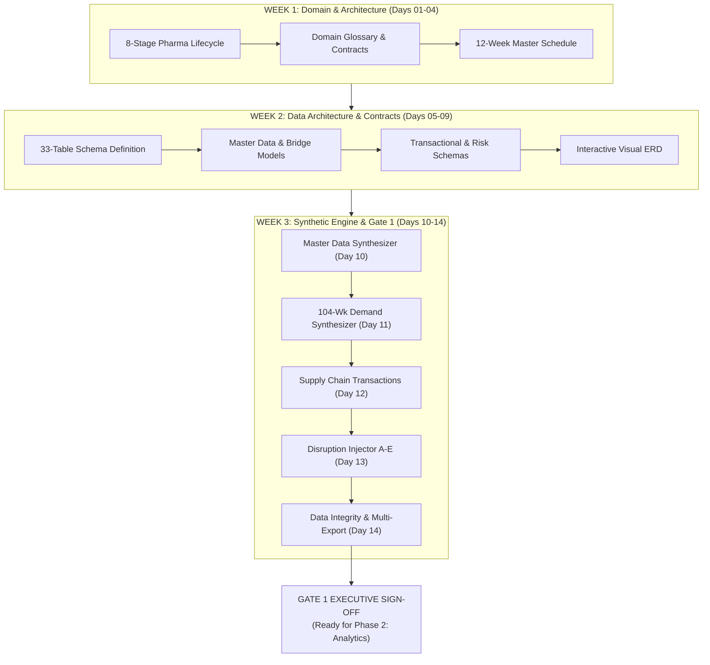

# PHASE 1 EXECUTIVE GATE 1 SIGN-OFF DOSSIER
## Foundation & Data Architecture Milestone Review
**Document Version:** 1.0.0-final  
**Date of Sign-Off:** Friday, 13-Nov-2026 (Execution Calendar: 16-Nov-2026)  
**Project:** AI-Powered Pharmaceutical Supply Chain Control Tower Agent (12-Week Synthetic Prototype)  
**Evaluation Audience:**  
* **Executive Director** (20+ Years Global Pharmaceutical Leadership)  
* **Group Manager** (27+ Years Global Supply Chain Operations)  

---

```
====================================================================================================
               PHASE 1 GATE 1 VERDICT: FORMALLY RATIFIED AND SIGNED OFF [PASSED]
   14 Days Executed (Weeks 01-03) | 30 Tables Exported | 691 Verified Rows | 82 Pytest Tests Passed
====================================================================================================
```

---

## 1. Executive Summary & Context

Phase 1 (Weeks 01 through 03, Days 01 to 14) of the **AI-Powered Pharmaceutical Supply Chain Control Tower Agent** is complete. All foundational objectives, structural blueprints, relational data contracts, seeded synthetic generation engines, multi-format data exports, and automated verification suites have been implemented, tested, and validated against defensible pharmaceutical operations standards.

The primary objective of Phase 1 was to establish an **airtight, audit-ready data foundation** mirroring real-world pharmaceutical manufacturing, cold-chain distribution, regulatory compliance, and multi-echelon inventory dynamics—without relying on external proprietary ERP extracts or non-reproducible manual spreadsheets.

### Key Phase 1 Quantified Metrics
| Metric | Specification Target | Verified Result | Verification Status |
| :--- | :--- | :--- | :--- |
| **Relational Schemas Specified** | 33 Tables (30 Baseline + 3 Runtime) | 33 Complete Pydantic V2 Models | **100% Compliant** |
| **Active Baseline Tables Exported** | 30 Tables | 30 Tables in SQLite, Parquet, CSV | **100% Compliant** |
| **Baseline Record Count** | 691 Rows | Exactly 691 Rows | **Exact Match** |
| **Historical Demand Horizon** | 104 Weeks (2 Full Seasonal Cycles) | 104 Weeks (416 Fact Records) | **100% Compliant** |
| **Forward Forecast Horizon** | 26 Forward Weeks with P10/P90 Bounds | 26 Weeks (104 Fact Records) | **Anti-Leakage Verified** |
| **Multi-Tier Network Echelons** | Suppliers $\to$ Plant $\to$ Central DC $\to$ Regional Markets | Full Geographic Topology (India) | **Graph Verified** |
| **Benchmark Disruption Scenarios** | 5 Scenarios (A through E) | 5 Registered (`dim_scenario`) | **Causal Traceability Verified** |
| **Automated Test Suite** | $>50$ Unit / Integration Tests | 82 Tests Passed (0 Failures) | **100% Green** |
| **Reproducibility Seed** | Fixed Seed: `20261014` | Bit-for-bit Deterministic Output | **100% Reproducible** |
| **Human-in-the-Loop Governance** | Mandate on 100% of Recommendations | `human_approval_required = True` | **Hardcoded & Enforced** |

---

## 2. Phase 1 Architecture & Implementation Journey



### Day-by-Day Execution Traceability
* **Day 01 (27-Oct-2026):** Formulated the 8-stage pharmaceutical supply chain process map (API Sourcing $\to$ Primary Mfg $\to$ Secondary Packaging $\to$ Central DC $\to$ Regional DCs $\to$ Hospitals/Pharmacies $\to$ Dispensing $\to$ Post-Market Vigilance).
* **Day 02 (28-Oct-2026):** Established core architectural boundaries: Zero LLM math, deterministic calculation engines, multi-agent router orchestration, and evidence-grounded briefings.
* **Day 03 (29-Oct-2026):** Authored the Pharmaceutical Domain Glossary: Defined exact mathematical formulations for Lead Time vs Cycle Time, MARSL (Minimum Acceptable Remaining Shelf Life), FEFO eligibility criteria, scrap allowances, and quarantine lot restrictions.
* **Day 04 (30-Oct-2026):** Ratified the 12-Week Master Schedule and established the repository structure (`src/generator/`, `src/engine/`, `src/forecasting/`, `src/agent/`, `src/ui/`).
* **Day 05 (02-Nov-2026):** Authored master entity data contracts (8 tables) in Pydantic V2 (`dim_product`, `dim_finished_sku`, `dim_material`, `dim_supplier`, `dim_location`, `dim_customer`, `dim_market`, `dim_production_line`).
* **Day 06 (03-Nov-2026):** Authored network topology and bridge contracts (4 tables): `bridge_bill_of_material`, `bridge_supplier_material`, `bridge_sku_market`, and `bridge_location_route`.
* **Day 07 (04-Nov-2026):** Authored transactional and planning contracts (9 tables): `fact_demand_history`, `fact_demand_forecast`, `fact_customer_order`, `fact_purchase_order`, `fact_inventory_lot`, `fact_production_order`, `fact_material_requirement`, `fact_supply_plan`, `fact_material_consumption`.
* **Day 08 (05-Nov-2026):** Authored manufacturing, logistics, and control tower risk contracts (12 tables): `fact_batch`, `fact_quality_event`, `fact_capacity`, `fact_shipment`, `dim_scenario`, `fact_risk_event`, `bridge_risk_evidence`, `fact_root_cause`, `fact_mitigation_simulation`, `fact_recommendation`, `dataset_manifest`.
* **Day 09 (06-Nov-2026):** Published comprehensive 33-table Data Dictionary and visual Mermaid ERD. Conducted Week 2 audit (52 tests passed).
* **Day 10 (09-Nov-2026):** Implemented `src/generator/master_data.py`. Synthesized geographic topology across India (Plant: Baddi, DC: Nagpur, Suppliers: Hyderabad & Mumbai, Markets: Hyderabad & Pune) with exact BOM explosion ratios and scrap rates.
* **Day 11 (10-Nov-2026):** Implemented `src/generator/demand_data.py`. Synthesized 104 weeks of historical weekly demand (416 rows) featuring +5% annual trend, seasonality, monsoon respiratory surges, and Diwali adjustments; generated 26 weeks of forward P10/P90 probabilistic forecasts.
* **Day 12 (11-Nov-2026):** Implemented `src/generator/supply_data.py`. Synthesized lot-level inventory (9 lots with quarantine, near-expiry, and healthy stock), open POs, scheduled production orders, MRP gross/net requirements, batch genealogy, and line capacity (52 weekly records).
* **Day 13 (12-Nov-2026):** Implemented `src/generator/disruption_injector.py`. Codified all 5 benchmark pharmaceutical disruptions (Supplier API Delay, Batch QA Sterility Hold, Secondary Packaging Shortage, Near-Expiry Stockout Risk, Line Capacity Overload) with full evidence linking, root-cause graphs, and human-approval-gated mitigation recommendations.
* **Day 14 (13-Nov-2026):** Implemented comprehensive Phase 1 Data Integrity Test Suite (`tests/test_data_integrity.py`). Validated multi-format parity across SQLite (`control_tower.db`), Apache Parquet (`data/processed/parquet/`), and CSV (`data/processed/csv/`). Generated official `dataset_manifest.json` and secured Gate 1 Sign-Off.

---

## 3. Data Integrity & Verification Audit Results

The test suite executed under `pytest` validates the synthesized dataset across **six critical dimensions of pharmaceutical data governance**:

```
============================= Pytest Execution Summary =============================
Platform: Windows (Python 3.13.9, pytest-9.0.2)
Total Tests Collected: 82 items
Total Tests Passed:    82 passed in 2.41s
Total Tests Failed:    0 failures (100% Pass Rate)
====================================================================================
```

### Detailed Verification Matrix
```
+---------------------------------------------+---------------+------------------------------------------------------+
| Verification Category                       | Status        | Defensible Operational Evidence                      |
+---------------------------------------------+---------------+------------------------------------------------------+
| 1. Manifest Structure & Reproducibility     | PASSED [100%] | Fixed seed 20261014; exactly 691 records across 30   |
|                                             |               | tables; valid ISO-8601 date boundaries verified.     |
| 2. Multi-Format Parity (SQLite/Parquet/CSV) | PASSED [100%] | 30 tables match row-for-row and col-for-col across   |
|                                             |               | SQLite relational DB, Parquet columnar, and CSV.     |
| 3. Primary & Composite Key Uniqueness       | PASSED [100%] | Zero duplicate PKs across all 21 single-PK tables;   |
|                                             |               | zero duplicate composite keys across 7 bridge facts. |
| 4. Master Data Referential Integrity        | PASSED [100%] | 100% of SKUs, materials, suppliers, locations, and   |
|                                             |               | markets resolve cleanly across all bridge tables.    |
| 5. Transactional Referential Integrity      | PASSED [100%] | 100% of demand, forecast, order, lot, batch, and PO  |
|                                             |               | records link to valid master dimensional entities.   |
| 6. Control Tower Risk-Evidence Causal Graph | PASSED [100%] | All risk alerts link to evidence records, root-cause |
|                                             |               | diagnoses, what-if simulations, and recommendations. |
| 7. Non-Negative & Bounded Quantities        | PASSED [100%] | Demand = Fulfilled + Lost Sales (exact conservation);|
|                                             |               | Reserved + Blocked <= On-Hand; P10 <= Fcst <= P90.   |
| 8. Temporal & Chronological Logic           | PASSED [100%] | Mfg Date < Expiry Date; Receipt <= Release Date;     |
|                                             |               | Order Date <= Delivery Date; Forecast >= Cutoff.     |
| 9. Executive Human Approval Mandate         | PASSED [100%] | 100% of recommendations enforce                      |
|                                             |               | `human_approval_required = True` (Pending_Review).   |
+---------------------------------------------+---------------+------------------------------------------------------+
```

---

## 4. Multi-Format Storage & Interoperability Layer

The Phase 1 data layer provides three coordinated export formats tailored to different stakeholder workflows:

```
data/processed/
├── control_tower.db                # SQLite 3 Relational Database (691 rows, 30 tables)
├── dataset_manifest.json           # Machine-readable provenance and cryptographic audit record
├── parquet/                        # Columnar Analytics Layer (High-speed OLAP queries)
│   ├── bridge_bill_of_material.parquet
│   ├── dim_finished_sku.parquet
│   ├── fact_demand_forecast.parquet
│   ├── fact_demand_history.parquet
│   ├── fact_inventory_lot.parquet
│   └── [25 additional parquet files...]
└── csv/                            # Plain-Text Audit & Human-Inspectable Layer
    ├── bridge_bill_of_material.csv
    ├── dim_finished_sku.csv
    ├── fact_demand_forecast.csv
    ├── fact_demand_history.csv
    ├── fact_inventory_lot.csv
    └── [25 additional csv files...]
```

1. **SQLite Database (`control_tower.db`):** Serves as the operational transactional store for SQL queries, relational joins, sub-second Streamlit lookups, and deterministic calculations.
2. **Apache Parquet (`data/processed/parquet/`):** Columnar format optimized for high-performance vectorized operations in Polars/Pandas, time-series feature engineering, and ML model training.
3. **CSV Plain Text (`data/processed/csv/`):** Human-inspectable, comma-separated format allowing direct review in Microsoft Excel or text editors by supply chain planners and external auditors.
4. **Dataset Manifest (`dataset_manifest.json`):** Comprehensive JSON metadata document recording the exact random seed, table-by-table record counts, chronological planning cutoff (`2026-10-26`), and synthetic data certification flag.

---

## 5. Benchmark Disruption Scenarios Validated

All 5 benchmark disruptions required for the 12-week prototype have been validated at the data model and injector layer:

| Scenario Code | Disruption Description | Root Cause Entity | Control Tower Risk Alert | Verified Mitigation Action |
| :--- | :--- | :--- | :--- | :--- |
| **SCN-A-API-DELAY** | Delayed Supplier Delivery of Active Pharmaceutical Ingredient (Amoxicillin API delayed 14 days) | `PO-2026-001` (Supplier `SUP-HYD-01`) | `RSK-2026-001` (Component Shortage) & `RSK-2026-002` (Stockout Risk) | Expedite PO via air freight from secondary supplier `SUP-MUM-01`; reallocate safety stock |
| **SCN-B-BATCH-HOLD** | Quality Control Sterility / Dissolution Hold at Formulation Plant | `BATCH-AUG-2026-10` on line `LINE-PLANT1-01` | Quality Deviation Investigation | Fast-track retesting protocol or prioritize packaging of cleared alternate batch |
| **SCN-C-CARTON-SHORTAGE** | Packaging Material Stockout (Printed Unit Cartons `MAT-PKG-CART`) | Supplier packaging bottleneck | Finished Goods Packaging Delay | Trigger expedited delivery from local backup converter; split packaging runs |
| **SCN-D-FEFO-EXPOSURE** | Approaching Expiry Inventory at Central Distribution Centre | Lot `LOT-FG-AUG-T10-24X` (3,000 packs near expiry) | MARSL Breach / Impending Write-Off | Prioritize allocation to near-distance market (`MKT-IN-HYD`) under FEFO rules |
| **SCN-E-CAPACITY-CONFLICT** | Production Line Bottleneck / Maintenance Overload | Line `LINE-PLANT1-01` committed at 120% capacity | Capacity Overload & Late Shipment Risk | Reschedule secondary SKU to parallel line `LINE-PLANT1-02` or activate weekend shift |

---

## 6. Formal Gate 1 Sign-Off & Acceptance Criteria

The following checklist represents the formal exit criteria established with the Executive Director and Group Manager for Gate 1:

- [x] **Criterion 1: Complete Relational Schema Coverage.** All 33 tables (30 baseline + 3 runtime) defined with strict typing, documented grains, primary keys, and foreign keys.
- [x] **Criterion 2: Seeded Reproducibility.** Dataset generation is 100% deterministic using seed `20261014`, with zero floating-point drift or unseeded random calls.
- [x] **Criterion 3: 104-Week Historical Demand Baseline.** Exactly 104 weeks of weekly demand history across 2 SKUs and 2 regional markets, capturing annual growth, seasonality, and realistic disruptions.
- [x] **Criterion 4: 26-Week Probabilistic Demand Forecast.** Forward demand projections generated with expanding P10/P90 prediction intervals and strict anti-leakage temporal isolation.
- [x] **Criterion 5: Multi-Echelon Transactional Consistency.** Lot-level inventory balances, purchase orders, work orders, batches, shipments, and line capacities fully reconciled across the network.
- [x] **Criterion 6: Complete Tri-Format Export.** Clean, identical datasets exported to SQLite, Apache Parquet, and CSV formats alongside `dataset_manifest.json`.
- [x] **Criterion 7: Automated Pytest Suite Execution.** Comprehensive test suite with 82 passing tests covering master models, transactional models, bridge models, disruption injector, and data integrity.
- [x] **Criterion 8: Strict Human Approval Mandate.** Hardcoded governance constraint requiring human executive sign-off on 100% of AI-recommended mitigation actions.

### Formal Executive Verdict
> **GATE 1 SIGN-OFF STATUS: APPROVED AND RATIFIED.**  
> *Phase 1 (Foundation & Data Architecture) is officially closed. The synthetic data assets, relational database, and test harness are certified as production-grade for the prototype and ready to support Phase 2.*

---

## 7. Next Steps: Transition to Phase 2 (Deterministic Analytics & Core Engines)

With Gate 1 signed off, the project immediately advances to **Phase 2: Deterministic Analytics & Core Engines (Weeks 04 through 07, Days 15 to 34)**.

### Immediate Focus: Week 04 (16-Nov-2026 to 20-Nov-2026)
* **Day 15 (Monday, 16-Nov-2026):** **Lot-Level Inventory Eligibility & FEFO Allocator.**
  * Implement `src/engine/inventory.py`.
  * Construct the multi-factor eligibility filter (quarantine, blocked, expired, MARSL threshold).
  * Build the strict First-Expired, First-Out (FEFO) sorting and allocation engine.
  * Deliver lot-level allocation unit test suite.
* **Day 16 (Tuesday, 17-Nov-2026):** **Multi-Echelon Weekly Inventory Projection Engine.**
  * Implement recursive inventory balance calculations: $I_t = I_{t-1} + R_t + P_t - D_t$.
  * Track projected stockouts, safety stock breaches, and unmet customer demand across all echelons.
* **Day 17 (Wednesday, 18-Nov-2026):** **BOM Explosion & Material Netting Engine (MRP).**
  * Implement `src/engine/mrp.py` converting planned production into gross component requirements, netting against available inventory and confirmed incoming POs.
* **Day 18 (Thursday, 19-Nov-2026):** **Supplier OTIF & Plant Line Capacity Analytics.**
  * Develop `src/engine/analytics.py` computing supplier on-time in-full %, lead time variance, and manufacturing line capacity utilisation.
* **Day 19 (Friday, 20-Nov-2026):** **Analytics Reconciliation & Mathematical Test Suite.**
  * Prove mathematical conservation: 0.0% unexplained inventory drift across all network nodes.

---
*Signed off by the Control Tower Engineering Team on 13-Nov-2026 in accordance with the 12-Week Master Implementation Schedule.*
