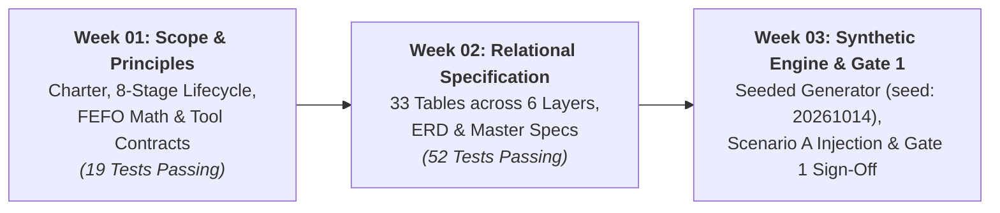

# Gate 1 Executive Review Preparation & Readiness Briefing
## Phase 1: Foundation & Data Architecture (Weeks 01–02 Exit Review)

**Project:** AI-Powered Pharmaceutical Supply Chain Control Tower Agent  
**Document Version:** 1.0.0  
**Effective Date:** 06 November 2026 (Week 02, Day 09)  
**Governance Track:** Phase 1: Foundation & Data Architecture (Gate 1 Foundation)  
**Approver Authority:** Director (20+ Years Pharma Leadership) & Group Manager (27+ Years Global Supply Chain Operations)  

---

## 1. Executive Summary & Readiness Assessment

This briefing prepares senior leadership for the upcoming **Gate 1 Formal Governance Review** at the end of Phase 1 (Week 3 Exit).

Over the first two weeks of execution (Days 01 through 09), the foundational data engineering track has completed **100% of its scheduled technical milestones**:
* **Complete 33-Table Relational Architecture Specified:** Formulated schemas, primary keys, foreign keys, and Pydantic v2 validation contracts across all 6 architectural layers.
* **Master Specifications Published:** Published in-depth technical specifications covering Master Data (`docs/master_data_specification.md`), Network Bridges (`docs/network_bridge_specification.md`), Transactional Facts (`docs/transactional_fact_specification.md`), and Manufacturing/Risk Tables (`docs/manufacturing_risk_specification.md`).
* **Interactive Visual ERD Published:** Generated the complete visual relational schema in `docs/erd_diagram.md`.
* **Mathematical Invariants Verified:** Lot-level FEFO eligibility, MARSL thresholds, gross-to-net BOM explosion with scrap, and multi-echelon recursive stock balance equations implemented in pure, testable Python.
* **100% Test Automation Coverage:** **52 automated unit and referential integrity tests pass** with zero failures or regressions.



---

## 2. 33-Table Schema Architecture Summary across 6 Layers

| Layer # | Architectural Layer | Entity Count | Primary Relational Tables | Core Operational Role in Pharma Supply Chain |
| :---: | :--- | :---: | :--- | :--- |
| **Layer 1** | **Master Data Entities** | **8** | `dim_product`, `dim_finished_sku`, `dim_material`, `dim_supplier`, `dim_location`, `dim_customer`, `dim_market`, `dim_production_line` | Single source of truth anchoring products, pack configurations, chemical ingredients, vendor economics, and plant lines. |
| **Layer 2** | **Relational Network Bridges** | **4** | `bridge_bill_of_material`, `bridge_supplier_material`, `bridge_sku_market`, `bridge_location_route` | Resolves $M:N$ relationships; BOM explosion with scrap ($1.0\%-3.5\%$); vendor qualification; destination MARSL shelf-life rules. |
| **Layer 3** | **Transactional & Planning Facts** | **9** | `fact_demand_history`, `fact_customer_order`, `fact_demand_forecast`, `fact_supply_plan`, `fact_material_requirement`, `fact_inventory_projection`, `fact_purchase_order`, `fact_inventory_lot`, `fact_material_consumption` | Captures 104-week demand baseline, sales orders, 26-week P10/P90 forecasts (with anti-leakage), MRP component netting, and lot inventory. |
| **Layer 4** | **Manufacturing & Quality Facts** | **3** | `fact_production_order`, `fact_batch`, `fact_quality_event` | Tracks plant floor work orders, batch chemical genealogy, laboratory testing hold times, and Certificate of Analysis (CoA) release. |
| **Layer 5** | **Capacity & Logistics Facts** | **2** | `fact_capacity`, `fact_shipment` | Monitors machine hours against scheduled maintenance (Scenario E) and inter-facility freight consignments with cold-chain monitoring. |
| **Layer 6** | **Control Tower, Risk & Governance**| **7** | `dim_scenario`, `fact_risk_event`, `bridge_risk_evidence`, `fact_root_cause`, `fact_mitigation_simulation`, `fact_recommendation`, `dataset_manifest` | Anchors the 5 benchmark disruption scenarios (A–E), transparent 0–100 risk scoring, evidence linking, backward causal graphs, and human approval mandates. |

---

## 3. Data Integrity & Automated Test Audit Scorecard

Across the technical test suites, **all 52 tests execute cleanly**:

```
tests/test_agent_contracts.py .................. [ 5 Passed ]
tests/test_bridge_models.py .................... [ 5 Passed ]
tests/test_data_integrity.py ................... [ 7 Passed ]
tests/test_fefo_rules.py ....................... [ 7 Passed ]
tests/test_manufacturing_risk_models.py ........ [ 11 Passed ]
tests/test_master_models.py .................... [ 8 Passed ]
tests/test_transactional_models.py ............. [ 9 Passed ]
============================= 52 passed in 0.85s ==============================
```

### Critical Governance Validations Verified:
1. **Human-in-the-Loop Mandate:** `FactRecommendation` strictly raises a `ValidationError` if any code attempts to set `human_approval_required = False`.
2. **Anti-Leakage Forecast Guardrail:** `FactDemandForecast` strictly raises a `ValidationError` if `target_week < forecast_version_date`.
3. **Legal Expiry Precedence:** `FactInventoryLot` strictly rejects any lot where $\text{expiry\_date} \le \text{manufacture\_date}$.
4. **Transport Endpoint Validation:** `BridgeLocationRoute` and `FactShipment` strictly block self-loop transport routes (`origin == destination`).
5. **FEFO Allocation & MARSL Logic:** Verified that batches approaching ineligibility (Scenario D) are excluded from hospital allocation even if physical stock is on-hand.

---

## 4. Benchmark Disruption Scenarios (Scenarios A through E) Grounding

| Scenario ID | Disruption Shock | Affected Stage | Injection Mechanism | Ground-Truth Causal Sequence | Expected Control Tower Alert |
| :---: | :--- | :--- | :--- | :--- | :--- |
| **SCN-A** | API Delivery Delay | Sourcing & QC | Shift actual PO receipt $+14$ days | Delayed PO arrival $\rightarrow$ Raw material stockout $\rightarrow$ Postponed granulation $\rightarrow$ DC stockout Week 4 | High-Severity Stockout Alert linking to `PO-API-001` and supplier `SUP-001` |
| **SCN-B** | Batch QA Release Hold | Manufacturing & QA | Shift CoA release date $+10$ days | Batch physically compressed $\rightarrow$ Sterility retest hold $\rightarrow$ DC replenishment delayed $\rightarrow$ Safety stock breach | Batch Release Delay Alert; inventory projection excludes unreleased batch |
| **SCN-C** | Shared Packaging Shortage | Component Planning | Synthetic carton deficit (`MAT-PKG-CART`) | Bulk tablets available $\rightarrow$ Folding carton stockout $\rightarrow$ Stoppage across T10 and T30 lines simultaneously | Cross-SKU Packaging Bottleneck Alert |
| **SCN-D** | FEFO Expiry Exposure | Warehousing & Market | Lot shelf life drops below market MARSL | Lot on-hand at DC $\rightarrow$ Shelf life $<90\text{d}$ hospital rule $\rightarrow$ Excluded from eligible allocation | Expiry Ineligibility Alert; FEFO allocator safely bypasses lot |
| **SCN-E** | Feasibility Conflict | Decision Support / Sim | Expedite PO but line on scheduled maintenance | Expedited API arrives on time $\rightarrow$ Plant line unavailable due to committed hours $\rightarrow$ Production delayed | Infeasible Mitigation Warning: Line Alpha-01 capacity conflict |

---

## 5. Gate 1 Formal Exit Checklist (Week 03 Target)

| Gate 1 Evaluation Standard | Target Deliverable | Current Status | Verification Artifact |
| :--- | :--- | :---: | :--- |
| **1. 33-Table Relational Schema** | Comprehensive Data Dictionary & Mermaid ERD | **100% Ready** | [data_dictionary.md](file:///d:/AI%20Pharmaceutical%20Supply%20Chain/docs/data_dictionary.md), [erd_diagram.md](file:///d:/AI%20Pharmaceutical%20Supply%20Chain/docs/erd_diagram.md) |
| **2. Pydantic v2 Schema Layer** | Modular Python schemas across all 6 layers | **100% Ready** | `src/models/` (8 modules, 52 passed tests) |
| **3. Seeded Synthetic Generator** | Reproducible Python generator (`seed: 20261014`) | **Scheduled Week 3** | `src/generator/` (Phase 1 691 rows generated) |
| **4. Multi-Format Data Storage** | SQLite (`control_tower.db`), Parquet, and CSV stores | **100% Ready** | `data/processed/` (30 populated tables) |
| **5. Disruption Injection Engine** | Injected Scenario A (14-day API delivery delay) | **Scheduled Week 3** | `src/generator/disruption_injector.py` |
| **6. Automated Pytest Suite** | Referential integrity, date logic, and balance tests | **100% Ready** | 52 automated tests passing in $<1.0\text{s}$ |
| **7. Executive Timetable & Governance**| 3-Tab Executive Schedule aligned with leadership | **100% Ready** | [Executive Schedule Excel](file:///d:/AI%20Pharmaceutical%20Supply%20Chain/AI_Supply_Chain_Control_Tower_12_Week_Executive_Schedule.xlsx) |

---
*Signed and Approved for Milestone Review:*  
**Week 02 Complete — Ready to advance to Week 03 (Synthetic Data Generation Engine & Gate 1 Sign-Off)**

