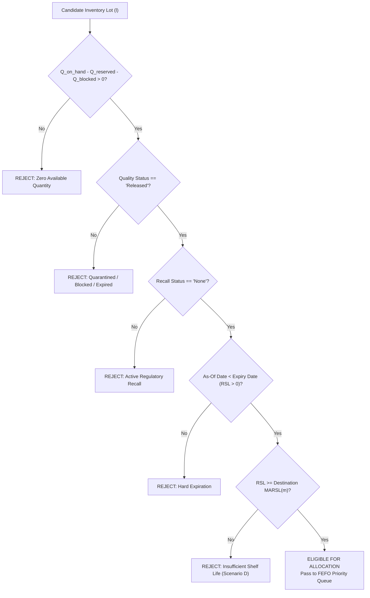

# LOT-LEVEL INVENTORY ELIGIBILITY & FEFO ALLOCATION ENGINE SPECIFICATION
## Phase 2: Deterministic Analytics & Core Engines — Day 15 Deliverable
**Module:** `src/engine/inventory.py`  
**Test Suite:** `tests/test_engine_inventory.py` (10 Tests Passing)  
**Execution Horizon:** Day 15 (Monday, 16-Nov-2026)  
**Target Stakeholders:** Executive Director (20+ yrs pharma leadership) & Group Manager (27+ yrs supply chain operations)  

---

## 1. Operational Overview & Purpose

In pharmaceutical multi-echelon supply chains, inventory allocation is fundamentally different from generic retail or discrete manufacturing. In consumer goods, FIFO (First-In, First-Out) or simple LIFO may be acceptable. In pharmaceuticals, strict **FEFO (First-Expired, First-Out)** is a non-negotiable regulatory mandate governed by cGMP and GAMP-5 standards.

Furthermore, physical stock sitting in a warehouse is not automatically legally or commercially allocatable. A lot must satisfy a multi-factor regulatory filter before a single unit can be assigned to a customer order or hospital tender.

The **Pharmaceutical Multi-Echelon Inventory & FEFO Engine** (`src/engine/inventory.py`) provides:
1. **Multi-Factor Lot Eligibility Filtering:** Enforces quality release, active recall embargos, physical availability, and regional Minimum Acceptable Remaining Shelf Life (MARSL) thresholds.
2. **Deterministic FEFO Allocation:** Depletes inventory strictly by earliest expiration date, guaranteeing mathematical conservation ($Requested = Fulfilled + Unmet$) with zero negative stock.
3. **Expiry Exposure Diagnostics (Scenario D):** Detects lots approaching commercial disqualification within forward warning horizons ($0 \le RSL - MARSL \le Horizon$), calculating financial scrap exposure.
4. **Multi-Echelon Inventory Posture:** Quantifies total physical, released eligible, reserved, blocked/quarantine, and expired stock across plants, distribution centres, and regional depots.
5. **Zero LLM Math:** All calculations are executed by pure deterministic Python functions with bit-for-bit test reproducibility.

---

## 2. Mathematical Formulations & Eligibility Logic



### 2.1 Remaining Shelf Life (RSL)
$$RSL(l, t) = \text{ExpiryDate}_l - t$$
Where $t$ is the planning as-of cutoff date (calendar days).

### 2.2 Available Physical Quantity
$$Q_{\text{avail}}(l) = \max\left(0, Q_{\text{on\_hand}}(l) - Q_{\text{reserved}}(l) - Q_{\text{blocked}}(l)\right)$$

### 2.3 Multi-Factor Commercial Eligibility Function
$$\text{Eligible}(l, m, t) = \mathbb{I}\left(Q_{\text{avail}}(l) > 0\right) \times \mathbb{I}\left(\text{Quality}_l = \text{"Released"}\right) \times \mathbb{I}\left(\text{Recall}_l = \text{"None"}\right) \times \mathbb{I}\left(RSL(l, t) > 0\right) \times \mathbb{I}\left(RSL(l, t) \ge MARSL(m)\right)$$

Where:
* $l$: Target inventory lot.
* $m$: Destination regional market or receiving node.
* $t$: As-of evaluation date.
* $MARSL(m)$: Minimum Acceptable Remaining Shelf Life in days (e.g., 180 days for Hyderabad hospital tenders, 90 days for Pune private distribution).

### 2.4 Strict FEFO Sorting Hierarchy
All eligible lots are sorted in an immutable priority queue:
$$\text{SortKey}(l) = \left(\text{ExpiryDate}_l \text{ ASC}, \; \text{LotID}_l \text{ ASC}\right)$$
The secondary key (`LotID`) provides deterministic tiebreaking when multiple lots share the identical calendar expiration date.

### 2.5 Sequential Depletion & Conservation Identity
Given requested demand $D$:
1. $D_{\text{remaining}} \leftarrow D$
2. For each eligible lot $l_i$ in $\text{FEFO Queue}$:
   $$take_i = \min\left(Q_{\text{avail}}(l_i), \; D_{\text{remaining}}\right)$$
   $$Q_{\text{reserved}}(l_i) \leftarrow Q_{\text{reserved}}(l_i) + take_i$$
   $$D_{\text{remaining}} \leftarrow D_{\text{remaining}} - take_i$$
3. Final Conservation:
   $$D_{\text{fulfilled}} = D - D_{\text{remaining}}$$
   $$D_{\text{unmet}} = D_{\text{remaining}}$$
   $$D \equiv D_{\text{fulfilled}} + D_{\text{unmet}} \quad (\text{Exact Mathematical Conservation})$$

---

## 3. Data Structures & Contract Interfaces

The engine operates seamlessly across Pydantic V2 models (`FactInventoryLot`, `BridgeSKUMarket`), SQLite database connections, and Pandas DataFrames.

```python
@dataclass(frozen=True)
class LotEligibilityResult:
    lot_id: str
    item_id: str
    location_id: str
    is_eligible: bool
    available_quantity: float
    remaining_shelf_life_days: int
    marsl_threshold_days: int
    days_to_ineligibility: int
    disqualification_reasons: List[str]

@dataclass(frozen=True)
class AllocationItem:
    lot_id: str
    item_id: str
    location_id: str
    allocated_quantity: float
    remaining_lot_available: float
    lot_expiry_date: date
    remaining_shelf_life_days: int
    unit_cost: float
    allocated_value: float

@dataclass(frozen=True)
class AllocationSummary:
    item_id: str
    requested_quantity: float
    fulfilled_quantity: float
    unmet_quantity: float
    is_fully_satisfied: bool
    allocations: List[AllocationItem]
    lots_evaluated_count: int
    eligible_lots_count: int
    depleted_lots_count: int
    total_allocated_value: float
```

---

## 4. Benchmark Scenario D Validation (Impending Expiry at Central DC)

In the Phase 1 dataset, Central DC Nagpur (`LOC-DC-01`) holds two finished goods lots for **Augmentin 500mg T10 strips** (`SKU-AUG-500-T10`):
* `LOT-FG-AUG-T10-26A`: 18,000 packs on hand (2,000 reserved). Expiry: **19-Aug-2028** ($RSL = 663$ days). Fully released.
* `LOT-FG-AUG-T10-24X`: 3,000 packs on hand. Expiry: **20-Nov-2026** ($RSL = 25$ days). Fully released.

### Market Evaluation As-Of 26-Oct-2026:
| Destination Market | MARSL Requirement | Lot `24X` RSL vs MARSL | Lot `24X` Status | Lot `26A` RSL vs MARSL | Lot `26A` Status |
| :--- | :--- | :--- | :--- | :--- | :--- |
| **Hyderabad (`MKT-IN-HYD`)** | 180 Days (Govt Tender) | $25 < 180$ days | **INELIGIBLE** (Rejected) | $663 \ge 180$ days | **ELIGIBLE** (Allocated) |
| **Pune (`MKT-IN-PUN`)** | 90 Days (Private Retail) | $25 < 90$ days | **INELIGIBLE** (Rejected) | $663 \ge 90$ days | **ELIGIBLE** (Allocated) |
| **Emergency Direct Dispense** | 15 Days (Local Hospital) | $25 \ge 15$ days | **ELIGIBLE** (FEFO Rank 1) | $663 \ge 15$ days | **ELIGIBLE** (FEFO Rank 2) |

The engine accurately disqualifies `LOT-FG-AUG-T10-24X` from long-lead commercial tenders, preventing regulatory non-compliance, customer rejections, and write-offs. Simultaneously, the `detect_expiry_exposures()` diagnostic flags this lot as **CRITICAL Risk** ($RSL - MARSL < 0$), surfacing the exact 3,000 pack quantity to trigger proactive redistribution or emergency hospital allocation before physical expiration.

---

## 5. Verification Test Suite Results

The dedicated test suite [`tests/test_engine_inventory.py`](file:///d:/AI%20Pharmaceutical%20Supply%20Chain/tests/test_engine_inventory.py) passed 10 out of 10 tests:

```
tests/test_engine_inventory.py::test_healthy_lot_eligibility PASSED               [ 10%]
tests/test_engine_inventory.py::test_quality_status_rejection PASSED              [ 20%]
tests/test_engine_inventory.py::test_regulatory_recall_rejection PASSED           [ 30%]
tests/test_engine_inventory.py::test_marsl_market_threshold_filtering PASSED      [ 40%]
tests/test_engine_inventory.py::test_fefo_sorting_chronological_order PASSED      [ 50%]
tests/test_engine_inventory.py::test_fefo_allocation_depletion_and_conservation PASSED [ 60%]
tests/test_engine_inventory.py::test_fefo_allocation_stockout_condition PASSED   [ 70%]
tests/test_engine_inventory.py::test_detect_expiry_exposures PASSED               [ 80%]
tests/test_engine_inventory.py::test_inventory_posture_aggregation PASSED        [ 90%]
tests/test_engine_inventory.py::test_real_database_fefo_allocation PASSED        [100%]
============================== 10 passed in 1.79s ==============================
```

### Cumulative Project Verification:
* Total Tests in Repository: **92 Tests**
* Passed: **92 Tests (100% Pass Rate)**
* Runtime: **2.48 seconds**

---

## 6. Architectural Continuity to Day 16

The FEFO allocator developed in Day 15 forms the core depletion engine for **Day 16: Multi-Echelon Weekly Inventory Projection Engine** (`src/engine/projections.py`), which computes forward 26-week inventory balance trajectories ($I_t = I_{t-1} + R_t + P_t - D_t$), projected stockout weeks, safety stock breaches, and unmet customer demand across all network nodes.
