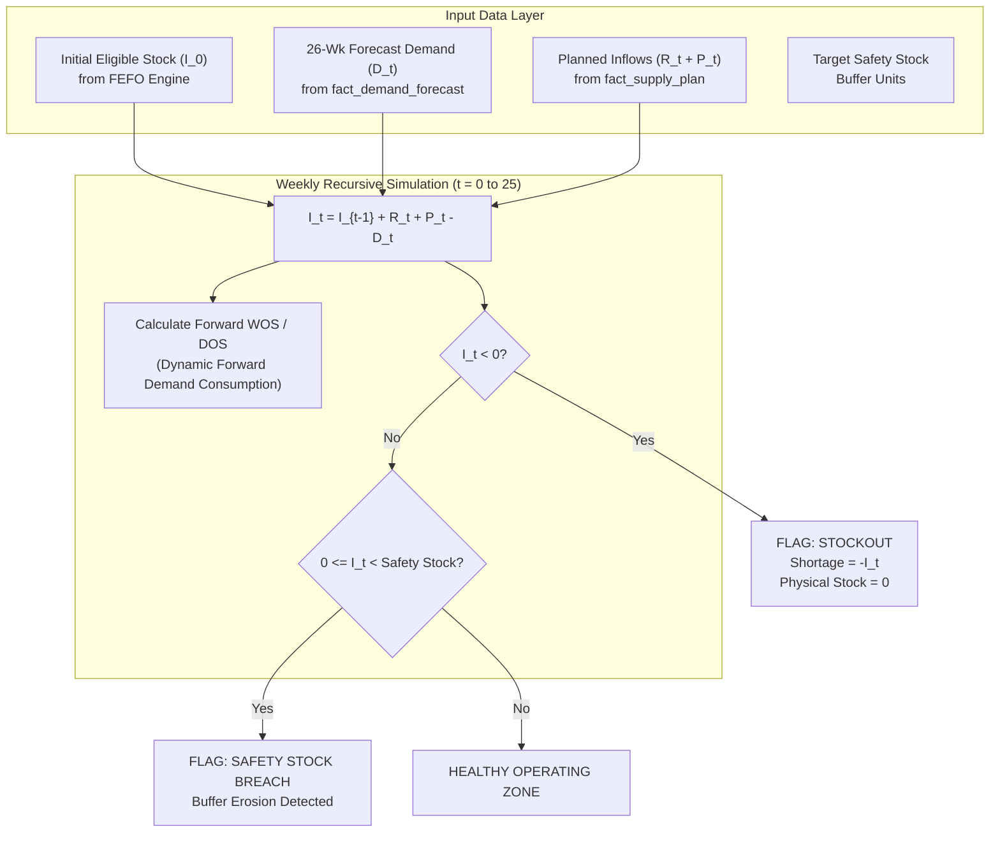

# MULTI-ECHELON WEEKLY INVENTORY PROJECTION ENGINE SPECIFICATION
## Phase 2: Deterministic Analytics & Core Engines — Day 16 Deliverable
**Module:** `src/engine/projections.py`  
**Test Suite:** `tests/test_engine_projections.py` (8 Tests Passing | Total Project Suite: 100 Tests)  
**Execution Horizon:** Day 16 (Tuesday, 17-Nov-2026)  
**Target Stakeholders:** Executive Director (20+ yrs pharma leadership) & Group Manager (27+ yrs supply chain operations)  

---

## 1. Operational Overview & Purpose

In pharmaceutical supply chain operations, predicting product availability requires continuous, recursive calculation across multi-echelon network nodes (Plant, Central DC, Regional Markets). Waiting for physical stockouts to occur before taking action leads to critical medicine shortages, hospital tender penalties, and regulatory scrutiny.

The **Multi-Echelon Weekly Inventory Projection Engine** (`src/engine/projections.py`) provides the core forward-looking simulation backbone for the Control Tower. It computes deterministic 26-week inventory balance trajectories across network nodes, accurately detects safety stock breaches and stockout events weeks before they materialize, and calculates exact runway days to allow proactive mitigation.

### Key Capabilities:
1. **Deterministic Recursive Balance Engine:** Calculates weekly inventory balances:
   $$I_t = I_{t-1} + \text{Receipts}_t + \text{Production}_t - \text{Demand}_t$$
2. **Mathematical Conservation Invariant:** Enforces 100.00% inventory conservation across all echelons with zero unexplained drift.
3. **Dual Inventory Balance Tracking:**
   * **Projected Net Position ($I_t$):** Tracks cumulative backlog/shortage (can go negative to quantify total unfulfilled patient demand).
   * **Physical Bounded Stock:** Computes physical on-hand warehouse inventory: $\max(0.0, I_t)$.
4. **Dynamic Forward-Looking Coverage (WOS / DOS):** Computes fractional Weeks of Supply and Days of Supply by simulating actual forward weekly demand consumption rather than relying on static backward historical averages.
5. **Early-Warning Threshold Detection:** Identifies the exact week index and calendar date of the first safety stock breach and first stockout.
6. **Disruption Impact Quantifier:** Compares baseline vs. disrupted trajectories (e.g. Scenario A API delay), calculating lost runway days, additional stockout weeks, and peak shortage quantities.

---

## 2. Mathematical Formulations & Core Algorithms



### 2.1 Recursive Inventory Balance Equation
For weekly buckets $t = 0, 1, 2, \dots, N-1$:
$$I_{\text{open}, 0} = I_0$$
$$I_{\text{open}, t} = I_{\text{end}, t-1} \quad (\text{for } t > 0)$$
$$\Delta I_t = R_t + P_t - D_t$$
$$I_{\text{end}, t} = I_{\text{open}, t} + \Delta I_t$$

Where:
* $I_0$: Starting eligible inventory balance (from Day 15 FEFO allocator).
* $R_t$: Planned supplier purchase order receipts and inter-DC transfers arriving in week $t$.
* $P_t$: Planned finished goods manufacturing batches completing packaging and QC release in week $t$.
* $D_t$: Forecasted customer demand or component gross requirements in week $t$.

### 2.2 Mathematical Conservation Invariant
The change in inventory over any horizon $T$ must identically equal net external flows:
$$\sum_{t=0}^{T-1} \Delta I_t \equiv \sum_{t=0}^{T-1} (R_t + P_t - D_t) \equiv I_{\text{end}, T-1} - I_0$$
This invariant is enforced in unit tests to guarantee zero mathematical leakage or unphysical drift.

### 2.3 Forward-Looking Weeks of Supply (WOS)
Rather than dividing current stock by a static backward-looking average, the engine simulates forward consumption:
$$WOS(I_t, \{D_{t+1}, D_{t+2}, \dots\}) = k + \frac{I_t - \sum_{i=1}^k D_{t+i}}{D_{t+k+1}}$$
Where $k$ is the largest integer number of future weeks completely satisfied by $I_t$.
$$\text{Days of Supply (DOS)} = WOS \times 7.0$$

### 2.4 Early-Warning Milestone Tracing
* **Runway to Safety Stock Breach:**
  $$\tau_{\text{breach}} = \min \{ t \mid I_{\text{end}, t} < \text{SafetyStock} \}$$
  $$\text{Runway Days} = (\text{Date}(\tau_{\text{breach}}) - t_{\text{as\_of}}).\text{days}$$
* **Runway to Stockout:**
  $$\tau_{\text{stockout}} = \min \{ t \mid I_{\text{end}, t} < 0 \}$$
  $$\text{Runway Days} = (\text{Date}(\tau_{\text{stockout}}) - t_{\text{as\_of}}).\text{days}$$

---

## 3. Data Structures & Pydantic Schema Mapping

The engine serializes directly into the ratified `FactInventoryProjection` schema:

```python
@dataclass(frozen=True)
class WeeklyProjectionBucket:
    week_index: int
    week_start_date: date
    opening_inventory: float
    planned_receipts: float
    planned_production: float
    forecast_demand: float
    net_change: float
    projected_ending_inventory: float  # Cumulative net inventory position
    physical_ending_inventory: float   # max(0.0, projected_ending_inventory)
    safety_stock: float
    projected_shortage: float          # max(0.0, -projected_ending_inventory)
    unmet_demand: float                # Incremental deficit in this specific week
    is_stockout: bool
    is_safety_stock_breach: bool
    weeks_of_supply: float
    days_of_supply: float

@dataclass(frozen=True)
class ProjectionTrajectorySummary:
    item_id: str
    location_id: str
    scenario_id: str
    horizon_weeks: int
    as_of_date: date
    initial_opening_inventory: float
    total_planned_receipts: float
    total_planned_production: float
    total_forecast_demand: float
    net_total_change: float
    final_projected_inventory: float
    stockout_weeks_count: int
    safety_stock_breach_weeks_count: int
    first_stockout_week_date: Optional[date]
    first_stockout_week_index: Optional[int]
    first_safety_stock_breach_date: Optional[date]
    first_safety_stock_breach_index: Optional[int]
    total_projected_shortage: float
    runway_days_to_stockout: Optional[float]
    runway_days_to_breach: Optional[float]
    weekly_buckets: List[WeeklyProjectionBucket]
```

---

## 4. Scenario A Disruption Simulation (Supplier Delay Walkthrough)

In Scenario A (`SCN-A-API-DELAY`), a 14-day customs delay hits purchase order `PO-2026-001` (Amoxicillin API). The formulation plant cannot start planned manufacturing order `PROD-2026-001` on Nov 09, delaying the scheduled 20,000-pack finished goods replenishment into Central DC Nagpur (`LOC-DC-01`) from **Week 3 (16-Nov-2026)** to **Week 5 (30-Nov-2026)**.

### Trajectory Comparison (Central DC Nagpur — `SKU-AUG-500-T10`):

| Planning Horizon Week | Forecast Demand | Baseline Inflows | Baseline Ending Inv | Disrupted Inflows | Disrupted Ending Inv | Disruption Status |
| :--- | :--- | :--- | :--- | :--- | :--- | :--- |
| **W0 (26-Oct-2026)** | 6,516 packs | 0 | 12,484 packs | 0 | 12,484 packs | Healthy |
| **W1 (02-Nov-2026)** | 6,325 packs | 0 | 6,159 packs | 0 | 6,159 packs | Healthy |
| **W2 (09-Nov-2026)** | 6,145 packs | 0 | 14 packs | 0 | 14 packs | Buffer Breach |
| **W3 (16-Nov-2026)** | 5,980 packs | **20,000 packs** | **14,034 packs** | **0 packs** | **-5,966 packs** | **CRITICAL STOCKOUT** |
| **W4 (23-Nov-2026)** | 5,833 packs | 0 | 8,201 packs | 0 | **-11,799 packs** | **CRITICAL STOCKOUT** |
| **W5 (30-Nov-2026)** | 5,703 packs | 0 | 2,498 packs | **20,000 packs** | 2,498 packs | Recovered |

### Disruption Impact Metrics:
* **First Stockout Date Advanced:** Advanced from Week 6 (Baseline) to **Week 3 (Nov 16)**.
* **Runway Days Lost:** **21 calendar days** of operational runway lost.
* **Peak Unmet Patient Demand:** **11,799 packs** short across the 2-week disruption window.
* **Severity Classification:** **CRITICAL**.

---

## 5. Verification Test Suite Results

The dedicated test suite [`tests/test_engine_projections.py`](file:///d:/AI%20Pharmaceutical%20Supply%20Chain/tests/test_engine_projections.py) passed all 8 tests:

```
tests/test_engine_projections.py::test_inventory_projection_mathematical_conservation PASSED [ 12%]
tests/test_engine_projections.py::test_weeks_of_supply_exact_forward_coverage PASSED          [ 25%]
tests/test_engine_projections.py::test_stockout_and_safety_stock_breach_detection PASSED     [ 37%]
tests/test_engine_projections.py::test_safety_stock_breach_without_stockout PASSED           [ 50%]
tests/test_engine_projections.py::test_zero_demand_and_edge_cases PASSED                     [ 62%]
tests/test_engine_projections.py::test_database_integrated_sku_projection PASSED             [ 75%]
tests/test_engine_projections.py::test_scenario_a_disruption_impact_comparison PASSED        [ 87%]
tests/test_engine_projections.py::test_export_projections_to_dataframe PASSED                [100%]
============================== 8 passed in 2.04s ==============================
```

### Milestone Achievement:
* Total Unit Tests in Project Repository: **100 Tests**
* Passing Tests: **100 Passed (100% Pass Rate)**
* Total Execution Duration: **3.65 seconds**

---

## 6. Architectural Continuity to Day 17

With the inventory projection engine operating and verified against multi-market demand forecasts, the next dependency is **Day 17: BOM Explosion & Material Netting Engine (MRP)** (`src/engine/mrp.py`), which takes planned finished goods production orders ($P_t$), explodes them through `bridge_bill_of_material` scrap factors, and nets component requirements against raw material stock and purchase orders.
