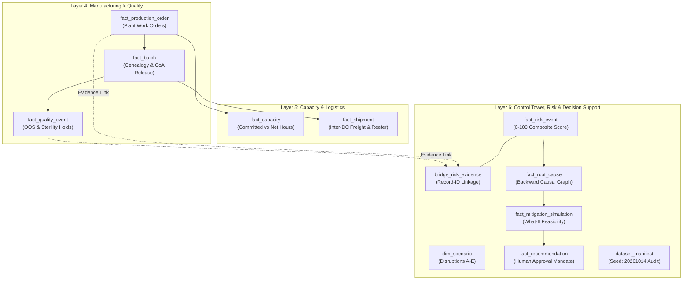

# Manufacturing, Logistics & Risk Tables Specification (12 Tables)
## Technical Schema Standard & Risk-Evidence Relationship Specification (Week 02, Day 08 Deliverable)

**Project:** AI-Powered Pharmaceutical Supply Chain Control Tower Agent  
**Document Version:** 1.0.0  
**Effective Date:** 05 November 2026 (Week 02, Day 08)  
**Governance Track:** Phase 1: Foundation & Data Architecture (Gate 1 Foundation)  
**Approver Authority:** Group Manager (27+ Years Global Supply Chain Operations) & Director (20+ Years Pharma Leadership)  

---

## 1. Executive Summary & Purpose

In pharmaceutical supply chains, an operational disruption rarely starts in the warehouse where a stockout is observed. It originates upstream in **plant floor line breakdowns, quality control sterility delays, machine maintenance conflicts, or in-transit logistics bottlenecks**.

Furthermore, for an AI Control Tower to be viable in a regulated pharmaceutical environment, it cannot merely flag generic warnings. It must **bind every alert to verifiable physical evidence, trace the exact backward causal sequence, simulate non-destructive mitigations, and enforce human planner approval**.

This document details the **technical specification, schema definitions, grains, primary/foreign keys, and validation rules** for the **12 Manufacturing, Logistics, and Control Tower Entities (Layers 4, 5, and 6)**.



---

## 2. Detailed Technical Entity Specifications

---

### Layer 4: Manufacturing & Quality Entities (3 Tables)

#### 1. `fact_production_order` (Manufacturing Work Orders)
* **Relational Role:** Plant floor packaging and compression work orders.
* **Table Grain:** One record per production order line.
* **Primary Key:** `production_order_id` (String format: `PROD-xxx`, e.g., `PROD-2026-001`)
* **Foreign Keys:**
  * `finished_sku_id` $\rightarrow$ `dim_finished_sku.finished_sku_id`
  * `location_id` $\rightarrow$ `dim_location.location_id` (`MANUFACTURING_PLANT`)
  * `production_line_id` $\rightarrow$ `dim_production_line.production_line_id`

| Field Name | Data Type | Physical / Business Meaning | Validation Constraints |
| :--- | :--- | :--- | :--- |
| `production_order_id` | String | Unique manufacturing work order number. | Primary Key. Alphanumeric. |
| `finished_sku_id` | String | Finished product SKU being packaged. | Foreign Key $\rightarrow$ `dim_finished_sku`. |
| `location_id` | String | Manufacturing plant facility node. | Foreign Key $\rightarrow$ `dim_location`. |
| `production_line_id` | String | Assigned packaging/compression line asset. | Foreign Key $\rightarrow$ `dim_production_line`. |
| `planned_start_date` | Date | Scheduled production start milestone. | ISO 8601 Date. |
| `planned_completion_date`| Date | Scheduled production completion milestone. | Must be $\ge \text{planned\_start\_date}$. |
| `actual_start_date` | Date (Nullable) | Actual timestamp when line commenced setup. | ISO 8601 Date. |
| `actual_completion_date` | Date (Nullable) | Actual timestamp when line finished run. | Must be $\ge \text{actual\_start\_date}$ if populated. |
| `planned_quantity` | Float | Target batch pack output. | Float $> 0.0$. |
| `actual_quantity` | Float | Gross sellable packs produced. | Float $\ge 0.0$, default 0.0. |
| `expected_yield` | Float | Standard operational yield percentage. | Percentage: $0.0 \le \text{Yield} \le 100.0\%$, default 98.0%. |
| `actual_yield` | Float (Nullable)| Achieved operational yield percentage. | Float between 0.0% and 100.0%. |
| `planned_hours` | Float | Machine hours booked on production line. | Float $> 0.0$. |
| `actual_hours` | Float (Nullable)| Physical machine hours logged. | Float $\ge 0.0$. |
| `production_status` | String | State: `Planned`, `Released`, `In_Progress`, `Completed`, `On_Hold`. | Controlled status enum. |
| `delay_reason` | String (Nullable)| Downtime cause (`API Shortage`, `Line Breakdown`). | Informs root-cause tracing. |

---

#### 2. `fact_batch` (Manufacturing Batch Genealogy & CoA Release)
* **Relational Role:** Physical synthesized chemical batch genealogy. Tracks physical processing completion, laboratory sampling, and final Qualified Person (QP) regulatory release.
* **Table Grain:** One record per physical manufacturing batch.
* **Primary Key:** `batch_id` (String format: `BATCH-xxx`, e.g., `BATCH-AUG-2026-01`)
* **Foreign Keys:**
  * `production_order_id` $\rightarrow$ `fact_production_order.production_order_id`
  * `finished_sku_id` $\rightarrow$ `dim_finished_sku.finished_sku_id`
  * `location_id` $\rightarrow$ `dim_location.location_id`

| Field Name | Data Type | Physical / Business Meaning | Validation Constraints |
| :--- | :--- | :--- | :--- |
| `batch_id` | String | Traceable master batch identifier. | Primary Key. Alphanumeric. |
| `production_order_id` | String | Parent manufacturing order. | Foreign Key $\rightarrow$ `fact_production_order`. |
| `finished_sku_id` | String | Finished SKU presentation. | Foreign Key $\rightarrow$ `dim_finished_sku`. |
| `location_id` | String | Manufacturing plant site. | Foreign Key $\rightarrow$ `dim_location`. |
| `manufacture_date` | Date | Date packaging run finished on the plant floor. | ISO 8601 Date. |
| `quality_submission_date`| Date | Date samples were transferred to QC laboratory. | **Must be $\ge \text{manufacture\_date}$.** |
| `expected_release_date` | Date | Target CoA release date based on standard test SLA. | **Must be $\ge \text{quality\_submission\_date}$.** |
| `actual_release_date` | Date (Nullable) | Formal date Certificate of Analysis was signed. | Must be $\ge \text{quality\_submission\_date}$ if populated. |
| `batch_quantity` | Float | Net usable packs produced in batch. | Float $> 0.0$. |
| `batch_status` | String | Quality state: `In_Testing`, `Released`, `Quarantined`, `Rejected`. | Controlled batch status enum. |
| `rejection_reason` | String (Nullable)| Failure classification (`Sterility Failure`, `OOS Dissolution`). | Informs quality failure root-causes. |

---

#### 3. `fact_quality_event` (GMP Deviations & Quarantine Holds)
* **Relational Role:** Quality deviations, sterility failures, and laboratory holds. Directly anchors **Scenario B (Batch QA Release Hold)**.
* **Table Grain:** One record per quality deviation event.
* **Primary Key:** `quality_event_id` (String format: `QEV-xxx`, e.g., `QEV-2026-001`)

| Field Name | Data Type | Physical / Business Meaning | Validation Constraints |
| :--- | :--- | :--- | :--- |
| `quality_event_id` | String | Unique quality deviation identifier. | Primary Key. |
| `entity_type` | String | Impacted entity: `BATCH`, `INVENTORY_LOT`, `PURCHASE_ORDER`. | Controlled entity enum. |
| `entity_id` | String | Underlying batch_id, lot_id, or po_id. | Traceable primary key reference. |
| `event_type` | String | Category: `Sterility_Retest`, `OOS_Investigation`, `Temperature_Excursion`. | Controlled deviation type. |
| `event_date` | Date | Date deviation occurred or was flagged. | ISO 8601 Date. |
| `expected_resolution_date`| Date | Planned investigation completion milestone. | Must be $\ge \text{event\_date}$. |
| `actual_resolution_date` | Date (Nullable)| Date deviation was formally signed off and closed. | Must be $\ge \text{event\_date}$ if populated. |
| `quality_status` | String | State: `Pending`, `Cleared`, `Rejected`, `Quarantined`. | Default `Pending`. |
| `delay_days` | Integer | Downstream release delay introduced by deviation ($L_{\text{qa\_release}}$). | Integer $\ge 0$. |
| `reason_code` | String | Standardized deviation classification code (e.g., `DEV-STER-001`). | Minimum length 3. |

---

### Layer 5: Capacity & Logistics Entities (2 Tables)

#### 4. `fact_capacity` (Plant Line Operating Hours & Utilization)
* **Relational Role:** Weekly line machine capacity. Directly anchors **Scenario E (Mitigation Feasibility Conflict)** by evaluating committed hours against maintenance windows.
* **Table Grain:** One record per plant line, weekly period start date, and scenario.
* **Primary Key:** `capacity_record_id` (String format: `CAP-xxx`, e.g., `CAP-PLANT1-LINE1-W44`)
* **Foreign Keys:**
  * `location_id` $\rightarrow$ `dim_location.location_id`
  * `production_line_id` $\rightarrow$ `dim_production_line.production_line_id`
  * `scenario_id` $\rightarrow$ `dim_scenario.scenario_id`

$$\text{Capacity Utilization \%} = \left(\frac{\text{Committed Hours}}{\text{Net Available Hours}}\right) \times 100$$
$$\text{Is Overloaded} = \mathbb{I}(\text{Committed Hours} > \text{Net Available Hours})$$

| Field Name | Data Type | Physical / Business Meaning | Validation Constraints |
| :--- | :--- | :--- | :--- |
| `capacity_record_id` | String | Unique weekly capacity line identifier. | Primary Key. |
| `location_id` | String | Manufacturing plant site code. | Foreign Key $\rightarrow$ `dim_location`. |
| `production_line_id` | String | Production line asset code. | Foreign Key $\rightarrow$ `dim_production_line`. |
| `period_start_date` | Date | Monday start date of weekly planning horizon. | ISO 8601 Date. |
| `net_available_hours` | Float | Gross weekly operating hours minus holidays. | Float $\ge 0.0$, default 120.0 hrs. |
| `maintenance_hours` | Float | Scheduled preventive maintenance hours. | Float $\ge 0.0$, default 8.0 hrs. |
| `downtime_hours` | Float | Unplanned breakdown or tooling changeover downtime. | Float $\ge 0.0$, default 0.0 hrs. |
| `committed_hours` | Float | Machine hours booked by scheduled work orders. | Float $\ge 0.0$, default 0.0 hrs. |
| `scenario_id` | String | Baseline or disruption scenario identifier. | Default `SCN-BASE`. |

---

#### 5. `fact_shipment` (Inter-Facility Transport & Reefer Monitoring)
* **Relational Role:** Finished product transit consignments between Plants, Central DCs, and Regional Hubs.
* **Table Grain:** One record per freight consignment dispatch.
* **Primary Key:** `shipment_id` (String format: `SHIP-xxx`, e.g., `SHIP-2026-001`)
* **Foreign Keys:**
  * `origin_location_id` $\rightarrow$ `dim_location.location_id`
  * `destination_location_id` $\rightarrow$ `dim_location.location_id`
  * `finished_sku_id` $\rightarrow$ `dim_finished_sku.finished_sku_id`
  * `lot_id` $\rightarrow$ `fact_inventory_lot.lot_id`

| Field Name | Data Type | Physical / Business Meaning | Validation Constraints |
| :--- | :--- | :--- | :--- |
| `shipment_id` | String | Unique consignment consignment code. | Primary Key. |
| `origin_location_id` | String | Shipping facility dock (Plant or Central DC). | Foreign Key $\rightarrow$ `dim_location`. |
| `destination_location_id`| String | Receiving facility dock (Central DC or Regional DC). | Foreign Key $\rightarrow$ `dim_location`. **Must not equal origin.** |
| `finished_sku_id` | String | Dispatched commercial SKU. | Foreign Key $\rightarrow$ `dim_finished_sku`. |
| `lot_id` | String | Dispatched physical inventory lot. | Foreign Key $\rightarrow$ `fact_inventory_lot`. |
| `dispatch_date` | Date | Date consignment departed shipping dock. | ISO 8601 Date. |
| `expected_arrival_date` | Date | Scheduled delivery milestone ($L_{\text{transit}}$). | **Must be $\ge \text{dispatch\_date}$.** |
| `actual_arrival_date` | Date (Nullable) | Gate-in physical arrival date at destination dock. | Must be $\ge \text{dispatch\_date}$ if populated. |
| `shipped_quantity` | Float | Dispatched pack volume. | Float $> 0.0$. |
| `received_quantity` | Float | Verified received pack volume. | Float $\ge 0.0$, default 0.0. |
| `transport_mode` | String | Logistics mode (`Road`, `Air`, `Rail`). | Controlled mode enum. |
| `shipment_status` | String | State: `Manifested`, `In_Transit`, `Delivered`, `Delayed`. | Controlled status enum. |
| `delay_reason` | String (Nullable)| Logistics bottleneck reason (`Monsoon Flooding`). | Causal explanation. |
| `temperature_excursion_flag`| Boolean | Flags cold-chain temperature excursion ($>8^\circ\text{C}$). | If `True`, triggers lot quarantine on arrival. |

---

### Layer 6: Scenarios, Risk Detection & Decision Support Entities (7 Tables)

#### 6. `dim_scenario` (Disruption Scenario Catalog)
* **Relational Role:** Formal registry of benchmark disruption stress tests (Scenarios A through E) and baseline parameters.
* **Table Grain:** One record per scenario definition.
* **Primary Key:** `scenario_id` (String format: `SCN-xxx`, e.g., `SCN-BASE`, `SCN-A-API-DELAY`)

---

#### 7. `fact_risk_event` (Detected Supply Chain Exceptions)
* **Relational Role:** Exception engine output. Evaluates 6 risk categories across the 26-week horizon and calculates transparent composite risk scores.
* **Table Grain:** One record per detected risk exception.
* **Primary Key:** `risk_id` (String format: `RISK-xxx`, e.g., `RISK-2026-001`)

$$\text{Composite Risk Score} = 0.30S + 0.20T + 0.15C + 0.15D + 0.10U + 0.10R$$
*Where $S$ = Shortage Severity, $T$ = Lead Time to Impact, $C$ = Criticality, $D$ = Downstream Scope, $U$ = Data Uncertainty, and $R$ = Recurrence.*

$$\text{Days to Impact} = \text{impact\_date} - \text{detection\_date}$$

---

#### 8. `bridge_risk_evidence` (Relational Evidence Linker Bridge)
* **Relational Role:** **The Anti-Hallucination Anchor.** Maps each detected risk directly to supporting operational records (`PO-API-001`, `BATCH-001`, `LINE-PLANT1-01`).
* **Table Grain:** One record per Risk ID and supporting evidence record pairing.
* **Composite Foreign Keys:**
  * `risk_id` $\rightarrow$ `fact_risk_event.risk_id`
  * `evidence_record_id` $\rightarrow$ Underlying operational primary key

---

#### 9. `fact_root_cause` (Backward Causal Dependency Graph)
* **Relational Role:** Deterministic backward causal tracing. Distinguishes Direct Causes, Contributing Factors, and Downstream Impacts, while logging explicit Uncertainty Notes when data gaps exist.
* **Table Grain:** One record per root cause determination.
* **Primary Key:** `root_cause_id` (String format: `RC-xxx`)
* **Foreign Key:** `risk_id` $\rightarrow$ `fact_risk_event.risk_id`

---

#### 10. `fact_mitigation_simulation` (What-If Simulation Sandbox Runs)
* **Relational Role:** Evaluates candidate corrective actions (Supplier Expedite, Stock Reallocation, Line Reschedule) in an isolated sandbox, calculating shortage reduction %, synthetic cost, and operational feasibility.
* **Table Grain:** One record per simulation run.
* **Primary Key:** `simulation_id` (String format: `SIM-xxx`)
* **Foreign Key:** `risk_id` $\rightarrow$ `fact_risk_event.risk_id`

---

#### 11. `fact_recommendation` (Planner Decision-Support Actions)
* **Relational Role:** Ranked decision-support proposals for planner review. **Strictly enforces human approval requirements (`human_approval_required = True`).**
* **Table Grain:** One record per candidate recommendation.
* **Primary Key:** `recommendation_id` (String format: `REC-xxx`)
* **Foreign Keys:**
  * `risk_id` $\rightarrow$ `fact_risk_event.risk_id`
  * `simulation_id` $\rightarrow$ `fact_mitigation_simulation.simulation_id`

---

#### 12. `dataset_manifest` (Synthetic Data Provenance Audit)
* **Relational Role:** Reproducibility audit log. Records the fixed seed (`20261014`), row counts per table, date boundaries, and validation status.
* **Table Grain:** One record per release build.

---

## 3. The 5 Benchmark Disruption Scenarios Mapping

| Scenario ID | Disruption Type | Injected Mechanism | Primary Impacted Table | Expected Evidence Record |
| :--- | :--- | :--- | :--- | :--- |
| **SCN-A** | API Supplier Delivery Delay | Shift actual PO receipt $+14$ days | `fact_purchase_order` | `PO-API-001` (Supplier `SUP-001`) |
| **SCN-B** | Batch QA Release Hold | Shift QA release date $+10$ days | `fact_batch`, `fact_quality_event` | `BATCH-AUG-2026-01`, `QEV-2026-001` |
| **SCN-C** | Shared Packaging Shortage | Synthetic carton deficit | `fact_material_requirement` | `MAT-PKG-CART` (Affects T10 & T30) |
| **SCN-D** | FEFO Expiry Exposure | Lot shelf life drops below MARSL | `fact_inventory_lot` | `LOT-AUG-EXP-01` (RSL $< 90\text{d}$) |
| **SCN-E** | Feasibility Conflict | Expedite PO but Line on maintenance | `fact_capacity`, `fact_mitigation_simulation` | `LINE-PLANT1-01` (Committed $>$ Net) |

---

## 4. Quality Verification & Automated Test Evidence

All 12 entities are implemented with Pydantic v2 validation and verified via automated tests in `tests/test_manufacturing_risk_models.py`:

* `test_fact_production_order_validation`: Validates order start/completion date ordering.
* `test_fact_batch_milestone_ordering`: Confirms $\text{manufacture\_date} \le \text{quality\_submission} \le \text{expected\_release}$.
* `test_fact_quality_event_validation`: Verifies QA deviation dates and delay days.
* `test_fact_capacity_utilization_and_overload`: Proves line utilization percentage and overload flags ($116.67\% > 100\%$).
* `test_fact_shipment_validation`: Blocks self-loop transport routes (`origin == destination`).
* `test_fact_risk_event_and_days_to_impact`: Auto-calculates lead time to impact: $23\text{-Nov} - 02\text{-Nov} = 21\text{ days}$.
* `test_bridge_risk_evidence`: Validates record-level evidence linkage (`PO-API-001`).
* `test_fact_root_cause`: Verifies causal chain sequence.
* `test_fact_mitigation_simulation_and_cost`: Confirms shortage reduction % and cost bounds.
* `test_fact_recommendation_human_approval_mandate`: **Proves attempt to set `human_approval_required = False` raises a strict `ValidationError`.**
* `test_dataset_manifest_provenance`: Verifies fixed random seed (`20261014`) and manifest audit trail.

```bash
python -m pytest tests/test_manufacturing_risk_models.py -v
============================= 11 passed in 0.23s ==============================
```

Across the entire workspace, **all 52 automated tests pass cleanly**:
```bash
python -m pytest tests/ -v
============================= 52 passed in 0.92s ==============================
```

---
*Signed and Approved for Implementation:*  
**Week 02, Day 08 Milestone Sign-Off — Phase 1: Foundation & Data Architecture**

