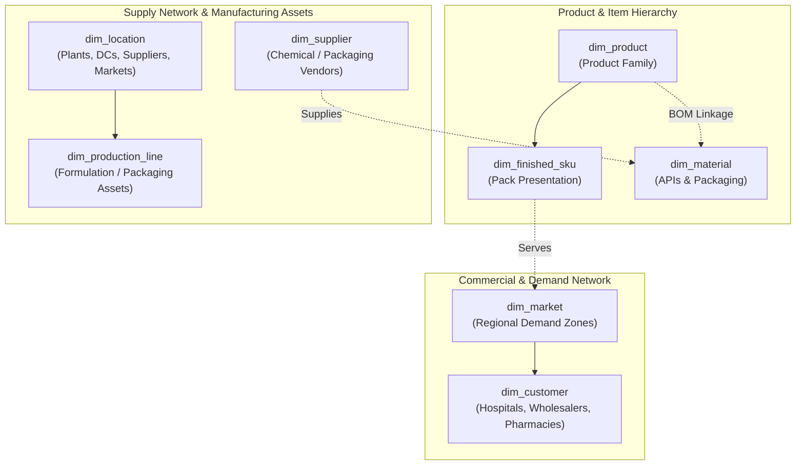

# Master Data Entities Specification (8 Tables)
## Technical Schema Standard & Data Governance Specification (Week 02, Day 05 Deliverable)

**Project:** AI-Powered Pharmaceutical Supply Chain Control Tower Agent  
**Document Version:** 1.0.0  
**Effective Date:** 02 November 2026 (Week 02, Day 05)  
**Governance Track:** Phase 1: Foundation & Data Architecture (Gate 1 Foundation)  
**Approver Authority:** Group Manager (27+ Years Global Supply Chain Operations) & Director (20+ Years Pharma Leadership)  

---

## 1. Executive Summary & Purpose

In enterprise pharmaceutical manufacturing and supply chain planning, **Master Data represents the single, immutable source of truth** anchoring every operational transaction. If master data is flawed, downstream transactional records—such as Bill of Materials (BOM) explosions, purchase orders, production work orders, and inventory lot releases—inevitably fail.

This document establishes the **formal technical specification, schema definitions, primary/foreign key hierarchies, and field validation constraints** for the **8 Master Data Entities (Layer 1)** of the Control Tower architecture.



---

## 2. Master Data Entities Detailed Specifications

---

### Entity 1: `dim_product` (Product Family Master)

* **Relational Role:** Top-level therapeutic brand identity. Represents a drug molecule family and clinical indication.
* **Table Grain:** One record per commercial product family.
* **Primary Key:** `product_id` (String format: `PRD-xxx`, e.g., `PRD-AUG`)
* **Downstream Linkages:** Parent to `dim_finished_sku`.

| Field Name | Data Type | Physical / Business Meaning | Validation & Governance Constraints |
| :--- | :--- | :--- | :--- |
| `product_id` | String | Unique product family identifier (e.g., `PRD-AUG`). | Primary Key. Minimum length 3, not null, uppercase alphanumeric. |
| `product_name` | String | Commercial brand name (e.g., `Augmentin`). | Not null, non-empty. |
| `product_family` | String | Therapeutic chemical grouping (e.g., `Antibiotic-Penicillin`). | Not null. |
| `therapy_area` | String | Clinical disease area (e.g., `Anti-Infectives`). | Controlled medical classification. |
| `critical_medicine_flag` | Boolean | Regulatory life-saving priority flag. | Default `True`. If `True`, elevates shortage severity in risk scoring. |
| `synthetic_data_flag` | Boolean | Provenance tracking indicator. | Mandatory `True` on all synthetic records. |

---

### Entity 2: `dim_finished_sku` (Finished Commercial SKU Master)

* **Relational Role:** Sellable, pack-level presentation distributed to hospitals and pharmacies.
* **Table Grain:** One record per distinct finished packaging format.
* **Primary Key:** `finished_sku_id` (String format: `SKU-xxx`, e.g., `SKU-AUG-500-T10`)
* **Foreign Key:** `product_id` $\rightarrow$ `dim_product.product_id`

| Field Name | Data Type | Physical / Business Meaning | Validation & Governance Constraints |
| :--- | :--- | :--- | :--- |
| `finished_sku_id` | String | Unique sellable SKU pack code. | Primary Key. Unique, not null. |
| `product_id` | String | Linkage to parent product family. | Foreign Key $\rightarrow$ `dim_product.product_id`. |
| `sku_description` | String | Full commercial pack description. | Minimum length 5. |
| `dosage_form` | String | Physical pharmaceutical form (e.g., `Tablet`, `Suspension`). | Controlled enum vocabulary. |
| `strength` | String | Active drug strength (e.g., `500mg/125mg`, `625mg`). | Standardized dosage labeling. |
| `pack_configuration` | String | Packaging format (e.g., `10-Tablet Alu-Alu Strip`, `30-Tablet HDPE Bottle`). | Differentiates blister strip vs bottle packaging. |
| `shelf_life_days` | Integer | Regulatory approved shelf life in calendar days. | Strictly positive integer ($> 0$), typically `730` (2 years). |
| `storage_condition` | String | Required temperature regime (`Ambient`, `Refrigerated`). | Controlled vocabulary: Ambient, Cold-Chain (2–8°C). |
| `launch_date` | Date | Commercial market introduction date. | ISO 8601 Date (`YYYY-MM-DD`). |
| `status` | String | Commercial lifecycle state (`Active`, `Discontinued`). | Default `Active`. |
| `synthetic_data_flag` | Boolean | Synthetic provenance flag. | Constant `True`. |

---

### Entity 3: `dim_material` (Component & Raw Material Master)

* **Relational Role:** Raw active ingredients (APIs), excipients, and primary/secondary packaging materials.
* **Table Grain:** One record per component SKU consumed in formulation or packaging.
* **Primary Key:** `material_sku_id` (String format: `MAT-xxx`, e.g., `MAT-API-001`)
* **Downstream Linkages:** Child in `bridge_bill_of_material`, referenced in `fact_purchase_order`.

| Field Name | Data Type | Physical / Business Meaning | Validation & Governance Constraints |
| :--- | :--- | :--- | :--- |
| `material_sku_id` | String | Unique component material SKU code. | Primary Key. Alphanumeric. |
| `material_name` | String | Chemical or trade description (e.g., `Amoxicillin Trihydrate API`). | Minimum length 3. |
| `material_type` | String | Category: `API`, `Excipient`, `Blister Foil`, `Bottle`, `Carton`. | Categorical classification. |
| `unit_of_measure` | String | Inventory measurement unit (`kg`, `g`, `units`, `rolls`). | Standard unit of measure. |
| `shelf_life_days` | Integer | Raw material stability limit in days. | Strictly positive ($> 0$). |
| `retest_interval_days` | Integer (Nullable) | Mandated chemical re-assay window. | Optional, $> 0$. Applicable to APIs/excipients. |
| `release_time_days` | Integer | Mandatory Inbound QC quarantine testing hold ($L_{\text{qc\_inbound}}$). | Integer $\ge 0$, default 5 days. |
| `critical_material_flag` | Boolean | Flags single-source or bottleneck materials. | Default `True` for APIs and shared cartons. |
| `storage_condition` | String | Ambient or cold-chain handling rules. | Storage temperature requirement. |
| `synthetic_data_flag` | Boolean | Synthetic provenance flag. | Constant `True`. |

---

### Entity 4: `dim_supplier` (Vendor & Sourcing Partner Master)

* **Relational Role:** External manufacturing partners and packaging converters.
* **Table Grain:** One record per qualified supplier entity.
* **Primary Key:** `supplier_id` (String format: `SUP-xxx`, e.g., `SUP-001`)
* **Downstream Linkages:** Referenced in `bridge_supplier_material` and `fact_purchase_order`.

| Field Name | Data Type | Physical / Business Meaning | Validation & Governance Constraints |
| :--- | :--- | :--- | :--- |
| `supplier_id` | String | Unique vendor identifier. | Primary Key. |
| `supplier_name` | String | Fictional business entity name. | Minimum length 3. |
| `supplier_type` | String | Vendor classification (`API Manufacturer`, `Packaging Supplier`). | Controlled taxonomy. |
| `default_lead_time_days` | Integer | Baseline procurement lead time ($L_{\text{supplier}}$). | Strictly positive integer ($> 0$), e.g., 21 days. |
| `minimum_order_quantity` | Float | Contractual Minimum Order Quantity (MOQ). | Float $\ge 0.0$. |
| `order_multiple` | Float | Batch procurement increment multiple. | Float $> 0.0$. |
| `otif_target` | Float | Contractual SLA On-Time In-Full percentage. | Percentage bounded: $0.0 \le \text{OTIF} \le 100.0$. |
| `risk_tier` | String | Operational reliability rating (`Low`, `Medium`, `High`). | Supplier risk categorization. |
| `single_source_dependency_flag` | Boolean | Flags absence of alternate qualified suppliers. | If `True`, amplifies disruption risk in Scenario A. |
| `synthetic_data_flag` | Boolean | Synthetic provenance flag. | Constant `True`. |

---

### Entity 5: `dim_location` (Network Topology Node Master)

* **Relational Role:** Physical sites across manufacturing, warehousing, and commercial tiers.
* **Table Grain:** One record per geographic network node.
* **Primary Key:** `location_id` (String format: `LOC-xxx`, e.g., `LOC-PLANT-01`)
* **Downstream Linkages:** Parent to `dim_production_line`, referenced in shipments and inventory lots.

| Field Name | Data Type | Physical / Business Meaning | Validation & Governance Constraints |
| :--- | :--- | :--- | :--- |
| `location_id` | String | Unique facility code. | Primary Key. |
| `location_name` | String | Facility business label. | Descriptive name. |
| `location_type` | String | Node classification (`MANUFACTURING_PLANT`, `DISTRIBUTION_CENTRE`, `SUPPLIER`, `MARKET`). | Controlled node type enum. |
| `city` | String | Real Indian city (e.g., `Hyderabad`, `Pune`, `Nagpur`). | Geographic anchor. |
| `state` | String | Real Indian state (e.g., `Telangana`, `Maharashtra`). | Regional administration. |
| `country` | String | Country of jurisdiction (`India`). | Default `India`. |
| `capacity` | Float | Nominal weekly throughput or storage volume. | Float $\ge 0.0$. |
| `cold_chain_capable` | Boolean | Temperature-controlled storage (2°C–8°C) flag. | True/False. |
| `synthetic_entity_flag` | Boolean | Synthetic provenance flag. | Constant `True`. |

---

### Entity 6: `dim_customer` (Commercial Account Master)

* **Relational Role:** Institutional hospitals, wholesale distributors, and retail pharmacy chains.
* **Table Grain:** One record per commercial account.
* **Primary Key:** `customer_id` (String format: `CUST-xxx`, e.g., `CUST-001`)
* **Foreign Key:** `market_id` $\rightarrow$ `dim_market.market_id`

| Field Name | Data Type | Physical / Business Meaning | Validation & Governance Constraints |
| :--- | :--- | :--- | :--- |
| `customer_id` | String | Unique customer account number. | Primary Key. |
| `customer_name` | String | Account business name (e.g., `Deccan Apex Hospital Network`). | Minimum length 3. |
| `market_id` | String | Linkage to servicing regional market. | Foreign Key $\rightarrow$ `dim_market.market_id`. |
| `customer_type` | String | Entity category (`Hospital`, `Wholesaler`, `Pharmacy Chain`). | Controlled client type. |
| `service_priority` | String | Contractual service priority level (`Tier-1`, `Tier-2`, `Tier-3`). | Determines order rationing during stockouts. |
| `synthetic_data_flag` | Boolean | Synthetic provenance flag. | Constant `True`. |

---

### Entity 7: `dim_market` (Regional Demand Zone Master)

* **Relational Role:** Aggregates customer consumption across metropolitan zones.
* **Table Grain:** One record per regional commercial market.
* **Primary Key:** `market_id` (String format: `MKT-xxx`, e.g., `MKT-IN-HYD`)
* **Downstream Linkages:** Parent to `dim_customer` and `bridge_sku_market`.

| Field Name | Data Type | Physical / Business Meaning | Validation & Governance Constraints |
| :--- | :--- | :--- | :--- |
| `market_id` | String | Unique regional market code. | Primary Key. |
| `market_name` | String | Zone commercial label (e.g., `Hyderabad Metro & Telangana Zone`). | Minimum length 3. |
| `city` | String | Metropolitan anchor city. | Regional urban center. |
| `state` | String | State jurisdiction. | Indian State. |
| `region` | String | Macro geographic zone (`South`, `West`, `North`, `East`). | Multi-market reporting grouping. |
| `synthetic_data_flag` | Boolean | Synthetic provenance flag. | Constant `True`. |

---

### Entity 8: `dim_production_line` (Manufacturing Asset Master)

* **Relational Role:** Physical machines, compression suites, and packaging lines within plants.
* **Table Grain:** One record per production or packaging line.
* **Primary Key:** `production_line_id` (String format: `LINE-xxx`, e.g., `LINE-PLANT1-01`)
* **Foreign Key:** `location_id` $\rightarrow$ `dim_location.location_id` (must be `MANUFACTURING_PLANT`)

| Field Name | Data Type | Physical / Business Meaning | Validation & Governance Constraints |
| :--- | :--- | :--- | :--- |
| `production_line_id` | String | Unique line asset code. | Primary Key. |
| `location_id` | String | Host manufacturing site. | Foreign Key $\rightarrow$ `dim_location.location_id`. |
| `line_name` | String | Asset title (e.g., `High-Speed Blister Thermoforming Line 2`). | Minimum length 3. |
| `capacity_unit` | String | Throughput measurement basis (`hours_per_week`). | Standard capacity unit. |
| `standard_rate` | Float | Operational output rate (packs/units produced per hour). | Strictly positive float ($> 0.0$). |
| `supported_product_group` | String | Formulation capability (`Solid Oral Antibiotics`). | Tooling compatibility constraint. |
| `maintenance_constraints` | String | Routine maintenance and clean-down rules. | Informs capacity utilization in Scenario E. |

---

## 3. Operational Mapping to 8-Stage Pharma Lifecycle

```mermaid
flowchart LR
    S1["Stage 1: Sourcing<br/><code>dim_supplier</code>, <code>dim_material</code>"] --> S2["Stage 2: Inbound QC<br/><code>dim_material.release_time_days</code>"]
    S2 --> S3["Stage 3: Manufacturing<br/><code>dim_location</code>, <code>dim_production_line</code>"]
    S3 --> S4["Stage 4: Batch QA<br/><code>dim_finished_sku.shelf_life_days</code>"]
    S4 --> S5["Stage 5: Logistics<br/><code>dim_location (PLANT -> CDC)</code>"]
    S5 --> S6["Stage 6: Warehousing<br/><code>dim_location (CDC / RDC)</code>"]
    S6 --> S7["Stage 7: Market Allocation<br/><code>dim_market</code>, <code>dim_finished_sku</code>"]
    S7 --> S8["Stage 8: Fulfilment<br/><code>dim_customer</code>"]
```



---

## 4. Quality Verification & Test Evidence

All 8 master entities are implemented in `src/models/master.py` with rigorous Pydantic v2 validation and verified via automated tests in `tests/test_master_models.py`:

* `test_dim_product_instantiation_and_validation`: Verified PK string constraints.
* `test_dim_finished_sku_validation`: Verified strictly positive `shelf_life_days` constraint.
* `test_dim_material_validation`: Verified non-negative `release_time_days` validation.
* `test_dim_supplier_validation_and_otif_bounds`: Verified $0.0 \le \text{OTIF} \le 100.0$ bounds.
* `test_dim_location_validation`: Verified node type and geographic attributes.
* `test_dim_customer_validation`: Verified service tier and market linkage.
* `test_dim_market_validation`: Verified regional zones.
* `test_dim_production_line_validation_and_rate`: Verified strictly positive `standard_rate` ($>0.0$).

```bash
python -m pytest tests/test_master_models.py -v
============================== 8 passed in 0.31s ==============================
```

---
*Signed and Approved for Implementation:*  
**Week 02, Day 05 Milestone Sign-Off — Phase 1: Foundation & Data Architecture**

