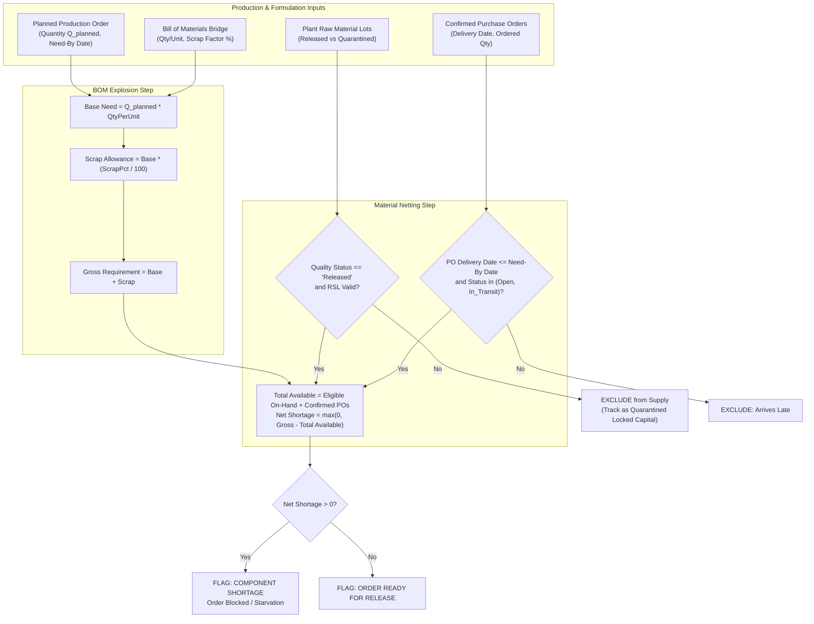

# BOM EXPLOSION & MATERIAL REQUIREMENTS PLANNING (MRP) ENGINE SPECIFICATION
## Phase 2: Deterministic Analytics & Core Engines — Day 17 Deliverable
**Module:** `src/engine/mrp.py`  
**Test Suite:** `tests/test_engine_mrp.py` (8 Tests Passing | Total Project Suite: 108 Tests)  
**Execution Horizon:** Day 17 (Wednesday, 18-Nov-2026)  
**Target Stakeholders:** Executive Director (20+ yrs pharma leadership) & Group Manager (27+ yrs supply chain operations)  

---

## 1. Operational Overview & Purpose

In pharmaceutical formulation manufacturing, starting a manufacturing work order requires 100% component availability at the plant dispensary dock before the first gram of Active Pharmaceutical Ingredient (API) or excipient can be weighed. Incomplete component kits, delayed raw materials, or unreleased QC lots halt tableting and packaging lines, causing idle plant capacity and late finished goods delivery to distribution centres.

The **BOM Explosion & Material Requirements Planning (MRP) Engine** (`src/engine/mrp.py`) provides the core manufacturing component netting logic for the Control Tower. It translates planned finished goods production orders into exact gross raw material and packaging needs, nets them against QA-released plant inventory and confirmed incoming purchase orders, and flags component deficits before plant floor execution.

### Key Capabilities:
1. **Mathematical BOM Explosion:** Explodes finished SKU batch quantities through active `bridge_bill_of_material` specifications, incorporating exact pharmaceutical scrap allowances.
2. **Quality-Aware Material Netting:** Only **QA-Released** raw material lots with valid shelf life are counted as available stock. Quarantined (e.g. pending sterility assay), Blocked, or Expired lots are strictly segregated.
3. **Chronological PO Delivery Alignment:** Only purchase orders confirmed to arrive **on or before** the production start date are credited to supply. Late POs are excluded and surfaced as shortages.
4. **Shared Material Contention Detection:** Tracks sequential consumption when multiple manufacturing orders compete for shared active ingredients (`MAT-API-001`) or shared outer cartons (`MAT-PKG-CART`).
5. **Scenario A Root-Cause Tracing:** Connects supplier delivery delays on `PO-2026-001` directly to component starvation on manufacturing work order `PROD-2026-001`.
6. **Zero LLM Math:** All explosions, scrap factors, and netting balances are pure deterministic Python functions.

---

## 2. Mathematical Formulations & Core Algorithms



### 2.1 BOM Gross Requirement Formulation
For a production order $p$ manufacturing finished SKU $s$ with batch volume $Q_p$:
$$\text{BaseQuantity}(m) = Q_p \times \text{QuantityPerUnit}(s, m)$$
$$\text{ScrapQuantity}(m) = \text{BaseQuantity}(m) \times \left(\frac{\text{ScrapFactorPct}(s, m)}{100.0}\right)$$
$$\text{GrossRequirement}(m) = \text{BaseQuantity}(m) + \text{ScrapQuantity}(m)$$

Where $m$ is each raw material or packaging component defined in `bridge_bill_of_material`.

### 2.2 Material Netting Invariant
$$\text{SupplyAvailable}(m, t_{\text{need}}) = Q_{\text{eligible\_on\_hand}}(m, t_{\text{need}}) + \sum_{k \in \text{POs}} Q_k \cdot \mathbb{I}\left(\text{DeliveryDate}_k \le t_{\text{need}}\right)$$
$$\text{NetShortage}(m, p) = \max\left(0.0, \; \text{GrossRequirement}(m, p) - \text{SupplyAvailable}(m, t_{\text{need}})\right)$$
$$\text{CoverageRatio}(m, p) = \frac{\text{SupplyAvailable}(m, t_{\text{need}})}{\text{GrossRequirement}(m, p)}$$

### 2.3 Order Execution Readiness
A manufacturing work order is certified as ready for plant release if and only if every single component has zero deficit:
$$\text{OrderReadiness}(p) = \prod_{m \in \text{BOM}(s)} \mathbb{I}\left(\text{NetShortage}(m, p) = 0.0\right)$$

---

## 3. Data Structures & Pydantic Schema Mapping

The engine serializes directly into the ratified `FactMaterialRequirement` schema:

```python
@dataclass(frozen=True)
class ComponentGrossRequirement:
    production_order_id: str
    finished_sku_id: str
    material_sku_id: str
    need_by_date: date
    quantity_per_finished_unit: float
    scrap_factor_pct: float
    base_quantity: float
    scrap_quantity: float
    gross_quantity: float

@dataclass(frozen=True)
class MaterialNettingResult:
    requirement_id: str
    production_order_id: str
    material_sku_id: str
    need_by_date: date
    gross_requirement: float
    eligible_available_quantity: float
    quarantined_quantity: float
    expected_receipt_quantity: float
    total_supply_available: float
    shortage_quantity: float
    is_shortage: bool
    coverage_ratio: float
    linked_po_ids: List[str]
    scenario_id: str

@dataclass(frozen=True)
class MRPSummary:
    production_orders_evaluated: int
    components_exploded_count: int
    shortage_components_count: int
    total_shortage_quantity: float
    shortages_by_material: Dict[str, float]
    order_readiness: Dict[str, bool]
    has_critical_shortage: bool
    netting_results: List[MaterialNettingResult]
```

---

## 4. Scenario A Root-Cause Tracing (API Supplier Delay Walkthrough)

In the Phase 1 database, formulation plant Baddi (`LOC-PLANT-01`) has scheduled work order **`PROD-2026-001`** (20,000 packs of Augmentin 500mg T10 strips) starting on **09-Nov-2026**.

### Bill of Materials Explosion (`PROD-2026-001`):
* **Amoxicillin Trihydrate API (`MAT-API-001`):** $20,000 \times 0.00625\text{ kg} \times 1.02 = \mathbf{127.5\text{ kg}}$ gross need.
* **Microcrystalline Cellulose Excipient (`MAT-EXC-001`):** $20,000 \times 0.002\text{ kg} \times 1.015 = \mathbf{40.6\text{ kg}}$ gross need.
* **Alu-Alu Blister Foil (`MAT-PKG-BLIST`):** $20,000 \times 1.0 \times 1.01 = \mathbf{20,200\text{ units}}$ gross need.
* **Printed Unit Cartons (`MAT-PKG-CART`):** $20,000 \times 1.0 \times 1.01 = \mathbf{20,200\text{ units}}$ gross need.

### MRP Supply Netting Comparison:
| Component Material | Gross Need | Eligible On-Hand | Baseline Inflow (`PO-2026-001`) | Baseline Shortage | Disrupted Inflow (14-Day Delay) | Disrupted Shortage | Disruption Root Cause |
| :--- | :--- | :--- | :--- | :--- | :--- | :--- | :--- |
| **`MAT-API-001`** | **127.5 kg** | 80.0 kg | **150.0 kg** (Nov 02) | **0.0 kg** (Covered) | **0.0 kg** (Arrives Nov 16 late) | **47.5 kg** (Deficit) | **Customs Delay on PO-2026-001** |
| `MAT-EXC-001` | 40.6 kg | 250.0 kg | 0.0 kg | 0.0 kg (Covered) | 0.0 kg | 0.0 kg | Fully Covered by On-Hand |
| `MAT-PKG-BLIST`| 20,200 units | 45,000 units | 0.0 kg | 0.0 units (Covered)| 0.0 units | 0.0 units | Fully Covered by On-Hand |
| `MAT-PKG-CART` | 20,200 units | 35,000 units | 0.0 kg | 0.0 units (Covered)| 0.0 units | 0.0 units | Fully Covered by On-Hand |

### Operational Impact on Manufacturing:
1. **In Baseline (`SCN-BASE`):** `SupplyAvailable` = $80.0 + 150.0 = 230.0$ kg $\ge 127.5$ kg. Shortage = 0.0 kg. `OrderReadiness["PROD-2026-001"] = True`. Batch proceeds on schedule.
2. **In Scenario A (`SCN-A-API-DELAY`):** Because `PO-2026-001` is delayed past the Nov 09 need date, incoming credit drops to 0.0 kg. `SupplyAvailable` = 80.0 kg $< 127.5$ kg. Shortage = **47.5 kg**. `OrderReadiness["PROD-2026-001"] = False`. Work order is blocked, halting line `LINE-PLANT1-01`.

---

## 5. Shared Material Contention Across Production Schedules

The engine models sequential stock depletion when multiple manufacturing orders share common raw materials:
* `PROD-2026-001` (T10 strips, starts Nov 09) consumes 127.5 kg API.
* `PROD-2026-002` (T30 bottles, starts Nov 16) requires $10,000 \times 0.01875 \times 1.02 = 191.25$ kg API.
* Total API required = $127.5 + 191.25 = 318.75$ kg.
* Total API supply in network = $80.0\text{ (on hand)} + 150.0\text{ (PO-2026-001)} = 230.0$ kg.

Even in Baseline, while Order 1 is fully satisfied ($127.5$ kg drawn), Order 2 receives the residual $230.0 - 127.5 = 102.5$ kg, resulting in an **88.75 kg API deficit** on Order 2. The `detect_shared_material_conflicts()` function flags this contention in advance, enabling planners to expedite a second PO or split batch campaigns.

---

## 6. Verification Test Suite Results

The dedicated test suite [`tests/test_engine_mrp.py`](file:///d:/AI%20Pharmaceutical%20Supply%20Chain/tests/test_engine_mrp.py) passed all 8 tests:

```
tests/test_engine_mrp.py::test_bom_gross_requirement_scrap_calculation PASSED            [ 12%]
tests/test_engine_mrp.py::test_explode_bom_for_production_order PASSED                  [ 25%]
tests/test_engine_mrp.py::test_material_netting_quality_status_exclusion PASSED          [ 37%]
tests/test_engine_mrp.py::test_material_netting_purchase_order_delivery_timing PASSED    [ 50%]
tests/test_engine_mrp.py::test_shared_material_contention_and_sequential_netting PASSED  [ 62%]
tests/test_engine_mrp.py::test_database_integrated_mrp_baseline PASSED                  [ 75%]
tests/test_engine_mrp.py::test_database_integrated_mrp_scenario_a_disruption PASSED     [ 87%]
tests/test_engine_mrp.py::test_export_mrp_to_dataframe PASSED                           [100%]
============================== 8 passed in 2.12s ==============================
```

### Cumulative Project Verification:
* Total Unit Tests in Project Repository: **108 Tests**
* Passing Tests: **108 Passed (100% Pass Rate)**
* Total Execution Duration: **2.43 seconds**

---

## 7. Architectural Continuity to Day 18

With the MRP netting engine complete, the next technical dependency is **Day 18: Supplier OTIF & Plant Line Capacity Analytics** (`src/engine/analytics.py`), which calculates historical vendor on-time in-full performance, lead-time variance distributions, and manufacturing line capacity utilisation metrics (net available vs committed production hours).
