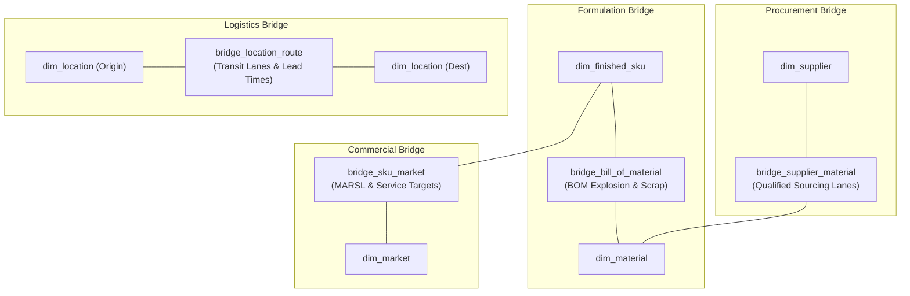
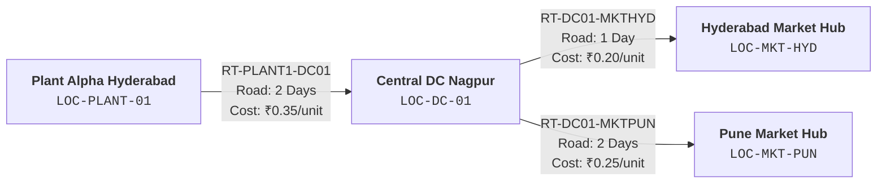

# Network Topology & Bridge Tables Specification (4 Tables)
## Technical Schema Standard & Connectivity Matrix (Week 02, Day 06 Deliverable)

**Project:** AI-Powered Pharmaceutical Supply Chain Control Tower Agent  
**Document Version:** 1.0.0  
**Effective Date:** 03 November 2026 (Week 02, Day 06)  
**Governance Track:** Phase 1: Foundation & Data Architecture (Gate 1 Foundation)  
**Approver Authority:** Group Manager (27+ Years Global Supply Chain Operations) & Director (20+ Years Pharma Leadership)  

---

## 1. Executive Summary & Purpose

In pharmaceutical supply chains, **Master Data entities (`dim_*`) cannot interact directly without relational bridge tables**. Real-world pharmaceutical operations are inherently **many-to-many ($M:N$)**:
* A finished drug SKU requires multiple raw materials, while a single active ingredient or packaging carton is shared across multiple finished SKUs.
* A supplier provides multiple chemical ingredients, but an ingredient may have a qualified primary supplier and a secondary backup supplier.
* A finished SKU is sold across multiple regional markets, but each destination market enforces distinct regulatory authorization, service SLA targets, and **Minimum Acceptable Remaining Shelf Life (MARSL)** acceptance thresholds.
* Manufacturing plants, central distribution centers, and regional hubs are interconnected via dedicated freight transit corridors with distinct transit lead times, freight costs, and cold-chain constraints.

This document details the **technical specification, mathematical formulas, and network connectivity matrix** for the **4 Network Bridge Tables (Layer 2)** of the Control Tower architecture.



---

## 2. Bridge Tables Detailed Specifications

---

### Bridge 1: `bridge_bill_of_material` (BOM Explosion & Process Scrap)

* **Relational Role:** Connects `dim_finished_sku` to `dim_material`. Powers the Material Requirements Planning (MRP) engine by exploding planned finished goods production into net raw material requirements.
* **Table Grain:** One record per Finished SKU and component Material SKU.
* **Primary Key:** `bom_id` (String format: `BOM-xxx`, e.g., `BOM-AUG-T10-01`)
* **Foreign Keys:**
  * `finished_sku_id` $\rightarrow$ `dim_finished_sku.finished_sku_id`
  * `material_sku_id` $\rightarrow$ `dim_material.material_sku_id`

#### Schema Definition:

| Field Name | Data Type | Physical / Business Meaning | Validation & Governance Constraints |
| :--- | :--- | :--- | :--- |
| `bom_id` | String | Unique BOM component line identifier. | Primary Key. Alphanumeric, not null. |
| `finished_sku_id` | String | Parent finished commercial presentation. | Foreign Key $\rightarrow$ `dim_finished_sku`. |
| `material_sku_id` | String | Component raw material or packaging SKU. | Foreign Key $\rightarrow$ `dim_material`. |
| `quantity_per_finished_unit` | Float | Net component quantity consumed per 1 pack. | Float $> 0.0$. Defined in material UOM (`kg`, `units`). |
| `scrap_factor_pct` | Float | Process loss scrap percentage during manufacturing. | Float bounded: $0.0 \le \text{Scrap} \le 50.0\%$, default 2.0%. |
| `effective_start_date` | Date | Master Batch Record (MBR) approval date. | ISO 8601 Date. |
| `effective_end_date` | Date (Nullable) | MBR revision expiry date. | Must be $\ge \text{effective\_start\_date}$ if populated. |
| `bom_version` | String | Regulatory formulation revision code (`V1`, `V2`). | Not empty, default `V1`. |
| `synthetic_data_flag` | Boolean | Synthetic provenance indicator. | Constant `True`. |

#### Mathematical Formulation for Gross Requirement:
In pharmaceutical tablet compression and blister packaging, physical process losses occur during blending, dust extraction, tablet sorting, and blister web trimming. Gross raw material requirements must account for scrap:

$$\text{Gross Requirement}(s, m, Q) = Q \times \text{QuantityPerUnit}(s, m) \times \left(1 + \frac{\text{ScrapFactorPct}(s, m)}{100}\right)$$

*Where $Q$ is planned finished pack production volume.*

#### Augmentin 625mg Bill of Materials Mapping:

| Finished SKU | Component Material SKU | Material Description | Net Qty / Pack | Scrap % | Gross Qty per 10,000 Packs |
| :--- | :--- | :--- | :--- | :--- | :--- |
| **`SKU-AUG-500-T10`** (Strip 10s) | `MAT-API-001` | Amoxicillin / Clavulanate API Blend | 0.00625 kg | 2.0% | **63.75 kg** |
| **`SKU-AUG-500-T10`** (Strip 10s) | `MAT-EXC-001` | Microcrystalline Cellulose Granules | 0.00200 kg | 1.5% | **20.30 kg** |
| **`SKU-AUG-500-T10`** (Strip 10s) | `MAT-PKG-BLIST` | Printed Alu Blister Foil Strip | 1.0 unit | 1.0% | **10,100 units** |
| **`SKU-AUG-500-T10`** (Strip 10s) | `MAT-PKG-CART` | Outer Printed Folding Carton | 1.0 unit | 1.0% | **10,100 units** |
| **`SKU-AUG-500-T30`** (Bottle 30s)| `MAT-API-001` | Amoxicillin / Clavulanate API Blend | 0.01875 kg | 2.0% | **191.25 kg** |
| **`SKU-AUG-500-T30`** (Bottle 30s)| `MAT-EXC-001` | Microcrystalline Cellulose Granules | 0.00600 kg | 1.5% | **60.90 kg** |
| **`SKU-AUG-500-T30`** (Bottle 30s)| `MAT-PKG-BOTT` | HDPE Bottle & Closure 100cc | 1.0 unit | 1.0% | **10,100 units** |
| **`SKU-AUG-500-T30`** (Bottle 30s)| `MAT-PKG-CART` | Outer Printed Folding Carton | 1.0 unit | 1.0% | **10,100 units** |

> **Shared Bottleneck Vulnerability (Scenario C):** Notice that `MAT-PKG-CART` is consumed by **both** T10 and T30 presentations. A supply failure in folding cartons blocks packaging across both product lines simultaneously.

---

### Bridge 2: `bridge_supplier_material` (Qualified Sourcing Matrix)

* **Relational Role:** Connects `dim_supplier` to `dim_material`. Defines vendor qualification status, supplier-specific lead times, and sourcing prioritization.
* **Table Grain:** One record per qualified Supplier and Material SKU pairing.
* **Foreign Keys:**
  * `supplier_id` $\rightarrow$ `dim_supplier.supplier_id`
  * `material_sku_id` $\rightarrow$ `dim_material.material_sku_id`

#### Schema Definition:

| Field Name | Data Type | Physical / Business Meaning | Validation & Governance Constraints |
| :--- | :--- | :--- | :--- |
| `supplier_id` | String | Qualified vendor entity identifier. | Foreign Key $\rightarrow$ `dim_supplier`. |
| `material_sku_id` | String | Approved component material. | Foreign Key $\rightarrow$ `dim_material`. |
| `supplier_lead_time_days` | Integer | Replenishment lead time for this pairing ($L_{\text{supplier}}$). | Strictly positive integer ($> 0$). |
| `minimum_order_quantity` | Float | Contractual Minimum Order Quantity (MOQ). | Float $\ge 0.0$. |
| `order_multiple` | Float | Batch procurement increment multiple. | Float $> 0.0$, default 50.0. |
| `approved_supplier_flag` | Boolean | Regulatory GMP audit qualification status. | Must be `True` for purchasing engine. |
| `supplier_priority` | Integer | Dual-sourcing preference rank ($1 = \text{Primary}, 2 = \text{Secondary}$). | Integer $1 \le \text{Priority} \le 5$. |
| `effective_start_date` | Date | Vendor audit qualification effective date. | ISO 8601 Date. |
| `effective_end_date` | Date (Nullable) | Re-audit expiration date. | Must be $\ge \text{effective\_start\_date}$ if populated. |

#### Operational Sourcing Mapping:

| Supplier ID | Supplier Name | Material SKU | Lead Time | MOQ | Priority | Single Source Flag |
| :--- | :--- | :--- | :---: | :---: | :---: | :---: |
| `SUP-001` | Deccan Active Pharma Chem | `MAT-API-001` (API Blend) | 21 days | 100 kg | **1 (Primary)** | **True (Bottleneck)** |
| `SUP-001` | Deccan Active Pharma Chem | `MAT-EXC-001` (Excipients) | 14 days | 200 kg | **1 (Primary)** | False |
| `SUP-002` | Western Packaging Solutions | `MAT-PKG-BLIST` (Foil) | 14 days | 5,000 units | **1 (Primary)** | False |
| `SUP-002` | Western Packaging Solutions | `MAT-PKG-BOTT` (Bottles) | 14 days | 5,000 units | **1 (Primary)** | False |
| `SUP-002` | Western Packaging Solutions | `MAT-PKG-CART` (Cartons) | 14 days | 5,000 units | **1 (Primary)** | **True (Bottleneck)** |

---

### Bridge 3: `bridge_sku_market` (Commercial Authorization & MARSL Rules)

* **Relational Role:** Connects `dim_finished_sku` to `dim_market`. Governs regional market authorization, customer service targets, and **Minimum Acceptable Remaining Shelf Life (MARSL)**.
* **Table Grain:** One record per Finished SKU and Regional Market pairing.
* **Foreign Keys:**
  * `finished_sku_id` $\rightarrow$ `dim_finished_sku.finished_sku_id`
  * `market_id` $\rightarrow$ `dim_market.market_id`

#### Schema Definition:

| Field Name | Data Type | Physical / Business Meaning | Validation & Governance Constraints |
| :--- | :--- | :--- | :--- |
| `finished_sku_id` | String | Commercial finished SKU presentation. | Foreign Key $\rightarrow$ `dim_finished_sku`. |
| `market_id` | String | Servicing regional consumer market. | Foreign Key $\rightarrow$ `dim_market`. |
| `market_priority` | Integer | Allocation rank when supply is constrained ($1 = \text{Highest}$). | Integer $1 \le \text{Priority} \le 5$. |
| `service_level_target` | Float | Contractual On-Time In-Full (OTIF) SLA target %. | Percentage: $0.0 \le \text{SLA} \le 100.0\%$, default 98.0%. |
| `min_acceptable_rsl_days` | Integer | **Minimum Acceptable Remaining Shelf Life (MARSL)** in days. | Strictly positive ($> 0$), default 90 days. |
| `effective_start_date` | Date | Regulatory marketing authorization start date. | ISO 8601 Date. |
| `effective_end_date` | Date (Nullable) | Product registration expiration date. | Must be $\ge \text{effective\_start\_date}$ if populated. |

#### MARSL & Service Level Matrix:

| Finished SKU | Regional Market | Market Name | MARSL Threshold | Service Target | Allocation Priority |
| :--- | :--- | :--- | :---: | :---: | :---: |
| `SKU-AUG-500-T10` | `MKT-IN-HYD` | Hyderabad Metro | **90 days** | 98.0% | Tier 1 |
| `SKU-AUG-500-T10` | `MKT-IN-PUN` | Pune Urban Zone | **90 days** | 98.0% | Tier 1 |
| `SKU-AUG-500-T30` | `MKT-IN-HYD` | Hyderabad Metro (Hospitals) | **180 days** | 95.0% | Tier 1 |
| `SKU-AUG-500-T30` | `MKT-IN-PUN` | Pune Urban Zone (Hospitals) | **180 days** | 95.0% | Tier 1 |

> **FEFO Connection (Scenario D):** The FEFO allocation engine directly reads `min_acceptable_rsl_days`. Even if a batch has 120 days of physical shelf life remaining, it is **rejected for hospital bottle supply** (`MARSL = 180`) while remaining **eligible for retail blister supply** (`MARSL = 90`).

---

### Bridge 4: `bridge_location_route` (Physical Network Connectivity Matrix)

* **Relational Role:** Connects origin facility nodes to destination facility nodes (`dim_location` $\rightarrow$ `dim_location`). Defines freight lanes, transit lead times, freight costs, and cold-chain compliance.
* **Table Grain:** One record per unidirectional transport lane.
* **Primary Key:** `route_id` (String format: `RT-xxx`, e.g., `RT-PLANT1-DC01`)
* **Foreign Keys:**
  * `origin_location_id` $\rightarrow$ `dim_location.location_id`
  * `destination_location_id` $\rightarrow$ `dim_location.location_id`

#### Schema Definition:

| Field Name | Data Type | Physical / Business Meaning | Validation & Governance Constraints |
| :--- | :--- | :--- | :--- |
| `route_id` | String | Unique freight route corridor code. | Primary Key. Alphanumeric. |
| `origin_location_id` | String | Dispatch facility node. | Foreign Key $\rightarrow$ `dim_location`. |
| `destination_location_id` | String | Receiving facility node. | Foreign Key $\rightarrow$ `dim_location`. Must not equal origin. |
| `transport_mode` | String | Logistics mode (`Road`, `Air`, `Rail`, `Sea`). | Controlled transport mode enum. |
| `standard_transit_days` | Integer | Standard transit duration ($L_{\text{transit}}$). | Integer $\ge 0$, default 2 days. |
| `transport_cost_per_unit` | Float | Synthetic freight transportation cost per unit/pack. | Float $\ge 0.0$ (e.g., ₹0.35/pack). |
| `cold_chain_required_flag` | Boolean | Mandatory 2°C–8°C refrigerated reefer transport flag. | True/False. |
| `route_status` | String | Lane operational state (`Active`, `Congested`, `Closed`). | Default `Active`. |

#### Physical Connectivity Corridor Matrix:



| Route ID | Origin Node | Destination Node | Mode | Transit ($L_{\text{transit}}$) | Freight Cost / Pack | Status |
| :--- | :--- | :--- | :---: | :---: | :---: | :---: |
| `RT-PLANT1-DC01` | Plant Alpha Hyderabad | Central DC Nagpur | Road | 2 Days | ₹0.35 | Active |
| `RT-DC01-MKTHYD` | Central DC Nagpur | Hyderabad Market Hub | Road | 1 Day | ₹0.20 | Active |
| `RT-DC01-MKTPUN` | Central DC Nagpur | Pune Market Hub | Road | 2 Days | ₹0.25 | Active |

---

## 3. Quality Verification & Automated Test Evidence

All 4 bridge entities are implemented in `src/models/bridges.py` with Pydantic v2 model validators and verified via automated tests in `tests/test_bridge_models.py`:

* `test_bridge_bom_instantiation_and_gross_calculation`: Proves gross calculation accounts for scrap: 10,000 packs $\times$ 0.00625 kg with 2% scrap = **63.75 kg**.
* `test_bridge_bom_date_validation_and_scrap_bounds`: Verifies `effective_end_date >= effective_start_date` and blocks scrap $> 50\%$.
* `test_bridge_supplier_material_validation`: Confirms non-positive supplier lead time ($L_{\text{supplier}} \le 0$) is rejected.
* `test_bridge_sku_market_marsl_and_service_target`: Verifies MARSL thresholds and blocks service levels $> 100\%$.
* `test_bridge_location_route_validation`: Verifies `origin_location_id != destination_location_id` (blocks self-loop routes).

```bash
python -m pytest tests/test_bridge_models.py -v
============================== 5 passed in 0.22s ==============================
```

Across the entire project repository, **all 32 automated unit and data integrity tests pass**:
```bash
python -m pytest tests/ -v
============================= 32 passed in 0.91s ==============================
```

---
*Signed and Approved for Implementation:*  
**Week 02, Day 06 Milestone Sign-Off — Phase 1: Foundation & Data Architecture**

