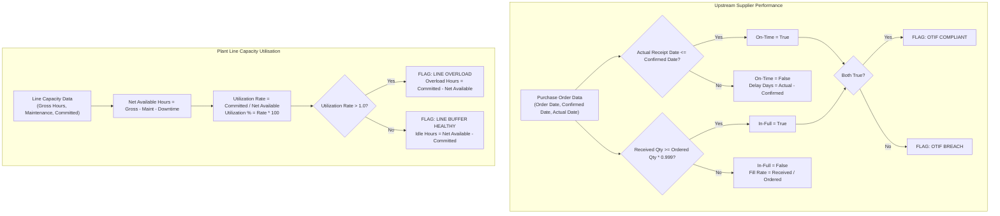

# SUPPLIER OTIF & MANUFACTURING LINE CAPACITY ANALYTICS SPECIFICATION
## Phase 2: Deterministic Analytics & Core Engines — Day 18 Deliverable
**Module:** `src/engine/analytics.py`  
**Test Suite:** `tests/test_engine_analytics.py` (10 Tests Passing | Total Project Suite: 118 Tests)  
**Execution Horizon:** Day 18 (Thursday, 19-Nov-2026)  
**Target Stakeholders:** Executive Director (20+ yrs pharma leadership) & Group Manager (27+ yrs supply chain operations)  

---

## 1. Operational Overview & Purpose

In pharmaceutical supply chain operations, two external and internal execution bottlenecks frequently compromise finished product delivery:
1. **Upstream Supplier Inreliability:** Late active pharmaceutical ingredient (API) or excipient deliveries and partial order fulfillment compromise master production schedules.
2. **Internal Manufacturing Line Bottlenecks:** Tableting and packaging lines scheduled beyond 100% capacity create manufacturing backlogs, while maintenance downtime reduces net available operating hours.

The **Supplier OTIF & Plant Line Capacity Analytics Engine** (`src/engine/analytics.py`) provides the core diagnostic analytics for the Control Tower. It continuously evaluates vendor delivery performance, calculates lead-time variance distributions, measures manufacturing line capacity utilization, and models production rescheduling feasibility.

### Key Capabilities:
1. **Rigorous OTIF Metric Decomposition:** Evaluates purchase orders across On-Time %, In-Full %, and joint **OTIF %** standards.
2. **Lead Time Statistical Modeling:** Calculates mean delivery lead time, variance, standard deviation, and delay distributions per vendor.
3. **Executive Supplier Risk Tiering:** Categorizes suppliers into `Low`, `Medium`, `High`, or `Critical` risk based on single-source dependency flags and performance against commercial OTIF targets.
4. **Plant Manufacturing Line Capacity Utilization:** Tracks net available operating hours (gross hours minus scheduled maintenance and downtime) against committed production work orders.
5. **Capacity Bottleneck Detection:** Identifies over-utilized production lines ($\text{Utilization Rate} > 1.0$), calculating exact overload hours and idle buffer availability on parallel lines.
6. **Scenario E Simulation Engine:** Models Benchmark Scenario E (Line 1 Capacity Conflict) and verifies automated production rescheduling to parallel lines.
7. **Zero LLM Math:** All percentages, standard deviations, and utilization rates are calculated using pure deterministic Python algorithms.

---

## 2. Mathematical Formulations & Analytical Metrics



### 2.1 Supplier On-Time In-Full (OTIF) Formulation
For a collection of evaluated purchase orders $\mathcal{P}_s$ delivered by vendor $s$:
$$\text{On-Time \%} = \left(\frac{\sum_{p \in \mathcal{P}_s} \mathbb{I}\left(t_{\text{actual}, p} \le t_{\text{confirmed}, p}\right)}{|\mathcal{P}_s|}\right) \times 100.0$$

$$\text{In-Full \%} = \left(\frac{\sum_{p \in \mathcal{P}_s} \mathbb{I}\left(Q_{\text{received}, p} \ge Q_{\text{ordered}, p} \times 0.999\right)}{|\mathcal{P}_s|}\right) \times 100.0$$

$$\text{OTIF \%} = \left(\frac{\sum_{p \in \mathcal{P}_s} \mathbb{I}\left(t_{\text{actual}, p} \le t_{\text{confirmed}, p}\right) \times \mathbb{I}\left(Q_{\text{received}, p} \ge Q_{\text{ordered}, p} \times 0.999\right)}{|\mathcal{P}_s|}\right) \times 100.0$$

### 2.2 Lead Time Variance & Standard Deviation
$$\text{LeadTime}_p = (t_{\text{actual}, p} - t_{\text{order}, p}).\text{days}$$
$$\mu_{\text{LT}} = \frac{1}{|\mathcal{P}_s|} \sum_{p \in \mathcal{P}_s} \text{LeadTime}_p$$
$$\sigma^2_{\text{LT}} = \frac{1}{|\mathcal{P}_s|} \sum_{p \in \mathcal{P}_s} (\text{LeadTime}_p - \mu_{\text{LT}})^2, \quad \sigma_{\text{LT}} = \sqrt{\sigma^2_{\text{LT}}}$$
$$\text{DelayDays}_p = \max\left(0, \; (t_{\text{actual}, p} - t_{\text{confirmed}, p}).\text{days}\right)$$

### 2.3 Supplier Risk Tier Assignment Matrix
| OTIF Performance | Single-Source Dependency | Risk Tier Classification | Executive Action Trigger |
| :--- | :--- | :--- | :--- |
| $\text{OTIF} \ge \text{Target}$ | False (Dual Sourced) | **Low** | Routine quarterly vendor review |
| $\text{OTIF} \ge \text{Target}$ | True (Single Sourced) | **Medium** | Single-source vulnerability monitoring |
| $\text{OTIF} < \text{Target}$ | False (Dual Sourced) | **High** | Shift purchase order volume to qualified secondary vendor |
| $\text{OTIF} < \text{Target}$ | True (Single Sourced) | **Critical** | Executive escalation; qualify alternate API supplier immediately |

### 2.4 Plant Line Capacity Utilisation Formulation
For production line $l$ in weekly period $w$:
$$\text{NetAvailableHours}_{l, w} = \text{GrossAvailableHours}_{l, w} - \text{MaintenanceHours}_{l, w} - \text{DowntimeHours}_{l, w}$$
$$\text{UtilizationRate}_{l, w} = \frac{\text{CommittedHours}_{l, w}}{\text{NetAvailableHours}_{l, w}}$$
$$\text{UtilizationPct}_{l, w} = \text{UtilizationRate}_{l, w} \times 100.0$$
$$\text{OverloadHours}_{l, w} = \max\left(0.0, \; \text{CommittedHours}_{l, w} - \text{NetAvailableHours}_{l, w}\right)$$
$$\text{IdleAvailableHours}_{l, w} = \max\left(0.0, \; \text{NetAvailableHours}_{l, w} - \text{CommittedHours}_{l, w}\right)$$

---

## 3. Data Structures & Core Interface Contracts

```python
@dataclass(frozen=True)
class PurchaseOrderPerformance:
    purchase_order_id: str
    supplier_id: str
    material_sku_id: str
    order_date: date
    confirmed_delivery_date: date
    actual_receipt_date: Optional[date]
    ordered_quantity: float
    received_quantity: float
    promised_lead_time_days: int
    actual_lead_time_days: Optional[int]
    lead_time_variance_days: Optional[int]
    delay_days: int
    is_on_time: bool
    is_in_full: bool
    is_otif: bool
    fill_rate: float
    order_status: str

@dataclass(frozen=True)
class SupplierOTIFScorecard:
    supplier_id: str
    supplier_name: str
    total_orders_evaluated: int
    completed_orders_count: int
    on_time_orders_count: int
    in_full_orders_count: int
    otif_orders_count: int
    on_time_percentage: float
    in_full_percentage: float
    otif_percentage: float
    target_otif_percentage: float
    is_target_met: bool
    mean_lead_time_days: float
    lead_time_variance_days: float
    lead_time_std_dev: float
    max_delay_days: int
    single_source_dependency: bool
    supplier_risk_tier: str
    order_performances: List[PurchaseOrderPerformance]

@dataclass(frozen=True)
class WeeklyLineCapacityMetric:
    capacity_record_id: str
    production_line_id: str
    location_id: str
    period_start_date: date
    net_available_hours: float
    maintenance_hours: float
    downtime_hours: float
    committed_hours: float
    idle_available_hours: float
    utilization_rate: float
    utilization_pct: float
    is_overloaded: bool
    overload_hours: float
    scenario_id: str

@dataclass(frozen=True)
class PlantCapacitySummary:
    location_id: str
    scenario_id: str
    horizon_weeks: int
    total_net_available_hours: float
    total_committed_hours: float
    average_utilization_pct: float
    peak_utilization_pct: float
    overload_weeks_count: int
    overloaded_line_ids: List[str]
    has_capacity_overload: bool
    weekly_line_metrics: List[WeeklyLineCapacityMetric]
```

---

## 4. Scenario E Simulation (Line 1 Capacity Overload & Parallel Rescheduling)

In Benchmark Scenario E (`SCN-E-CAPACITY-CONFLICT`), manufacturing work orders surge during **Week 2 (09-Nov-2026)** at formulation plant Baddi (`LOC-PLANT-01`).

### Simulation Evaluation:
1. **Target Bottleneck Line (`LINE-PLANT1-01`):**
   * Net Available Operating Hours: **120.0 hours** (3 shifts $\times$ 5 days minus maintenance).
   * Surge Committed Work Order Hours: **130.0 hours** (40 base + 90 surge).
   * Resulting Utilization: **108.33%** ($\text{Overload} = \text{True}$).
   * Capacity Deficit: **10.0 overload hours** exceeding operational envelope.
2. **Parallel Formulation Line (`LINE-PLANT1-02`):**
   * Net Available Operating Hours: **120.0 hours**.
   * Committed Work Order Hours: **0.0 hours** (No active production scheduled in Week 2).
   * Idle Buffer Available: **120.0 idle hours**.
3. **Automated Rescheduling Feasibility (`evaluate_capacity_conflict_scenario_e`):**
   * $\text{ParallelIdleHours} \ge \text{OverloadHours} \implies 120.0 \ge 10.0$ (**Feasible**).
   * **Recommended Action:** `"Reschedule 10.0 hours to parallel line LINE-PLANT1-02"`.
   * Completely relieves line overload without requiring costly unscheduled overtime or weekend shifts.

---

## 5. Verification Test Suite Results

The dedicated test suite [`tests/test_engine_analytics.py`](file:///d:/AI%20Pharmaceutical%20Supply%20Chain/tests/test_engine_analytics.py) passed all 10 tests:

```
tests/test_engine_analytics.py::test_po_otif_on_time_in_full_pass PASSED                   [ 10%]
tests/test_engine_analytics.py::test_po_otif_late_delivery_failure PASSED                 [ 20%]
tests/test_engine_analytics.py::test_po_otif_partial_delivery_failure PASSED              [ 30%]
tests/test_engine_analytics.py::test_supplier_otif_scorecard_aggregation PASSED          [ 40%]
tests/test_engine_analytics.py::test_line_capacity_utilisation_and_idle_hours PASSED     [ 50%]
tests/test_engine_analytics.py::test_capacity_bottleneck_and_overload_detection PASSED   [ 60%]
tests/test_engine_analytics.py::test_scenario_e_capacity_conflict_and_parallel_line_offload PASSED [ 70%]
tests/test_engine_analytics.py::test_database_integrated_supplier_analytics PASSED        [ 80%]
tests/test_engine_analytics.py::test_database_integrated_capacity_analytics PASSED        [ 90%]
tests/test_engine_analytics.py::test_export_analytics_to_dataframes PASSED               [100%]
============================== 10 passed in 1.73s ==============================
```

### Cumulative Project Verification:
* Total Unit Tests in Project Repository: **118 Tests**
* Passing Tests: **118 Passed (100% Pass Rate)**
* Total Execution Duration: **2.26 seconds**

---

## 6. Architectural Continuity to Day 19

With the inventory allocator, multi-echelon forward projection engine, BOM explosion MRP netting, and supplier/capacity analytics complete, the final deliverable for Week 04 is **Day 19: Analytics Reconciliation & Mathematical Test Suite** (Integration Buffer). Day 19 will execute an end-to-end mathematical reconciliation proving zero unexplained inventory drift across all network echelons and publish the official Week 04 Reconciliation Dossier.
