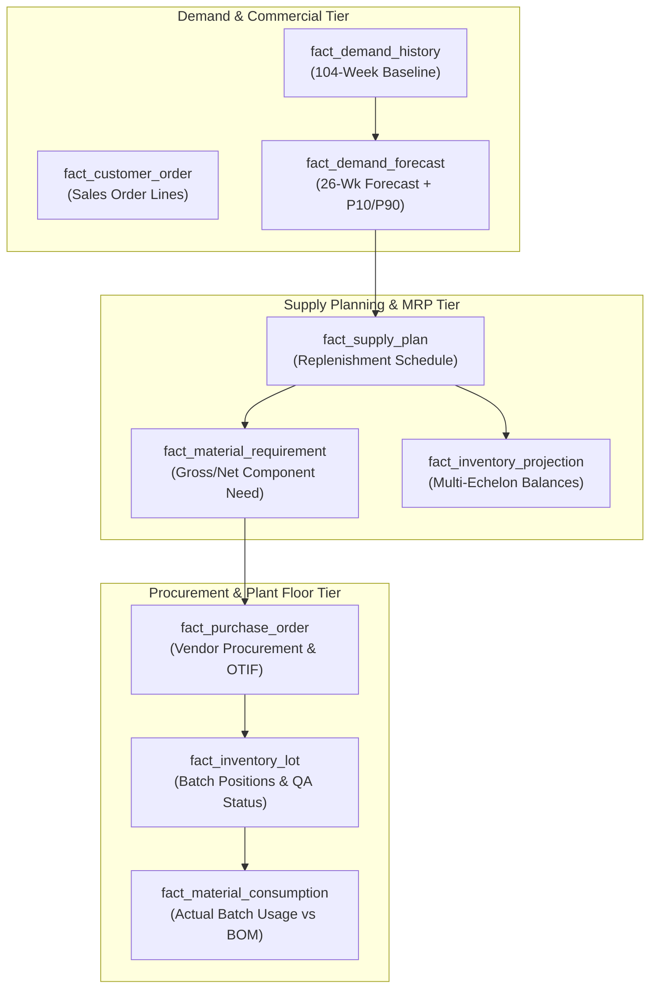
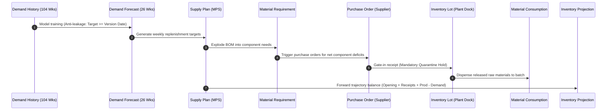

# Transactional & Planning Fact Tables Specification (9 Tables)
## Technical Schema Standard & Temporal Validity Specification (Week 02, Day 07 Deliverable)

**Project:** AI-Powered Pharmaceutical Supply Chain Control Tower Agent  
**Document Version:** 1.0.0  
**Effective Date:** 04 November 2026 (Week 02, Day 07)  
**Governance Track:** Phase 1: Foundation & Data Architecture (Gate 1 Foundation)  
**Approver Authority:** Group Manager (27+ Years Global Supply Chain Operations) & Director (20+ Years Pharma Leadership)  

---

## 1. Executive Summary & Purpose

In pharmaceutical supply chain operations, master data and network bridge tables define *what can happen*, but **Transactional & Planning Fact Tables record *what has happened* (historical facts) and *what is calculated to happen* (forward projections)**.

Because pharmaceutical supply chains are tightly regulated under Good Manufacturing Practice (GMP) and Good Distribution Practice (GDP), planning transactions must obey strict:
1. **Temporal Precedence:** Raw materials cannot be consumed before they are released; orders cannot be delivered before they are placed.
2. **Version Date Integrity (Anti-Leakage):** Statistical forecasts and supply plans must carry an immutable creation date (`forecast_version_date`) so that backtesting models cannot peek into future information.
3. **Physical Conservation of Mass:** Forward inventory projections must reconcile opening balances, incoming receipts, production batches, and customer dispatches without unexplained drift.

This document details the **technical specification, schema definitions, grains, primary/foreign keys, and validation rules** for the **9 Transactional & Planning Fact Tables (Layer 3)**.



---

## 2. Detailed Technical Fact Specifications

---

### Fact 1: `fact_demand_history` (104-Week Historical Baseline)

* **Relational Role:** Records historical weekly market demand and commercial sales across 104 historical weeks. Serves as training ground truth for forecasting models.
* **Table Grain:** One record per Monday week start date, Finished SKU, Regional Market, and Scenario.
* **Composite Primary Key:** `(week_start_date, finished_sku_id, market_id, scenario_id)`
* **Foreign Keys:**
  * `finished_sku_id` $\rightarrow$ `dim_finished_sku.finished_sku_id`
  * `market_id` $\rightarrow$ `dim_market.market_id`
  * `scenario_id` $\rightarrow$ `dim_scenario.scenario_id`

| Field Name | Data Type | Physical / Business Meaning | Validation & Governance Constraints |
| :--- | :--- | :--- | :--- |
| `week_start_date` | Date | Monday start date of weekly historical bucket. | ISO 8601 Date. |
| `finished_sku_id` | String | Commercial finished product SKU. | Foreign Key $\rightarrow$ `dim_finished_sku`. |
| `market_id` | String | Servicing regional consumer market. | Foreign Key $\rightarrow$ `dim_market`. |
| `demand_quantity` | Float | True customer demand volume in sellable packs. | Float $\ge 0.0$. |
| `fulfilled_quantity` | Float | Actual commercial shipments fulfilled against demand. | Float $\ge 0.0$. |
| `lost_sales_quantity` | Float | Unfulfilled demand resulting in lost revenue. | Auto-calculated: $\max(0, \text{Demand} - \text{Fulfilled})$. |
| `event_type` | String | Demand anomaly driver (`Normal`, `Holiday_Spike`, `Epidemic_Surge`). | Controlled categorical enum. |
| `scenario_id` | String | Scenario identifier (`SCN-BASE`). | Default `SCN-BASE`. |
| `synthetic_data_flag` | Boolean | Synthetic provenance indicator. | Constant `True`. |

---

### Fact 2: `fact_customer_order` (Customer Sales Order Lines)

* **Relational Role:** Captures distinct purchasing transactions from hospitals and wholesalers.
* **Table Grain:** One record per customer order line.
* **Primary Key:** `customer_order_id` (String format: `ORD-xxx`, e.g., `ORD-2026-001`)
* **Foreign Keys:**
  * `customer_id` $\rightarrow$ `dim_customer.customer_id`
  * `market_id` $\rightarrow$ `dim_market.market_id`
  * `finished_sku_id` $\rightarrow$ `dim_finished_sku.finished_sku_id`

| Field Name | Data Type | Physical / Business Meaning | Validation & Governance Constraints |
| :--- | :--- | :--- | :--- |
| `customer_order_id` | String | Unique commercial order number. | Primary Key. Alphanumeric. |
| `customer_id` | String | Purchasing institutional or wholesale account. | Foreign Key $\rightarrow$ `dim_customer`. |
| `market_id` | String | Regional delivery territory. | Foreign Key $\rightarrow$ `dim_market`. |
| `finished_sku_id` | String | Ordered finished SKU presentation. | Foreign Key $\rightarrow$ `dim_finished_sku`. |
| `order_date` | Date | Timestamp of order registration. | ISO 8601 Date. |
| `requested_delivery_date`| Date | Customer's requested dock arrival date. | Must be $\ge \text{order\_date}$. |
| `promised_delivery_date` | Date | ERP confirmed delivery date milestone. | Must be $\ge \text{order\_date}$. |
| `ordered_quantity` | Float | Quantity ordered in sellable packs. | Float $> 0.0$. |
| `fulfilled_quantity` | Float | Quantity successfully delivered. | Float $\ge 0.0$, default 0.0. |
| `outstanding_quantity` | Float | Backorder balance remaining. | Float $\ge 0.0$. |
| `order_status` | String | State: `Open`, `In_Transit`, `Delivered`, `Short_Shipped`, `Cancelled`. | Controlled order status enum. |

---

### Fact 3: `fact_demand_forecast` (26-Week Forecast & Probabilistic Intervals)

* **Relational Role:** Stores versioned demand forecasts generated by statistical and ML models over a 26-week future horizon.
* **Table Grain:** One record per forecast ID (version date, target week, finished SKU, market, scenario).
* **Primary Key:** `forecast_id` (String format: `FCST-xxx`)
* **Foreign Keys:**
  * `finished_sku_id` $\rightarrow$ `dim_finished_sku.finished_sku_id`
  * `market_id` $\rightarrow$ `dim_market.market_id`
  * `scenario_id` $\rightarrow$ `dim_scenario.scenario_id`

| Field Name | Data Type | Physical / Business Meaning | Validation & Governance Constraints |
| :--- | :--- | :--- | :--- |
| `forecast_id` | String | Unique forecast record identifier. | Primary Key. |
| `forecast_version_date` | Date | **As-of creation date to prevent future data leakage.** | ISO 8601 Date. |
| `target_week` | Date | Monday start date of predicted horizon week. | Must be $\ge \text{forecast\_version\_date}$. |
| `finished_sku_id` | String | Predicted finished SKU pack format. | Foreign Key $\rightarrow$ `dim_finished_sku`. |
| `market_id` | String | Destination market zone. | Foreign Key $\rightarrow$ `dim_market`. |
| `forecast_quantity` | Float | Deterministic point forecast volume in packs. | Float $\ge 0.0$. |
| `lower_bound` | Float | Probabilistic P10 lower prediction interval bound. | Float $\ge 0.0$, must be $\le \text{upper\_bound}$. |
| `upper_bound` | Float | Probabilistic P90 upper prediction interval bound. | Float $\ge 0.0$, must be $\ge \text{lower\_bound}$. |
| `override_quantity` | Float (Nullable)| Documented human planner override. | Optional float $\ge 0.0$. |
| `model_version` | String | Algorithm release code (e.g., `Ensemble-HoltWinters-Ridge-v1.0`). | Documentation tracking. |
| `scenario_id` | String | Baseline or disruption scenario identifier. | Foreign Key $\rightarrow$ `dim_scenario`. |

---

### Fact 4: `fact_supply_plan` (Master Production & Replenishment Schedule)

* **Relational Role:** Specifies planned weekly replenishment targets to distribution centers and formulation plants.
* **Table Grain:** One record per supply plan ID.
* **Primary Key:** `supply_plan_id` (String format: `SP-xxx`)
* **Foreign Keys:**
  * `finished_sku_id` $\rightarrow$ `dim_finished_sku.finished_sku_id`
  * `location_id` $\rightarrow$ `dim_location.location_id`
  * `scenario_id` $\rightarrow$ `dim_scenario.scenario_id`

| Field Name | Data Type | Physical / Business Meaning | Validation & Governance Constraints |
| :--- | :--- | :--- | :--- |
| `supply_plan_id` | String | Unique replenishment schedule line. | Primary Key. |
| `finished_sku_id` | String | Replenished finished SKU. | Foreign Key $\rightarrow$ `dim_finished_sku`. |
| `location_id` | String | Receiving facility node (e.g., Central DC Nagpur). | Foreign Key $\rightarrow$ `dim_location`. |
| `planned_week` | Date | Target replenishment planning bucket. | Monday planning date. |
| `planned_quantity` | Float | Target replenishment volume in packs. | Float $\ge 0.0$. |
| `source_type` | String | Replenishment mode: `MANUFACTURING`, `INTER_DC_TRANSFER`, `CMO_PURCHASE`. | Controlled source enum. |
| `source_order_id` | String (Nullable)| Traceable link to production order or shipment. | Foreign Key link. |
| `expected_availability_date`| Date | Milestone when stock passes QA and is eligible for dispatch. | Must be $\ge \text{planned\_week}$. |
| `scenario_id` | String | Scenario identifier. | Default `SCN-BASE`. |
| `plan_status` | String | Lifecycle state (`Draft`, `Committed`, `Executed`). | Default `Committed`. |

---

### Fact 5: `fact_material_requirement` (Gross/Net MRP Explosion)

* **Relational Role:** Netting engine records for component materials. Converts planned production orders into gross component need via BOM explosion, nets against on-hand eligible stock and incoming POs, and calculates net shortages.
* **Table Grain:** One record per requirement ID.
* **Primary Key:** `requirement_id` (String format: `REQ-xxx`)
* **Foreign Keys:**
  * `production_order_id` $\rightarrow$ `fact_production_order.production_order_id`
  * `material_sku_id` $\rightarrow$ `dim_material.material_sku_id`
  * `scenario_id` $\rightarrow$ `dim_scenario.scenario_id`

| Field Name | Data Type | Physical / Business Meaning | Validation & Governance Constraints |
| :--- | :--- | :--- | :--- |
| `requirement_id` | String | Unique component requirement code. | Primary Key. |
| `production_order_id` | String | Linked manufacturing work order. | Foreign Key $\rightarrow$ `fact_production_order`. |
| `material_sku_id` | String | Required component material SKU. | Foreign Key $\rightarrow$ `dim_material`. |
| `required_quantity` | Float | Gross material requirement calculated via BOM. | Float $\ge 0.0$. |
| `required_date` | Date | Need-by date at manufacturing plant dock. | ISO 8601 Date. |
| `eligible_available_quantity`| Float | Released unreserved stock on-hand by need-by date. | Float $\ge 0.0$. |
| `expected_receipt_quantity` | Float | Confirmed incoming POs arriving before need-by date. | Float $\ge 0.0$. |
| `shortage_quantity` | Float | Net unfulfilled component deficit. | Auto-calculated: $\max(0, \text{Gross} - \text{Available} - \text{Receipts})$. |
| `scenario_id` | String | Scenario identifier. | Default `SCN-BASE`. |

---

### Fact 6: `fact_inventory_projection` (Multi-Echelon Forward Trajectory)

* **Relational Role:** Core projection engine table. Stores the weekly stock balance trajectory across all echelons and identifies projected safety stock breaches and stockout occurrences across a 26-week horizon.
* **Table Grain:** One record per projection ID (item, location, weekly bucket, scenario).
* **Primary Key:** `projection_id` (String format: `PRJ-xxx`)
* **Foreign Keys:**
  * `location_id` $\rightarrow$ `dim_location.location_id`
  * `scenario_id` $\rightarrow$ `dim_scenario.scenario_id`

#### Mathematical Formulation:
$$I_t = I_{t-1} + R_t + P_t - D_t$$
$$\text{Projected Shortage} = \max\Big(0, \ -I_t\Big) \quad \text{when } I_t < 0$$

| Field Name | Data Type | Physical / Business Meaning | Validation & Governance Constraints |
| :--- | :--- | :--- | :--- |
| `projection_id` | String | Unique projection row ID. | Primary Key. |
| `item_type` | String | `FINISHED_SKU` or `RAW_MATERIAL`. | Controlled item category. |
| `item_id` | String | `finished_sku_id` or `material_sku_id`. | Foreign key identifier. |
| `location_id` | String | Facility node (Plant, Central DC, Regional DC). | Foreign Key $\rightarrow$ `dim_location`. |
| `week_start_date` | Date | Monday horizon date. | ISO 8601 Date. |
| `opening_inventory` | Float | Opening eligible stock balance ($I_{t-1}$). | Unreserved released stock. |
| `planned_receipts` | Float | Confirmed PO or inbound transfer receipts ($R_t$). | Float $\ge 0.0$. |
| `planned_production` | Float | Finished goods batch receipts ($P_t$). | Float $\ge 0.0$. |
| `forecast_demand` | Float | Customer demand forecast or material gross usage ($D_t$). | Float $\ge 0.0$. |
| `projected_ending_inventory`| Float | Projected closing stock balance ($I_t$). | Reconciles mathematically. |
| `safety_stock` | Float | Configured target safety buffer units. | Float $\ge 0.0$. |
| `projected_shortage` | Float | Deficit volume below zero stock. | $\max(0, -\text{Ending Inventory})$. |
| `scenario_id` | String | Scenario identifier. | Default `SCN-BASE`. |

---

### Fact 7: `fact_purchase_order` (Vendor Procurement & OTIF Tracking)

* **Relational Role:** Material purchasing orders. Tracks PO issuance, supplier commitments, physical receipt dates, and On-Time In-Full (OTIF) delivery variance.
* **Table Grain:** One record per purchase order line.
* **Primary Key:** `purchase_order_id` (String format: `PO-xxx`, e.g., `PO-2026-001`)
* **Foreign Keys:**
  * `supplier_id` $\rightarrow$ `dim_supplier.supplier_id`
  * `material_sku_id` $\rightarrow$ `dim_material.material_sku_id`

| Field Name | Data Type | Physical / Business Meaning | Validation & Governance Constraints |
| :--- | :--- | :--- | :--- |
| `purchase_order_id` | String | Unique purchase order code. | Primary Key. Alphanumeric. |
| `supplier_id` | String | Selected vendor entity. | Foreign Key $\rightarrow$ `dim_supplier`. |
| `material_sku_id` | String | Procured material SKU. | Foreign Key $\rightarrow$ `dim_material`. |
| `order_date` | Date | Date PO was transmitted to vendor. | ISO 8601 Date. |
| `requested_delivery_date`| Date | Buyer's required delivery date. | Must be $\ge \text{order\_date}$. |
| `confirmed_delivery_date`| Date | Vendor's promised dock delivery date. | Must be $\ge \text{order\_date}$. |
| `actual_receipt_date` | Date (Nullable) | Physical gate-in receipt date at plant dock. | Must be $\ge \text{order\_date}$ if populated. |
| `ordered_quantity` | Float | Contracted purchase volume in material UOM. | Float $> 0.0$. |
| `received_quantity` | Float | Verified received quantity. | Float $\ge 0.0$, default 0.0. |
| `purchase_order_status` | String | Status: `Open`, `In_Transit`, `Received`, `Delayed`, `Short_Shipped`. | Controlled PO state. |
| `delay_reason` | String (Nullable)| Root-cause classification for delayed delivery. | Informs Scenario A causal tracing. |
| `quality_status` | String | Inspection state: `Pending_Inspection`, `Released`, `Quarantined`. | Default `Pending_Inspection`. |

---

### Fact 8: `fact_inventory_lot` (Lot-Level Physical Batch Inventory)

* **Relational Role:** Physical batch inventory positions. Underpins FEFO allocation by recording manufacturing dates, expiry dates, QA release milestones, and quarantine/blocked flags.
* **Table Grain:** One record per physical inventory lot and location.
* **Primary Key:** `lot_id` (String format: `LOT-xxx`, e.g., `LOT-API-2026-01`)
* **Foreign Keys:**
  * `location_id` $\rightarrow$ `dim_location.location_id`
  * `batch_id` $\rightarrow$ `fact_batch.batch_id` (Nullable)

| Field Name | Data Type | Physical / Business Meaning | Validation & Governance Constraints |
| :--- | :--- | :--- | :--- |
| `lot_id` | String | Unique batch/lot tracking identity. | Primary Key. Alphanumeric. |
| `item_type` | String | `FINISHED_SKU` or `RAW_MATERIAL`. | Controlled item category. |
| `item_id` | String | `finished_sku_id` or `material_sku_id`. | Foreign key identifier. |
| `location_id` | String | Physical warehouse or plant facility holding stock. | Foreign Key $\rightarrow$ `dim_location`. |
| `batch_id` | String (Nullable)| Associated finished manufacturing batch. | Foreign Key $\rightarrow$ `fact_batch`. |
| `manufacture_date` | Date | Physical synthesis or packaging date. | ISO 8601 Date. |
| `expiry_date` | Date | Regulatory stamped expiration milestone. | **Must strictly exceed `manufacture_date`.** |
| `retest_date` | Date (Nullable) | Mandated chemical re-assay date for APIs. | ISO 8601 Date. |
| `quantity_on_hand` | Float | Total physical stock currently held on-site. | Float $\ge 0.0$. |
| `reserved_quantity` | Float | Stock allocated to active packing or customer orders. | Float $\ge 0.0$, must be $\le \text{quantity\_on\_hand}$. |
| `blocked_quantity` | Float | Stock under regulatory, quality, or recall embargo. | Float $\ge 0.0$. |
| `quality_status` | String | Quality state: `Released`, `Quarantined`, `Blocked`, `Expired`. | Controlled quality status enum. |
| `receipt_date` | Date | Date inventory arrived at facility. | ISO 8601 Date. |
| `release_date` | Date (Nullable) | Date QA formally released the lot. | Must be $\ge \text{receipt\_date}$ if populated. |
| `recall_status` | String | Regulatory recall state (`None`, `Class-I`, `Under_Investigation`). | Default `None`. |
| `synthetic_data_flag` | Boolean | Synthetic provenance indicator. | Constant `True`. |

---

### Fact 9: `fact_material_consumption` (Actual Batch Material Usage)

* **Relational Role:** Manufacturing floor dispensing records. Audits actual chemical ingredient consumption against theoretical BOM requirements.
* **Table Grain:** One record per production order, material SKU, and consumed lot.
* **Primary Key:** `consumption_id` (String format: `CONS-xxx`)
* **Foreign Keys:**
  * `production_order_id` $\rightarrow$ `fact_production_order.production_order_id`
  * `material_sku_id` $\rightarrow$ `dim_material.material_sku_id`
  * `lot_id` $\rightarrow$ `fact_inventory_lot.lot_id`

| Field Name | Data Type | Physical / Business Meaning | Validation & Governance Constraints |
| :--- | :--- | :--- | :--- |
| `consumption_id` | String | Unique dispensing transaction ID. | Primary Key. |
| `production_order_id` | String | Manufacturing work order consuming material. | Foreign Key $\rightarrow$ `fact_production_order`. |
| `material_sku_id` | String | Consumed chemical ingredient or packaging SKU. | Foreign Key $\rightarrow$ `dim_material`. |
| `lot_id` | String | Specific raw material lot dispensed from warehouse. | Foreign Key $\rightarrow$ `fact_inventory_lot`. |
| `planned_quantity` | Float | Theoretical BOM requirement. | Float $> 0.0$. |
| `actual_quantity` | Float | Physical quantity charged into batch reactor/line. | Float $\ge 0.0$. |
| `consumption_date` | Date | Timestamp of dispensing to plant cleanroom. | ISO 8601 Date. |
| `variance_quantity` | Float | Dispensing variance. | Auto-calculated: $\text{Actual} - \text{Planned}$. |

---

## 3. Operational Data Flow & Temporal Sequence



---

## 4. Quality Verification & Automated Test Evidence

All 9 transactional and planning fact entities are implemented across `src/models/` and verified via automated tests in `tests/test_transactional_models.py`:

* `test_fact_demand_history_and_lost_sales`: Proves lost sales auto-calculates as $\max(0, \text{Demand} - \text{Fulfilled})$.
* `test_fact_customer_order_milestone_validation`: Proves delivery dates earlier than order date raise `ValidationError`.
* `test_fact_demand_forecast_data_leakage_and_intervals`: Proves data leakage ($\text{target} < \text{as\_of}$) and inverted intervals ($\text{P10} > \text{P90}$) are strictly rejected.
* `test_fact_supply_plan_validation`: Verifies planned week and availability milestone logic.
* `test_fact_material_requirement_shortage`: Proves net component shortage calculation: $500\text{ kg need} - 200\text{ kg avail} - 100\text{ kg incoming} = 200\text{ kg shortage}$.
* `test_fact_inventory_projection_math`: Validates recursive balance: $10{,}000 + 2{,}000 + 3{,}000 - 18{,}000 = -3{,}000$ ending inventory ($\text{Shortage} = 3{,}000$).
* `test_fact_purchase_order_validation`: Verifies PO dates and order quantity constraints.
* `test_fact_inventory_lot_expiry_and_reserves`: Proves $\text{expiry\_date} \le \text{manufacture\_date}$ and $\text{reserved} > \text{on\_hand}$ are strictly rejected.
* `test_fact_material_consumption_variance`: Proves consumption variance auto-calculates as $\text{actual} - \text{planned}$.

```bash
python -m pytest tests/test_transactional_models.py -v
============================== 9 passed in 0.23s ==============================
```

Across the entire workspace, **all 41 automated unit and data integrity tests pass**:
```bash
python -m pytest tests/ -v
============================= 41 passed in 0.88s ==============================
```

---
*Signed and Approved for Implementation:*  
**Week 02, Day 07 Milestone Sign-Off — Phase 1: Foundation & Data Architecture**

