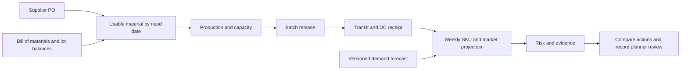

# Week 1 · Rebuild foundation

**Synthetic data for demonstration only. Not for operational decision making.**

## Scope and planner workflow

The first release covers one fictional product family, initially two pack SKUs, and one enabled disruption type, API receipt delay. Add pack SKUs when they represent a distinct planning need, such as different market eligibility or material requirements. The network will contain 10 materials, 6 suppliers, 4 plants, 3 distribution centres, and 8 markets. Generate 104 historical weeks and a versioned 26-week forecast for each served SKU–market pair.

The planner asks which markets could run short if a selected ingredient receipt slips. They inspect the records behind the impact, check forecast quality, and compare expediting, reallocating finished stock, and rescheduling production. The approval screen will record a planner's approval or rejection inside the prototype. Operational changes are handled in company systems and are outside the scope of this project.

## Planner journeys and acceptance

| Question from the brief | Required inputs and result | Acceptance check | Delivery week |
|---|---|---|---|
| What are the top critical risks? | Calculated severity, days to impact, and affected SKU and market. | Ranking matches the calculated scores, with evidence IDs on each alert. | 6–9 |
| Which products will breach safety stock in the next four weeks? | Weekly projections and target buffers, filtered by date and market. | Includes a breach inside the window and excludes one beyond it. | 6–9 |
| Why is Product X at risk in Market Y? | Stock projection and relevant records linking the receipt, production, material, and PO. | Changing the market changes the result and the linked records where applicable. | 6–9 |
| Which suppliers are associated with open high-severity risks? | Open alerts, severity, and evidence-linked supplier IDs. | Closed or unrelated records do not appear. | 6–9 |
| Which products need a forecast review? | Held-out error, bias, uncertainty, and demand anomaly signals. | Metric values match the selected SKU–market forecast and evaluation period. | 5, 8–9 |
| What happens if a material receipt is delayed by 14 days? | Selected PO and delay, plus baseline and scenario projections, shortage, service, and recovery. | Compare 0, 10, and 14 days and verify an unaffected market. | 4–5, 8–9 |
| Which mitigation options are feasible and what constraints remain? | Three simulated actions with before-and-after metrics, synthetic cost, and feasibility. | A failed constraint is shown with its supporting record. Planner review is required. | 7–9 |
| Can you generate a morning briefing with evidence references? | Ranked risks, days to impact, source records, and next review. | A changed planning cutoff or market filter changes the briefing accordingly. | 8–9 |

The last four delivery weeks also cover usability, approvals, robustness, unsupported-claim evaluation, handover, and the final demo. The local company brief sets the original requirements. The [updated schedule](../AI_Supply_Chain_Control_Tower_12_Week_Executive_Schedule.xlsx) tracks the release.

## Process and architecture

Use a seeded generator to populate a new SQLite database with fictional master data, transactions, and plans. Store each scenario as a PO reference and receipt-date input. Baseline, delay, and mitigation comparisons use the same starting snapshot and forecast version. Save benchmark expectations separately from calculated results. Key each weekly projection by run, SKU, market, and week, with the forecast version recorded on the run.

Python will calculate material availability, forecasts, inventory, scores, and mitigation feasibility. The Streamlit views, briefing, and question interface will use those results and their evidence IDs. The question interface can extract supported parameters from similar wording, clarify ambiguous records, and report insufficient evidence. An optional LLM can interpret a request or phrase calculated results. It has no role in authorising actions.

## Glossary and calculation conventions

| Term | Meaning in this project |
|---|---|
| API | Active pharmaceutical ingredient. The scenario changes the expected receipt of a selected order for this material. |
| SKU and market | The sellable pack and its demand destination. Each served pair has its own forecast and projection. |
| Bill of materials | The materials and quantities required for a production run. |
| Batch release | The quality milestone after which eligible finished stock can enter the next supply step. |
| Usable stock | On-hand quantity after excluding reservations, quality blocks, and shelf-life ineligibility. |
| Weekly projected ending stock | Usable opening stock plus receipts available in the bucket, less fulfilled demand. Changes to eligibility during the week must be accounted for. |
| Safety-stock breach | Projected ending stock is below the policy target. Stockout is tracked separately through unserved units. |
| Service | Fulfilled demand divided by total demand over the selected period. A zero-demand period has no measured service ratio. |
| Recovery | The first week after a breach with no unserved demand and ending stock at or above the target. |

## Hand-calculated acceptance example

The [benchmark fixture](../examples/api_delay_benchmark.json) uses a single SKU and market. The planned production start is November 9, 2026. It needs 127.5 kg. The plant has 80 kg eligible and a 150 kg receipt due November 2. A 14-day delay moves the receipt to November 16, leaving a **47.5 kg** gap on November 9. In this example a line slot is available immediately on receipt, and all other inputs are ready. Production completion, release, and transit take 4, 3, and 2 calendar days, respectively. The 200-unit finished receipt moves from November 18 to November 25.

For this benchmark, each weekly bucket credits eligible receipts before weekly demand, and unmet demand is recorded as unserved without carrying it forward. Opening finished stock is 160 units, weekly demand is 100 units, and the safety-stock target is 50 units.

| Week starting | Baseline ending stock | Delayed ending stock | Delayed unserved demand |
|---|---:|---:|---:|
| Nov 9 | 60 | 60 | 0 |
| Nov 16 | 160 | 0 | 40 |
| Nov 23 | 60 | 100 | 0 |

Baseline service is 300 ÷ 300, or 100%. Delayed service is 260 ÷ 300, or 86.7%. The delayed plan first breaches safety stock in the week of November 16 and recovers in the week of November 23. These values are expected test outcomes for Week 4.

### One-minute explanation

> If a supplier delivers a critical ingredient late, the planner needs to know which markets could run short and how soon. The control tower will trace the delay from the order through production and release to the finished stock available for each market. The planner can compare three responses and record a decision using the evidence behind the projected outcome.
