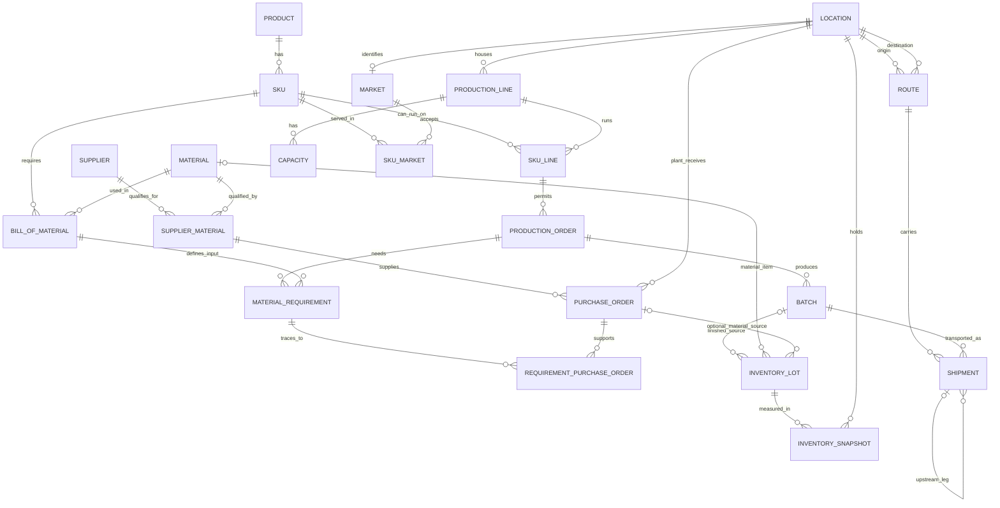
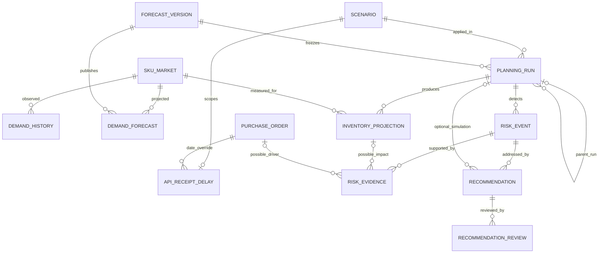

# Week 2 · SQLite data model

**Synthetic data for demonstration only. Not for operational decision making.**

The schema supports one product family with multiple pack SKUs and an expandable supply network. It follows the company brief’s separation of master data, transactions, forecast versions, scenario inputs, and calculated outputs. See the [SQLite definitions](../control_tower/schema.sql) and [sample records](../examples/week_02_sample.sql).

## Entity relationships

The first diagram shows the supply path. The second shows planning and evidence. Each event or row retains the IDs of the records it depends on.

## Data dictionary

Tables are SQLite `STRICT`. IDs and categories are text. Dates use ISO calendar dates and weekly buckets start on Mondays. Counts and flags use integers. Fractional material quantities, labour hours, percentages, and forecasts use real numbers. Material amounts follow the material’s unit, kilograms or each. Finished physical stock uses packs. Currency amounts use integer minor units with a three-character currency code. Forecasts and projections can contain fractional packs.

### Master data and relationships

| Table | Grain and key | Main fields and validation |
|---|---|---|
| `dataset` | One metadata row per database, keyed by `singleton`. | Dataset version, optional seed, mandatory synthetic flag and disclaimer. SQLite `user_version` records the schema version. |
| `product` | One fictional product family per `product_id`. | Unique name, therapy area, dosage form, lifecycle, and criticality flag. |
| `sku` | One sellable pack per `sku_id`. | Product reference, pack size, shelf life in days, storage condition, and cost. Pack size and shelf life must be positive. |
| `location` | One physical network node per `location_id`. | Plant, DC or market, plus name, region, storage capacity in packs, and cold-chain capability. |
| `market` | One demand destination per `market_id`. | References a location of kind MARKET and defines service priority. |
| `production_line` | One line per `line_id`. | References a location of kind PLANT and records a line name. |
| `supplier` | One vendor per `supplier_id`. | Unique name, type, on-time in-full target percentage, and risk tier. |
| `material` | One supply input per `material_id`. | API, excipient or packaging, with unit, shelf life and inspection days, criticality, and single-source flag. |
| `supplier_material` | One qualification per supplier and material. | Lead time in days, minimum order in material units, and optional primary flag. At most one supplier can be primary per material. |
| `bill_of_material` | One component per SKU and material. | Pack count for the reference batch, material quantity per batch, and scrap percentage. Positive quantities and a 0–100% scrap range. |
| `sku_line` | One eligible pair per SKU and line. | Valid parent SKU and line. Production orders must use an eligible pair. |
| `sku_market` | One served pair per SKU and market. | Safety stock in packs and minimum remaining shelf life in days. Both are non-negative. |
| `route` | One lane option per `route_id`. | Distinct origin and destination, mode, transit days, and cold-chain capability. |

### Procurement, manufacturing, and inventory

| Table | Grain and key | Main fields and validation |
|---|---|---|
| `purchase_order` | One supplier order for one material and plant per `purchase_order_id`. | Qualified supplier, plant, order/planned/expected/actual receipt dates, ordered and received material quantities, order and quality status, and delay reason. Received quantity and dates must agree with status. |
| `production_order` | One scheduled batch run per `production_order_id`. | SKU and eligible line at the assigned plant, planned and actual start/completion, pack quantities, yield percentages, planned hours, status, and delay reason. Completion follows start. |
| `material_requirement` | One BOM input per production order and material, identified by `requirement_id`. | Production order, SKU, plant, BOM component, need date, and positive required quantity in the material unit. |
| `requirement_purchase_order` | One potential supply link per requirement and PO. | Material and plant must agree on both ends. A link identifies a candidate receipt. Actual usable quantity must be calculated at the need date. |
| `capacity` | One weekly bucket per line and Monday. | Available, maintenance, downtime, and committed hours. Derived net hours cannot be negative. Commitments may exceed net hours so analysis can detect overload. |
| `batch` | One finished batch per `batch_id`. | Production order, matching SKU and plant, manufacture, planned and actual release, expiry, quantities, and quality status. Released units require an actual release date and RELEASED status. |
| `inventory_lot` | One material or finished lot per `lot_id`. | A material lot carries a material ID and optional source PO. A finished lot carries a matching batch and SKU. Expiry must follow manufacture. |
| `inventory_snapshot` | One lot balance per location and snapshot date. | On-hand, reserved, blocked, and in-transit quantities. Available is derived as on hand less reserved and blocked. Eligibility by expiry, route and quality is evaluated separately. |
| `shipment` | One batch movement per `shipment_id`. | Route, endpoints, optional upstream leg, planned and actual dates and quantities, customs delay, and temperature flag. A linked upstream leg must carry the same batch and deliver to the current origin. Arrival cannot precede dispatch. |

### Planning, scenarios, and evidence

| Table | Grain and key | Main fields and validation |
|---|---|---|
| `demand_history` | One observation per SKU, market, and week. | Observed and fulfilled packs, derived lost sales, event type, and JSON drivers. Fulfilment is bounded by observed demand. |
| `forecast_version` | One forecast publication per `forecast_version_id`. | Issue date, training cutoff, model name and version. The training cutoff cannot follow publication. |
| `demand_forecast` | One estimate per forecast version, SKU, market, and week. | Point, lower and upper estimates plus optional override quantity and reason. Bounds contain the point estimate, and overrides carry a reason. |
| `scenario` | One planning scenario per `scenario_id`. | Name, kind, and JSON assumptions. The baseline and API delay share an input dataset. |
| `api_receipt_delay` | One disruption input per API-delay scenario. | Selected PO and matching API material, plus delay days. Foreign keys enforce the scenario and material types. |
| `planning_run` | One calculation run per `run_id`. | Scenario, frozen forecast version, as-of date, and optional parent run for comparisons. |
| `inventory_projection` | One result per run, SKU, market, and week, identified by `projection_id`. | Opening, received, ineligible, demand, fulfilled, and safety stock. Derives ending stock and unserved demand. |
| `risk_event` | One alert per `risk_id` and owning run. | Risk type, SKU and market if known, status, severity, days to impact, shortage, six normalised score components, and weighted score. |
| `risk_evidence` | One evidence link per `evidence_id`. | Driver, impact, or context role. Exactly one linked PO, requirement, production order, batch, shipment, lot, projection, or forecast version. A linked projection belongs to the same run as the alert. |
| `recommendation` | One action proposal per `recommendation_id`. | Owning risk, optional comparable simulation run, action, feasibility, synthetic cost and currency, expected score reduction, assumptions, and constraints. Human approval is mandatory. |
| `recommendation_review` | One recorded decision per `review_id`. | Recommendation, reviewer label, decision timestamp, approval or rejection, and optional comment. Week 9 will connect it to the review interface. |

## Scenario catalogue and trace

| Scenario | Input and intended use |
|---|---|
| Baseline | Uses original expected procurement dates and planned supply records. |
| API receipt delay | Adds the chosen number of days to one API PO’s original expected receipt in the scenario view. Zero days matches the original date. The sample uses 14 days. |

`scenario_purchase_order` presents original and effective dates side by side. `market_supply_trace` shows linked plans and procurement evidence for a market shipment. In the sample, `DEMO-SHIP-MKT` traces through `DEMO-SHIP-DC`, `DEMO-BATCH-01`, `DEMO-PROD-01`, and `DEMO-REQ-API` to `DEMO-PO-01`, with a separate row for the packaging requirement. The baseline PO date is November 2, 2026. The delay view gives November 16 for that PO. The two shipment legs currently describe the baseline plan.

The Week 2 dataset demonstrates the schema with a single supply path, two SKU masters, one market, and a hand-entered fixture forecast. The Week 3 generator will populate the expanded network and check coverage, complete BOMs, supplier qualification counts, route and cold-chain compatibility, and cross-record balances. Weeks 4–7 will populate calculated runs, forecasts, alerts, and actions. Before calculating a run, that implementation must also verify the selected forecast was available at the cutoff, the scenario PO is an eligible expected receipt, and a delay scenario has exactly one input.
